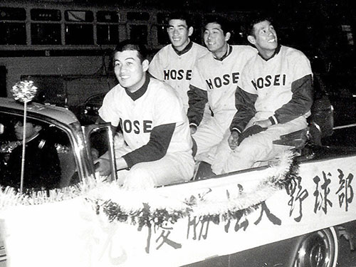
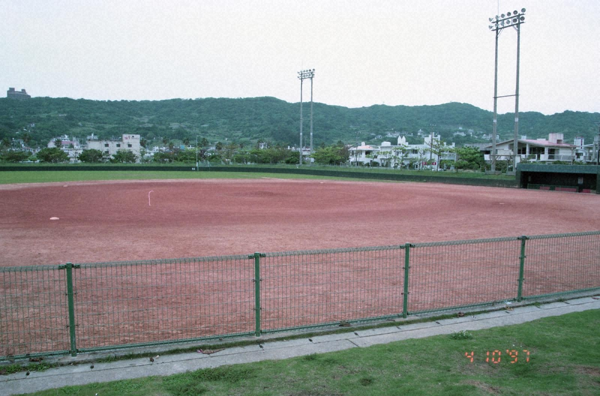
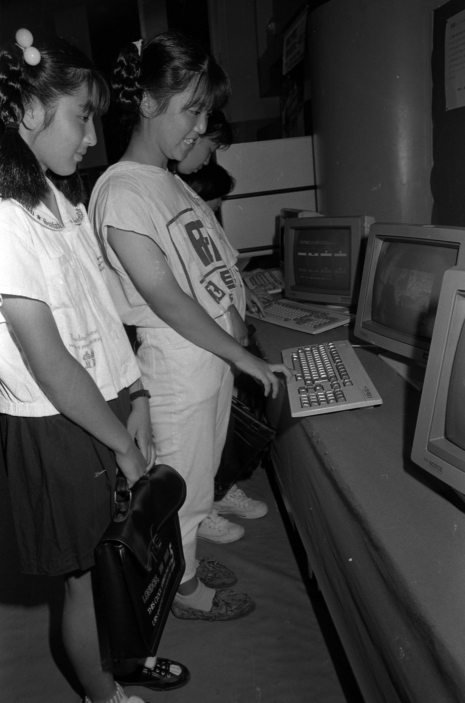

30年前の今日、1996年11月24日。プロ野球界を揺るがす大きな移籍が決まりました。西武ライオンズの主砲として黄金期を築いてきた清原和博選手が、フリーエージェント権を行使し、読売ジャイアンツへ入団することを表明したのです。高校卒業時のドラフト会議から11年、紆余曲折を経て憧れの球団へとたどり着いた瞬間でした。

## 甲子園の怪物と1985年ドラフトの涙

大阪のＰＬ学園高校で桑田真澄投手とともに「ＫＫコンビ」として甲子園を沸かせた清原選手は、通算13本塁打という大会記録を打ち立て、高校球界のスターとして注目を集めました。実家が電器店を営んでいた清原家は父親以外の家族全員が巨人ファンで、清原選手自身も幼少期から「巨人の4番」を夢見ていました。

しかし、運命の1985年ドラフト会議で、巨人が1位指名したのは早稲田大学進学を表明していた桑田投手でした。清原選手には西武や阪神など6球団の指名が重複し、抽選の末に西武が交渉権を獲得します。会見場で悔し涙を浮かべる清原選手の姿は、日本中の野球ファンの記憶に深く刻まれました。自宅で落胆する息子に、母親は「男なら見返してやりなさい。泣いてる暇なんてないはずやで」と言い放ち、清原選手はプロの世界へ挑む覚悟を決めました。

## 西武黄金期の若き4番として躍動

1986年に西武ライオンズへ入団した清原選手は、高卒1年目から驚異的な才能を発揮しました。開幕直後からスタメンに定着し、シーズンを通じて打率3割4厘、31本塁打、78打点を記録。高卒新人の打率3割到達および31本塁打は現在も破られていない大記録であり、文句なしの新人王に選出されました。

翌1987年の日本シリーズ第6戦では、王貞治監督率いる巨人を破って日本一を決める直前、一塁の守備に就いていた清原選手が涙を流して試合が中断する場面がありました。ドラフトの日の無念や憧れの巨人を倒す万感の思いがこみ上げた清原選手を、二塁手の辻発彦選手が優しくなだめる姿は名場面として語り継がれています。清原選手は西武の4番としてチームのリーグ優勝や日本一に大きく貢献し、球界を代表するスラッガーへと成長していきました。

*法政三羽ガラス2 — 写真: Unknown authorUnknown author / Public domain*

## 1996年11月24日、決断の時

プロ入りから11年の歳月が流れた1996年、清原選手は国内ＦＡ権を取得し、行使を表明しました。球界屈指の強打者の獲得を巡り、地元・関西の球団などからも熱心な誘いが寄せられました。

長嶋茂雄監督が率いる読売ジャイアンツとの交渉の末、1996年11月24日に巨人への移籍が決まりました。会見で清原選手は、11年前に指名されなかった悔しさを乗り越え、子どもの頃から抱き続けてきた夢のユニホームを着る喜びを語りました。かつて涙を流した少年が、堂々と自らの力でジャイアンツの門をくぐったこの日は、プロ野球の歴史に残る劇的な一日となりました。

*新開の風景 — 写真: 南城市教育委員会 / CC BY (Japan Search)*

## 巨人の主砲として放った劇的一打の数々

巨人に移籍した清原選手は、強打の一塁手としてチームの中軸を担いました。2000年や2002年の日本一奪還にも貢献し、巨人時代に通算185本塁打を放ちました。これは他球団からの移籍選手としては巨人史上最多の記録となっています。

また、通算2000安打やNPB歴代5位となる通算525本塁打など、数々の金字塔を打ち立てました。大舞台や好機に強いバッティングは「お祭り男」と呼ばれ、相手投手の気迫に真っ向から立ち向かう豪快なスイングは、多くのファンの胸を熱くさせました。

*児童館コスモス 夏休み特別イベント「地球を守る科学技術」 — 写真: ndl / CC BY (Japan Search)*

## 今も輝く球史の記録と記憶

清原和博選手が残した記録には、今も破られていないものが数多くあります。甲子園通算13本塁打や高卒新人のシーズン31本塁打をはじめ、プロ通算でのサヨナラ安打20本、サヨナラ本塁打12本、オールスターゲームでの通算36打点やMVP獲得7回など、記憶にも記録にも残る数字が並びます。

悔しさをバネにグラウンドで結果を出し続け、最後には自らの足で憧れの地へとたどり着いた清原選手の野球人生。1996年11月24日の巨人入り決定は、昭和から平成へと続く日本プロ野球の熱いドラマを象徴する出来事でした。

### 参考資料

- <https://ja.wikipedia.org/wiki/%E5%9F%BC%E7%8E%89%E8%A5%BF%E6%AD%A6%E3%83%A9%E3%82%A4%E3%82%AA%E3%83%B3%E3%82%BA>
- <https://commons.wikimedia.org/wiki/File:Tokyo_-_Baseball_(3410369438).jpg>
- <https://commons.wikimedia.org/wiki/File:%E6%B3%95%E6%94%BF%E4%B8%89%E7%BE%BD%E3%82%AC%E3%83%A9%E3%82%B92.jpg>
- <https://nanjo-archive.jp/document/?detail=10851&genre=6>
- <https://adeac.jp/koshigaya-city-digital-archives/catalog/mp237517-200020>
