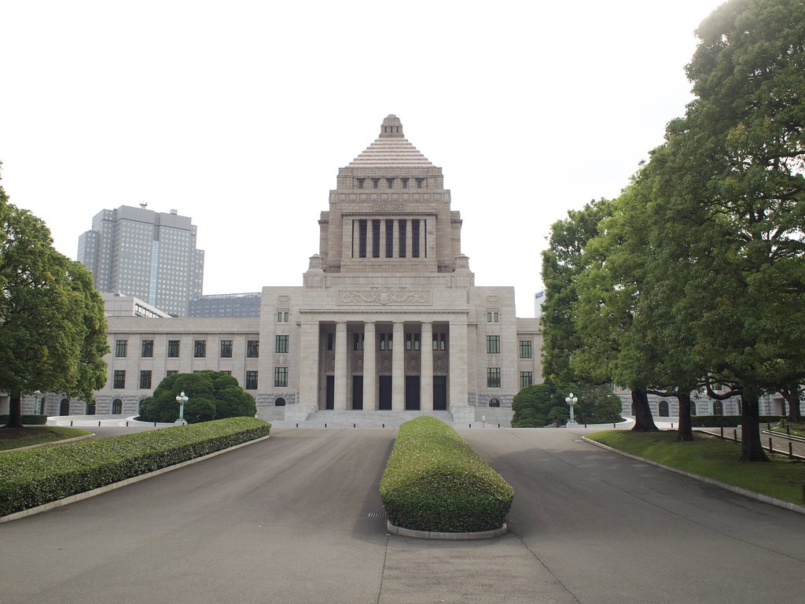
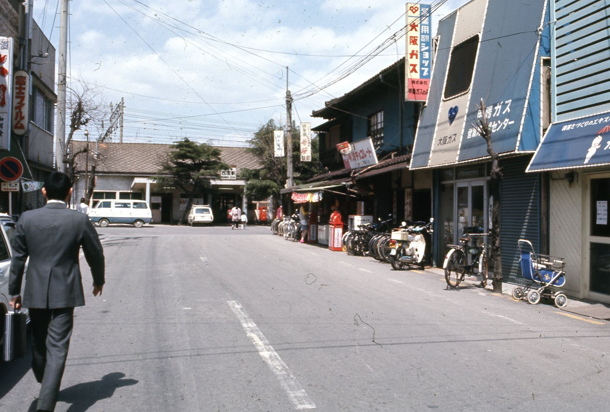
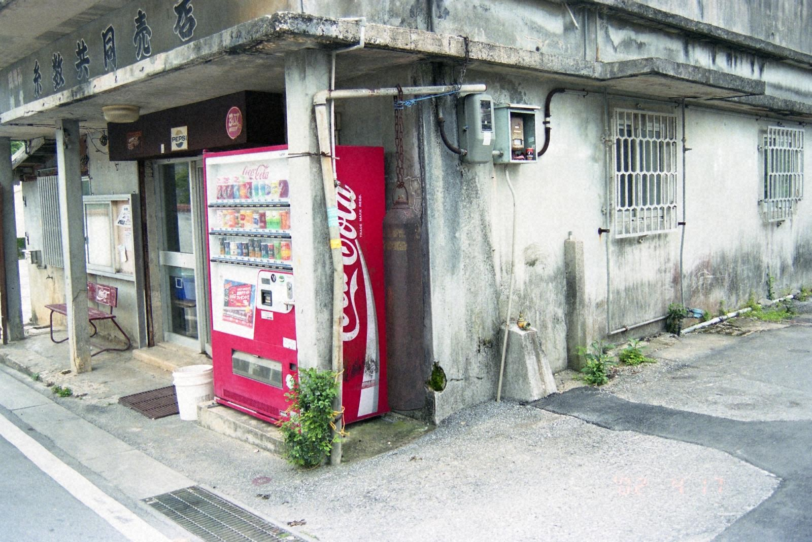

26年前の今日、2000年11月24日。特定の人物へのつきまといや嫌がらせを規制し、殺人や傷害などの重大事件を未然に防ぐための「ストーカー規制法」が日本で施行されました。それまで個人の私的な関係のトラブルとして扱われがちだったつきまとい行為が、公権力によって明確に取り締まられる法的な枠組みへと踏み出した節目の一日でした。

## 桶川ストーカー殺人事件の衝撃と立法への歩み

ストーカー規制法（正式名称：ストーカー行為等の規制等に関する法律）の誕生には、1999年に埼玉県桶川市で発生した「桶川ストーカー殺人事件」が深く関係しています。被害者が警察に被害を訴え、告訴状を提出していたにもかかわらず事件が防げなかった事態は、社会に大きな怒りと衝撃を与えました。

事態の深刻さを受け、警察庁出身で当時自民党所属の参議院議員だった松村龍二氏らが草案を作成し、超党派による議員立法が進められました。そして2000年5月24日に法律が制定され、同年11月24日に施行の日を迎えることとなったのです。

## 「未来の犯罪を抑止する」法律の新たな思想

この法律の大きな特徴は、近代司法の基本原則であった「過去に起きた違法行為に対する処罰」にとどまらず、「未来に発生しうる凶悪犯罪の抑止」を主眼に置いている点にあります。刑罰法令が存在しなかったパワーハラスメントやセクシャルハラスメントなどと異なり、相手に不安を覚えさせる精神的な加害行為そのものを法的に処罰できる道を開きました。

ただし、公権力の介入が無制限に広がらないよう配慮もなされました。規制対象は、特定の者に対する「恋愛感情その他の好意の感情」または「それが満たされなかったことに対する怨恨の感情」を充足する目的に限定されたのです。

*National Diet Building (JAPAN) - 04 — 写真: beve4 / CC BY 2.0*

## 2000年施行当初の制度と罰則の枠組み

施行当初の法律では、住居や学校などでの待ち伏せ、見張り、立ちふさがり、面会の強要、粗野な言動、連続した無言電話、名誉や性的羞恥心を害する行為など8つの行為を「つきまとい等」と定義しました。そして、これらを反復して行うことを「ストーカー行為」と位置づけました。

被害者からの申し出があった場合、警察署長等による警告や、都道府県公安委員会による禁止命令を出す手続きが導入されました。また、被害者支援として防犯アラームの貸し出しや弁護士の紹介なども盛り込まれました。当初の罰則は、禁止命令前のストーカー行為に対して6か月以下の懲役または50万円以下の罰金（親告罪）、禁止命令に違反した場合は1年以下の懲役または100万円以下の罰金と定められていました。

*国鉄西ノ宮駅 : 西ノ宮駅前 — 写真: 西宮市 : ニシノミヤシ / CC BY (Japan Search)*

## 度重なる悲劇と法改正による厳罰化

施行後もストーカー被害は後を絶たず、法律の隙間を埋めるための改正が繰り返されました。2012年に起きた「逗子ストーカー殺人事件」を受けて2013年6月に第1次改正が成立し、電子メールの連続送信などが規制対象に加わりました。

さらに2016年の「小金井ストーカー殺人未遂事件」を経て、同年12月に第2次改正が成立します。この改正では、緊急時に警告を経ずとも直接禁止命令を出せる仕組みが整えられたほか、職権での命令発出も可能となりました。また、親告罪の規定が撤廃されて非親告罪となり、ストーカー行為に対する罰則も「1年以下の懲役または100万円以下の罰金」、禁止命令違反は「2年以下の懲役または200万円以下の罰金」へと大幅に引き上げられました。

*糸数共同売店 — 写真: 南城市教育委員会 / CC BY (Japan Search)*

## 技術の進化と位置情報をめぐる法整備

時代の変化に伴い、電子技術を悪用した監視行為も問題化しました。2020年7月、最高裁判所はGPSを用いて相手の所在を調べる行為について、当時の法が定める「見張り」には当たらないとする判断を下しました。しかし、GPSを悪用した痛ましい事件が相次いでいたことから、2021年5月にはGPS機器の無断取り付けなどを明確に禁止する改正法が成立しました。

さらに、所持品などに忍ばせる小型の紛失防止タグを用いた位置情報の無承諾取得に対応するため、2025年にも法改正が行われました。この改正法は2025年12月30日に施行され、2026年3月からは警察による通知制度の運用も始まるなど、手口の巧妙化に合わせた更新が続いています。

## 施行から26年、命を守る模索は続く

ストーカー規制法が動き出してから四半世紀以上が経過しました。警察庁では「#9110」の相談窓口を設け、重大事件に発展する危険性を見極めるための危険性判断チェック票を活用するなど、早期対応の強化を進めています。また、被害者の支援主体として従来の警察だけでなく、勤務先や学校との連携も法的に位置づけられました。

他方で、加害者の執着や逆恨みへの対策、加害行動への心理的・精神医学的介入など、法制度だけで解決できない課題も指摘されています。尊い命を守るために生まれた法律の歴史を振り返ることは、身近な安全と社会のあり方を改めて見つめ直す契機となっています。

### 参考資料

- <https://ja.wikipedia.org/wiki/%E3%82%B9%E3%83%88%E3%83%BC%E3%82%AB%E3%83%BC%E8%A1%8C%E7%82%BA%E7%AD%89%E3%81%AE%E8%A6%8F%E5%88%B6%E7%AD%89%E3%81%AB%E9%96%A2%E3%81%99%E3%82%8B%E6%B3%95%E5%BE%8B>
- <https://commons.wikimedia.org/wiki/File:1960%27s_Japanese_Postcard_(52784040480).jpg>
- <https://www.flickr.com/photos/26958633@N02/4727600054>
- <https://adeac.jp/nishinomiya-city/catalog/0100001267>
- <https://nanjo-archive.jp/document/?detail=10288&genre=6>
