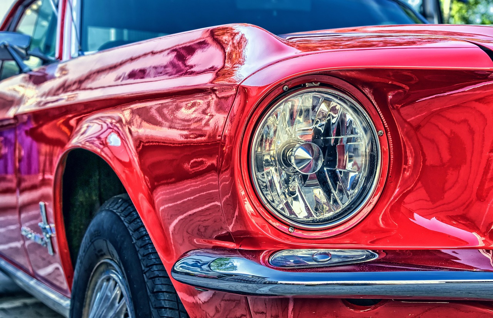
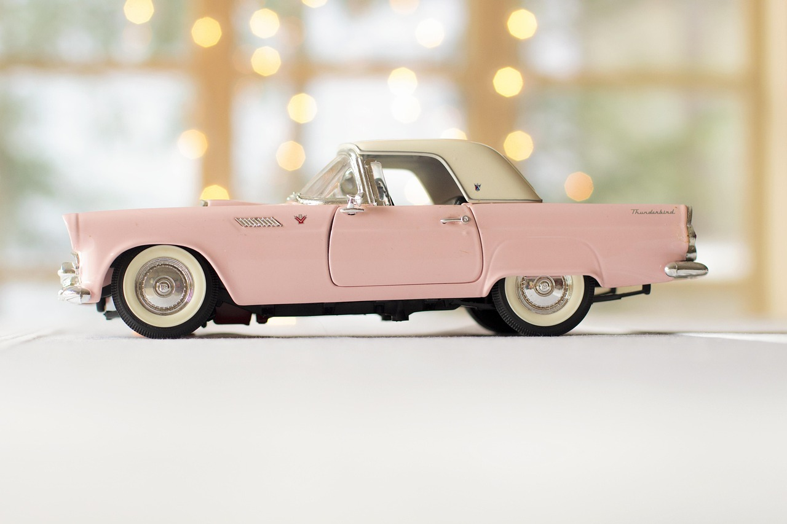
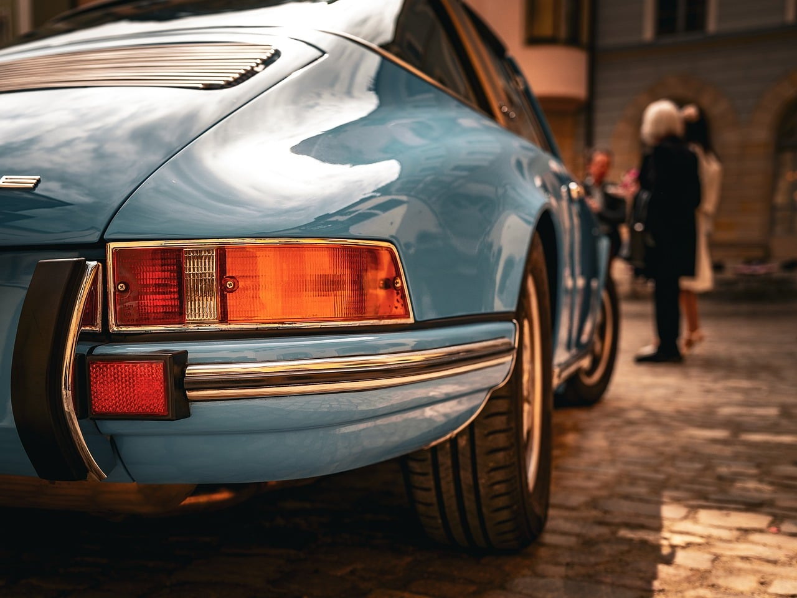

48年前の今日、1978年11月24日。本田技研工業が、新型の2ドアクーペ「プレリュード」を発売しました。同時に立ち上げられた新ディーラー網「ベルノ店」の専売モデルとして登場したこの車は、日本車として初となる電動サンルーフを備え、若者や車好きの心を強く引きつけました。

## 4年ぶりに復活したホンダのクーペ

ホンダにおける2ドアクーペは、1974年12月に販売を終了した「145クーペ」以来、3年11か月ぶりのことでした。当時、シビックやアコードで世界的な評価を確立していたホンダが、満を持して投入したスペシャリティカーがプレリュードでした。

車体構造には、シビックやアコードで採用されていたサブフレーム構造を発展させ、サブフレーム一体型のモノコックボディを採用しました。フロントピラーも2重構造にするなど、剛性を高めた設計が施されていました。前輪駆動（FF）でありながら、コーナー限界付近では後輪駆動（FR）のような操縦感覚を示す味付けがなされ、走りを重視するドライバーたちからも熱い視線を集めました。

## 日本車初の電動サンルーフと斬新な内装

初代プレリュードの最大のハイライトは、国産車として初めて標準装備（一部グレードを除く）された電動サンルーフでした。スイッチを押すだけで鉄板ルーフがスライドして開き、車内に外の風と光を取り込む演出は、当時の車好きに強い憧れを抱かせました。中期以降のモデルでは、ガラスサンルーフへとさらに進化を遂げています。

運転席に座ると、速度計とタコメーターが同心円状に配置された「集中ターゲットメーター」がドライバーを迎えます。計器類を効率よく確認できるように工夫されたこのデザインは、未来的でスポーティな印象を強めました。上位グレードには、海外の高級車にも使われていたコノリーレザーがオプション設定されるなど、上質さへのこだわりも随所に散りばめられていました。

*当日の写真ではありません · 事件当時の写真ではありません · イメージ写真 — 写真: Tama66 / Pixabay Content License*

## 新チャネル「ベルノ店」とともに誕生

プレリュードの発売日は、ホンダの新しい販売チャンネルである「ベルノ店」が発足した日でもありました。緑をシンボルカラーとし、「クルマが、個性になる。」をスローガンに掲げたベルノ店は、スポーティーカーや個性的なモデルを中心に取り扱う拠点として位置づけられました。

ベルノ店は販売手法の面でも画期的でした。当時の日本の自動車業界では、セールスマンが顧客の自宅を一軒ずつ回る「訪問販売」が主流でしたが、ベルノ店は「販売責任地域（PMA）」の考え方を導入し、店舗に顧客を迎えて車を提案する「店頭販売」を推し進めました。ゴダイゴが歌うテレビCMのメロディとともに、新時代のカーライフの幕開けを象徴する存在となったのです。

*当日の写真ではありません · 事件当時の写真ではありません · イメージ写真 — 写真: TerriC / Pixabay Content License*

## 生産台数の8割が世界へ

プレリュードの先進的なスタイルと走りは、日本国内にとどまらず海外でも極めて高い評価を受けました。約4年間にわたる初代モデルの総生産台数は約31万3000台に達しましたが、そのうちのおよそ80％が日本国外市場へ輸出されました。

厳しい北米市場などでも受け入れられ、ホンダの持つ技術力とスタイリッシュなブランドイメージを世界中に広く定着させる原動力となりました。排ガス規制をクリアしながら軽快な走りを実現したCVCCエンジンの進化版も搭載され、環境と走りの両立を追求したモデルとしても記録されています。

*当日の写真ではありません · 事件当時の写真ではありません · イメージ写真 — 写真: alandsmann / Pixabay Content License*

## 「デートカー」ブームと今に続く系譜

初代が開拓したクーペの路線は、1982年に登場した2代目プレリュードでさらに開花します。低いボンネットにリトラクタブル・ヘッドライトを備えたスタイリッシュな外観は、女性からも絶大な人気を集め、「デートカー」という流行語を生み出しました。続く3代目では、世界初となる機械式4WS（4輪操舵システム）を搭載し、常に技術の最先端を走り続けました。

一方、プレリュードとともに歩み始めたベルノ店は、後にクリオ店やプリモ店とともにホンダの国内販売網を支え、2006年に現在の「Honda Cars店」へと統合されました。ボタン一つで青空を開放した1978年のあのクーペは、日本の車文化が実用性からライフスタイルの楽しみへと大きく舵を切った記念碑的な一台でした。

### 参考資料

- <https://ja.wikipedia.org/wiki/11%E6%9C%8824%E6%97%A5>
- <https://commons.wikimedia.org/wiki/File:Tirage_au_sort_de_la_Coupe_de_France_1978-1979.jpg>
- <https://pixabay.com/photos/ford-mustang-car-vehicle-red-car-2705402/>
- <https://pixabay.com/photos/car-thunderbird-drive-driving-1957037/>
- <https://pixabay.com/photos/sports-car-luxury-car-classic-car-10229948/>
