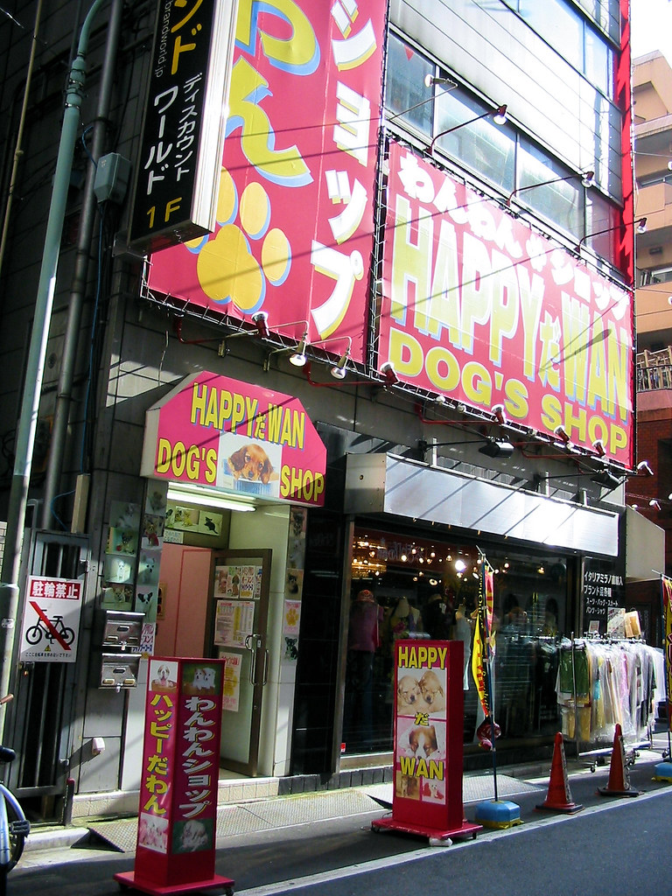
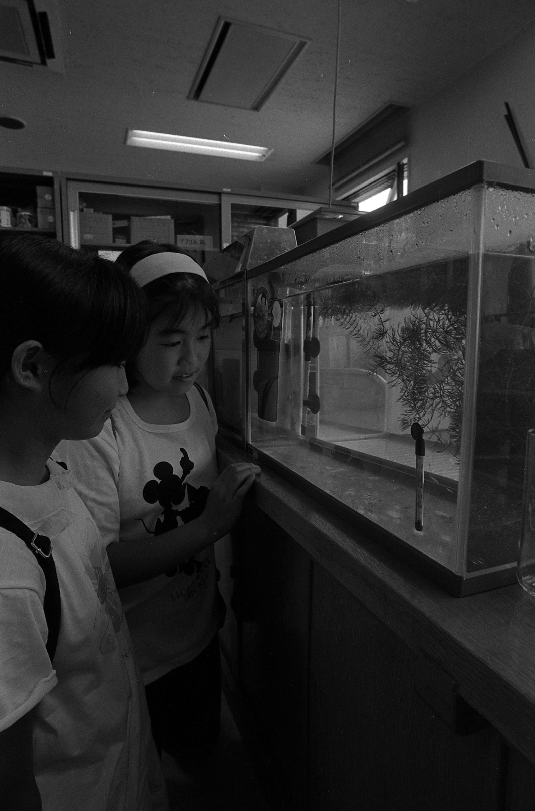

27年前の今日、1999年11月24日。日本で生きた外国産のカブトムシやクワガタムシ、合わせて44種の輸入が解禁されました。それまで図鑑の写真や標本の中でしか眺めることができなかった憧れの昆虫たちが、生きたまま街のペットショップやデパートの店頭に姿を現した瞬間でした。

## 身近な里山文化と「図鑑の中の憧れ」

日本にはノコギリクワガタやミヤマクワガタ、ヒラタクワガタ、オオクワガタ、コクワガタなど約40種のクワガタムシと、カブトムシが生息しています。これらは雑木林など人間にとって身近な里山環境に発生し、大顎や角が武将の兜に似ていることから、古くから子どもたちや大人たちに親しまれてきました。しかし、日本在来の甲虫の大半は黒や褐色で、色彩としては地味なものが中心でした。

一方、海を越えた熱帯雨林には、想像を絶する姿をした甲虫たちが生息していました。世界には約1500種のクワガタムシ、約1500種のカブトムシ亜科が存在し、特に東南アジアや中南米には巨大な種や鮮やかな種が集中しています。長年、愛好家や子どもたちにとって、それらは図鑑のカラーページを食い入るように眺めるだけの遠い存在でした。

## 1999年11月24日、44種の輸入が解禁される

長らく生体の輸入が厳しく制限されていた外国産甲虫でしたが、1990年代終盤に見直しが進み、1999年11月24日にカブトムシとクワガタムシ合わせて44種の輸入が正式に解禁されました。

この解禁によって、生きた世界の甲虫が正規のルートで日本国内へ入ってくる道が開かれました。少年のころに昆虫採集へ熱中した経験を持つ大人たちも巻き込み、デパートの催事場やペットショップには長蛇の列ができるなど、日本中を巻き込む空前のブームが幕を開けたのです。

*Ikebukuro - Dog's Shop — 写真: DocChewbacca / CC BY-SA 2.0*

## 世界一の美しさと最大級の迫力

輸入解禁によって日本にやってきた顔ぶれは、まさに図鑑の主役たちでした。オーストラリア産で世界一美しいと評されるニジイロクワガタや、東南アジアのオウゴンオニクワガタ、最大体長120ミリに達する世界最大のクワガタであるギラファノコギリクワガタが次々と輸入されました。

カブトムシでも、最大体長180ミリを超える原名亜種が確認されている世界最長のカブトムシ、ヘラクレスオオカブトや、強靭な3本の角を持つコーカサスオオカブトなどが登場しました。その圧倒的な体躯と勇壮な姿は、多くの人々を魅了しました。

*12・1号 まちのわだい 国際理解図画展 — 写真: ndl / CC BY (Japan Search)*

## 飼育産業の進化と42億円の市場

輸入解禁は、日本国内の昆虫飼育技術にも大きな変革をもたらしました。木材粉砕物に栄養添加物を混ぜてキノコの菌糸を培養した「菌糸ビン」が普及し、幼虫を人工的に大きく育てる手法が確立。さらに昆虫マットや成虫用の昆虫ゼリーなど、専用の飼育用品が手軽に購入できるようになりました。

ペット業界誌を発行する野生社の集計によると、2007年の日本国内における昆虫関連市場は約42億円に達し、爬虫類・両生類市場を上回り、鳥関連市場の約121億円に次ぐ一大産業へと成長しました。2017年時点では、年間約40万頭ものカブトムシやクワガタムシが日本に輸入される規模にまで広がりました。

*6・1号 こどもニュース 宇宙メダカⅢ世 — 写真: ndl / CC BY (Japan Search)*

## ブームの過熱と突きつけられた環境問題

しかし、ブームの急速な過熱は新たな影も落としました。オオクワガタをはじめとする人気種の採集をめぐって乱獲や過激な材割り採集が行われ、日本の里山環境が破壊される事態が起きました。さらに海外の原産国でも過剰な捕獲による熱帯雨林の生態系破壊が懸念されるようになりました。

また、飼いきれなくなった外国産昆虫が野外へ放虫されることによる外来種問題も深刻化しました。在来種との交雑や餌場・生息地の競合など、自然環境に対する影響が強く指摘されるようになり、生き物を飼育するモラルと責任があらためて厳しく問われることとなりました。

## 今も身近に残る飼育文化と自然への眼差し

現在では、カブトムシやクワガタムシの飼育用品はホームセンターなどで手軽に安く手に入るようになり、外国産甲虫はひとつのペット文化として完全に定着しました。

1999年の解禁から四半世紀以上が経過した今も、生命の力強さや多様な造形美は子どもから大人までを惹きつけ続けています。世界の昆虫と出会う喜びとともに、野生動物を飼う責任と生態系を守る大切さを学び直す日々が続いています。

### 参考資料

- <https://ja.wikipedia.org/wiki/11%E6%9C%8824%E6%97%A5>
- <https://commons.wikimedia.org/wiki/File:Dynastes_hercules.jpg>
- <https://www.flickr.com/photos/49462908@N00/130342256>
- <https://adeac.jp/koshigaya-city-digital-archives/catalog/mp110530-200020>
- <https://adeac.jp/koshigaya-city-digital-archives/catalog/mp105460-200020>
