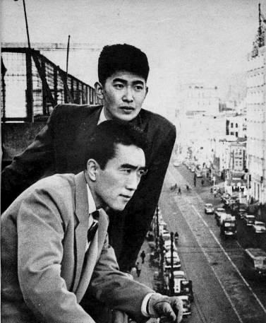
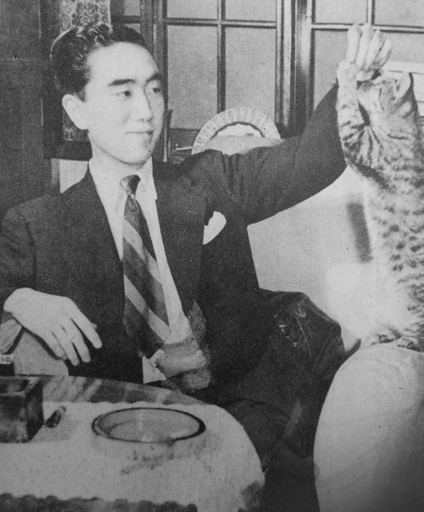
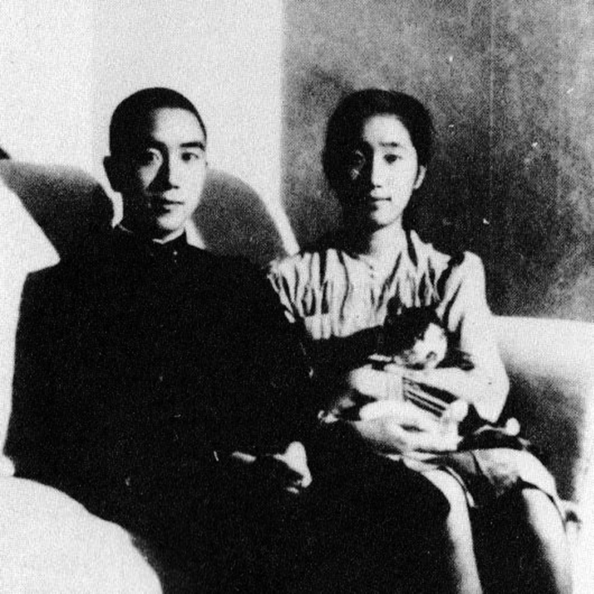

56年前の今日、1970年（昭和45年）11月25日。世界的な名声を誇る大作家・三島由紀夫が、東京・市ヶ谷の陸上自衛隊東部方面総監部に乗り込み、総監を人質にとるという前代未聞の事件が起きました。憲法改正のため自衛隊に決起を呼びかける演説を行った直後、三島は総監室で自らの命を絶ちました。

## 世界的作家のもう一つの顔と「楯の会」

1925年に生まれた三島由紀夫（本名・平岡公威）は、10代で『花ざかりの森』を発表して天才と称され、戦後は『仮面の告白』『潮騒』『金閣寺』『憂国』など数々の傑作を世に送り出しました。その絢爛豪華な文体と唯美的な作風は国境を越えて高く評価され、ノーベル文学賞の有力候補に挙げられるなど、世界的に著名な日本人作家としての地位を確立していました。

しかし昭和40年代に入ると、三島は自衛隊への体験入隊を重ね、祖国防衛の志を同じくする学生らとともに民兵組織「楯の会」を結成します。日本が高度経済成長に沸く一方で、三島は憲法第9条による制約や戦後社会のあり方に強い危機感を抱き、次第に自らの思想を行動によって体現しようとしていきました。

## 周到に計画された市ヶ谷駐屯地への訪問

1970年11月25日の午前10時58分頃、三島は楯の会の森田必勝（25歳）、小賀正義（22歳）、小川正洋（22歳）、古賀浩靖（23歳）の4人を伴い、東京都新宿区市谷本村町の陸上自衛隊市ヶ谷駐屯地正門を通過しました。事前に表彰の報告という名目で面会を予約していたため、門衛の敬礼を受けてフリーパスで通過し、東部方面総監部2階の総監室へと案内されました。

応接室で益田兼利総監（57歳）と向かい合った三島は、同行した隊員たちを紹介した後、持参した日本刀「関孫六」を取り出して見せました。刃文を眺めた総監が元の席に戻った午前11時5分頃、三島が合図として刀の鍔鳴りをパチンと鳴らすと、隊員たちがすばやく総監の背後に回り込み、ロープで椅子に縛りつけてさるぐつわを噛ませました。

*Ishihara Mishima — 写真: unknown / Public domain*

## 総監室での激しい乱闘と自衛官たちの負傷

室内での異様な物音に気づいた幕僚らがドアを壊して突入を試みると、森田が「来るな」と叫び、ドア下から要求書が差し出されました。室内に通じる別の扉のバリケードを破って幕僚たちがなだれ込むと、三島は軍刀拵えの関孫六を抜いて応戦。狭い総監室内で激しい乱闘が繰り広げられました。

木刀や椅子、地球儀などを手に応戦した幹部らに対し、三島は手元を引きながら刃先で切りつけ、自衛隊員8人が負傷しました。中でも掌の腱を切られた中村菫正2佐は全治12週間の重傷を負うことになります。幕僚らは総監の身の安全を考慮して一旦退散し、廊下からの説得を続けました。

*Mishima Yukio 1948 — 写真: 朝日新聞社 / Public domain*

## バルコニーからの絶叫と、衝撃の自決

三島は窓越しに要求書を投げ渡し、総監の命を盾に「正午までに本館前に自衛官を集めて演説を聞かせろ」と要求しました。11時40分、駐屯地内に可能な限り集合するよう通達が出され、本館前広場には多数の隊員が集まりました。

額に「七生報国」の鉢巻きを締めた三島は、正午前に総監室のバルコニーに姿を現しました。集まった隊員たちに向かって憲法改正のための蜂起を激しく訴えましたが、隊員たちからは激しい怒号と野次が飛び交い、三島の声はかき消されていきました。予定していた演説を切り上げた三島は、総監室へと戻ります。そして益田総監の目の前で短刀を腹に突き立て、森田による介錯を受けて割腹自決を遂げました。続いて森田も自決し、壮絶な結末を迎えました。

*Mishima Yukio and sister — 写真: Family Album Portrait, 1944s / Public domain*

## 日本中と世界を揺るがした事件の余波

世界的文学者が軍事施設を占拠して決起を促し、割腹自殺を遂げたというニュースは、日本社会のみならず世界中を駆け巡り、大きな衝撃を与えました。テレビや新聞は特別報道を続け、人々に計り知れない戸惑いと波紋を残しました。

後年のアンケート調査でも、三島事件は「20世紀の日本における重大事件」として太平洋戦争の敗戦に次ぐ出来事として挙げられるなど、戦後史の大きな節目として記録されています。文学界においても、類まれな才能を持った作家のあまりにも劇的な死は「一つの時代の終わり」と受け止められました。

## 今に受け継がれる現場の記憶

事件の舞台となった市ヶ谷駐屯地の旧1号館は、戦前は陸軍士官学校本部や大本営陸軍部が置かれ、戦後は極東国際軍事裁判の法廷としても使われた歴史的な建物でした。防衛庁本庁の新庁舎建設に伴って解体されましたが、その一部は「市ヶ谷記念館」として敷地内に移設復元されています。

記念館には、かつて東部方面総監室だった部屋の扉や、あの日の乱闘でつけられた刀傷が今も大切に保存されています。半世紀以上の時が流れた現在も、市ヶ谷の地には昭和の激動を駆け抜けた作家が遺した痕跡が、静かにその歴史を物語っています。

### 参考資料

- <https://ja.wikipedia.org/wiki/%E4%B8%89%E5%B3%B6%E7%94%B1%E7%B4%80%E5%A4%AB>
- <https://commons.wikimedia.org/wiki/File:Mishima_Yukio_1970.jpg>
- <https://commons.wikimedia.org/wiki/File:Ishihara_Mishima.jpg>
- <https://commons.wikimedia.org/wiki/File:Mishima_Yukio_1948.JPG>
- <https://commons.wikimedia.org/wiki/File:Mishima_Yukio_and_sister.jpg>
