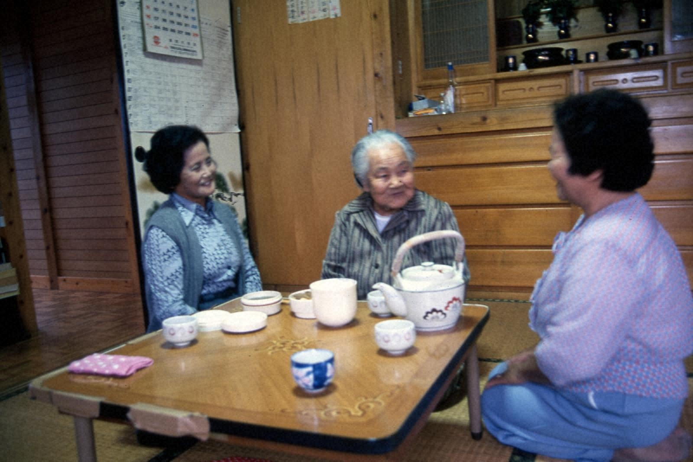
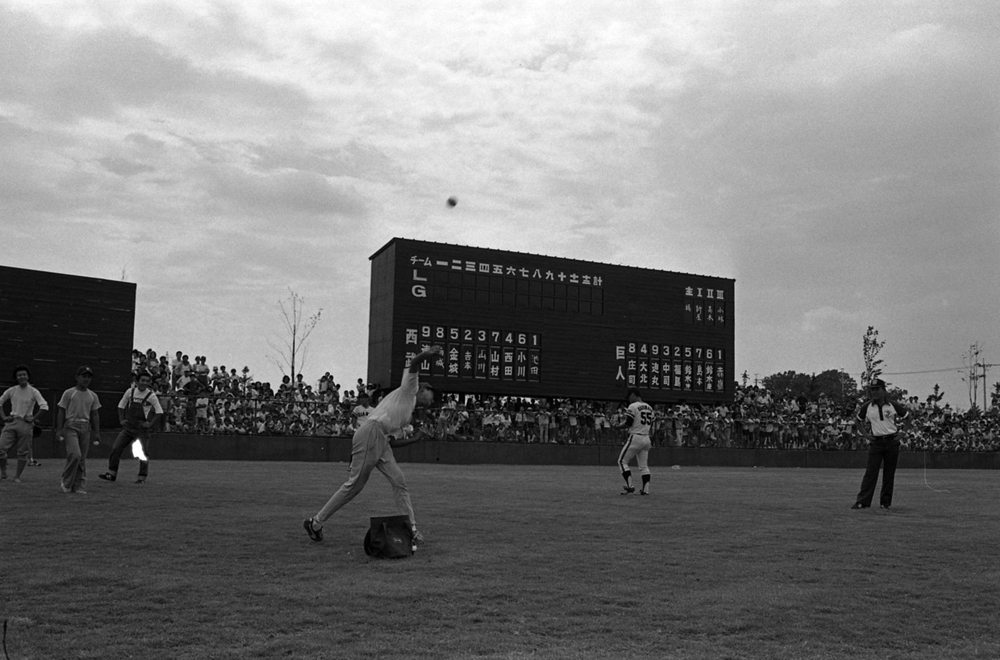
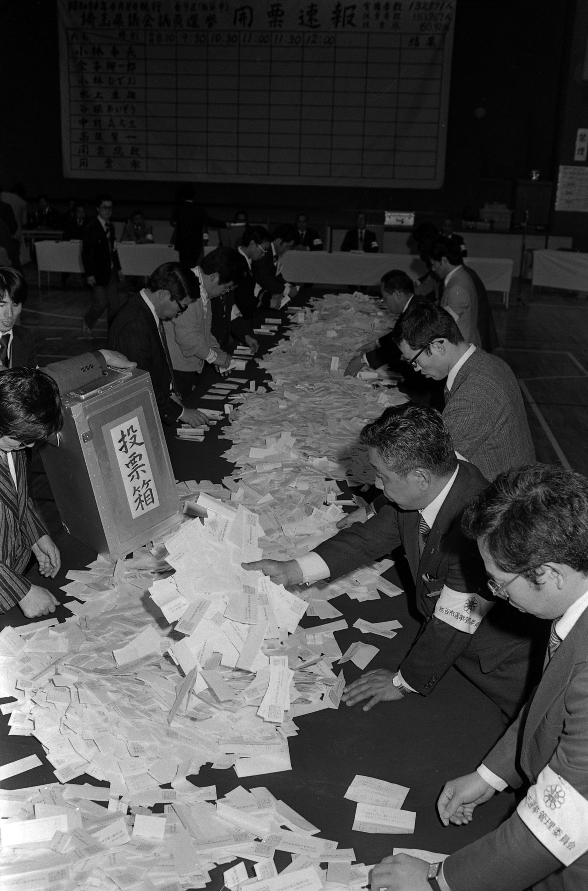

42年前の今日、1984年11月25日。東京競馬場で行われた第4回ジャパンカップで、カツラギエースが鮮やかな逃げ切り勝ちを収め、日本調教馬として初めてこの国際競走を制覇しました。世界との圧倒的な実力差に打ちのめされていた日本競馬界に、歓喜と自信をもたらした記念碑的な一日でした。

## 「日本馬は永遠に勝てないのか」という絶望

1970年代後半から「世界に通用する強い馬づくり」を目指してきた日本中央競馬会は、1981年に日本初の国際招待競走としてジャパンカップを創設しました。しかし、鳴り物入りで始まったレースで日本馬を待っていたのは冷酷な現実でした。

第1回を制したのは、本国アメリカでは目立たない戦績だった牝馬メアジードーツでした。従来のコースレコードを1秒も更新する圧勝劇に、日本の関係者は「日本馬は永遠に勝てないのではないか」という強い衝撃を受けます。その後も第2回、第3回と外国馬が連勝し、日本馬は世界のスピードとパワーの前に手も足も出ない状況が続いていました。

## 新旧三冠馬の激突と、10番人気の伏兵

迎えた1984年の第4回ジャパンカップ。この年の日本馬の出走頭数は、同競走史上最少となるわずか4頭でした。外国馬の厚い壁を前に陣営の出走回避が相次ぐ中、ファンの視線は日本競馬史に残る新旧三冠馬の直接対決に注がれていました。

前年の三冠馬ミスターシービーと、無敗で三冠を達成したばかりの3歳馬シンボリルドルフです。この2頭のどちらかが外国馬を倒してくれるのではないかという期待が高まる一方、春に宝塚記念を制していたカツラギエースは中距離専門と見なされ、2400メートルの距離不安や気性の激しさから10番人気という低評価にとどまっていました。

*ひとりぐらし老人家庭奉仕員 — 写真: 南城市教育委員会 / CC BY (Japan Search)*

## 陣営が密かに仕掛けた二つの秘策

下馬評は低くとも、カツラギエースの陣営は勝利を諦めていませんでした。鞍上の西浦勝一騎手は、馬に余計なプレッシャーをかけずリラックスして走らせることが不可欠だと考えました。「2400メートルだが、2000メートルを走らせるつもりで走れば息はもつ」と見定め、ハミが馬の口に当たらないよう、通常より約30センチ長い手綱を採用しました。

さらに担当の原園講二厩務員は、当日の巨大な観衆の歓声に馬が動揺しないよう、耳の部分の革を厚く仕立てた特注の白いメンコを準備しました。耳栓のような効果を狙ったこの道具は、もし調教師に反対されて外すことになっては困ると、本番直前まで土門一美調教師に秘密にされていた徹底ぶりでした。

*イースタンリーグ 巨人VS西武戦 — 写真: ndl / CC BY (Japan Search)*

## 10馬身以上引き離す大逃げ、どよめく東京競馬場

レースのゲートが開くと、カツラギエースは迷わず先頭に立ちました。長い手綱で無理に抑え込まず、馬の気持ちに任せて気持ちよく走らせると、向こう正面では2番手以下を10馬身以上も引き離す独走状態となりました。

中団に構えるシンボリルドルフ、最後方から末脚にかけるミスターシービー、そして海外の強豪馬たちを置き去りにしたまま、レースは最終コーナーへ進みます。直線に入ってもカツラギエースのストライドは衰えず、坂を駆け上がっても後続との差は簡単には詰まりません。猛然と追いすがる外国馬やルドルフを1馬身半抑え込み、先頭のまま栄光のゴール板を駆け抜けました。

*県議選本部(速報) — 写真: ndl / CC BY (Japan Search)*

## 世界一のレースへと飛躍した日本競馬の起点

カツラギエースの劇的な逃げ切りは、日本の馬とホースマンが世界の一流馬と互角以上に渡り合えることを証明した瞬間でした。創設から最初の10年間で日本馬が勝ったのは、この1984年のカツラギエースと翌年のシンボリルドルフの2頭だけでしたが、この勝利が競馬界全体の意識を大きく変える原動力となりました。

その後、日本馬のレベルは飛躍的に向上し、現在ではジャパンカップが世界のトップ100・GIレースの格付けで世界1位に選ばれるまでに発展しました。世界の高かった壁に風穴を開け、歴史を動かしたあの一頭の白いメンコの逃走劇は、今も競馬ファンの心に鮮烈な記憶として刻まれています。

### 参考資料

- <https://ja.wikipedia.org/wiki/%E3%82%B8%E3%83%A3%E3%83%91%E3%83%B3%E3%82%AB%E3%83%83%E3%83%97>
- <https://commons.wikimedia.org/wiki/File:Tokyo_Racecourse1940.jpg>
- <https://nanjo-archive.jp/document/?detail=29099&genre=6>
- <https://adeac.jp/koshigaya-city-digital-archives/catalog/mp182706-200020>
- <https://adeac.jp/koshigaya-city-digital-archives/catalog/mp180957-200020>
