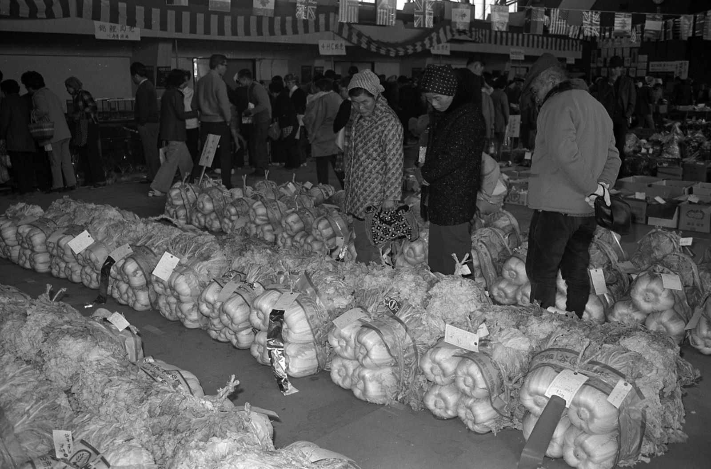
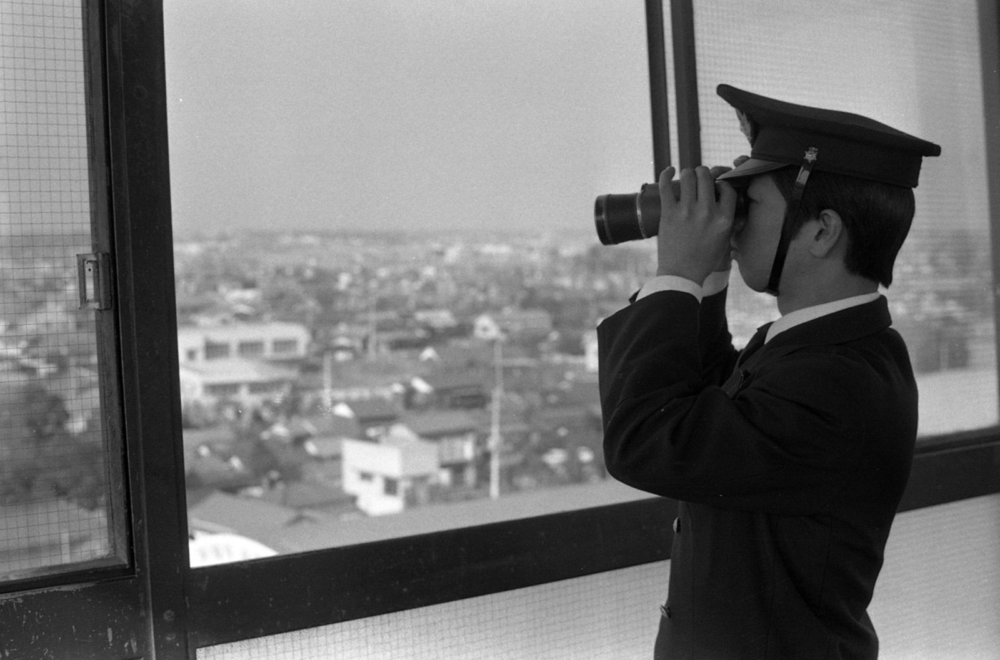
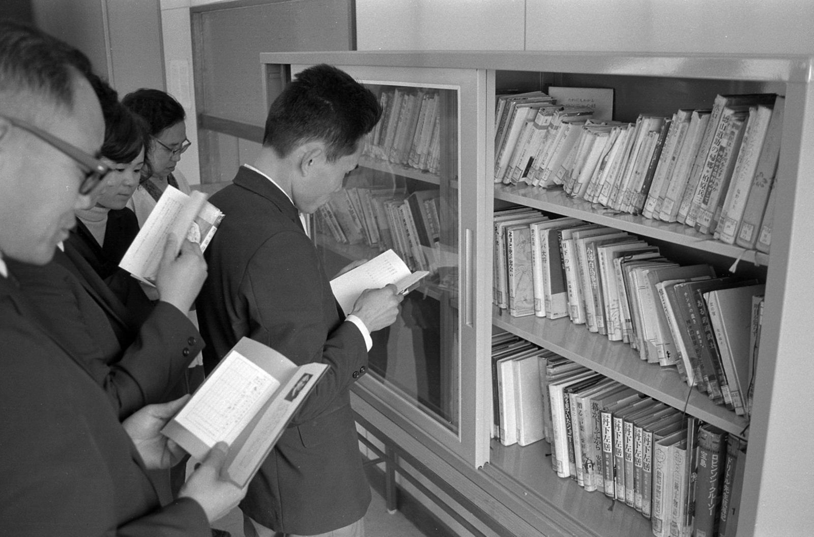

1973年11月25日、祥伝社から一冊の新書が世に送り出されました。作家の五島勉氏が著した『ノストラダムスの大予言』です。フランスの医師・占星術師ノストラダムスが遺した詩を題材に、「1999年7の月に人類が滅亡する」という解釈を提示した本書は、瞬く間に列島を揺るがす大ベストセラーとなりました。半世紀以上が経過した今もなお、昭和後期の世相を象徴する出来事として多くの人々の記憶に刻まれています。

## 不安に覆われていた昭和48年の日本社会

1973年の日本は、戦後の高度経済成長が大きな転換点を迎えた激動の年でした。同年10月に勃発した第四次中東戦争をきっかけに第一次オイルショックが発生し、トイレットペーパーの買い占め騒動が起きるなど、市民生活は深刻な混乱に見舞われていました。

さらに各地で深刻化していた大気汚染や水質汚濁といった公害問題、さらにはローマクラブによる報告書『成長の限界』の発表などが重なり、将来に対する漠然とした不安心理が社会全体に漂っていたのです。

五島勉氏はもともと女性週刊誌の記者などを経てオカルト記事を執筆していた人物で、祥伝社の編集者・伊賀弘三良氏に複数の預言者を扱った企画を持ち込んだところ、ノストラダムス1本に絞る方針が決まり執筆が進められました。時代の閉塞感と終末ブームが合致したことで、本書は世に出るべくして出た一冊となったのです。

## わずか3か月でミリオンセラーを達成

11月25日に初版が発行されると、本は爆発的な勢いで売れ始めました。発売からわずか3か月ほどで公称100万部を突破し、1974年3月2日付の『朝日新聞』広告では、出版科学研究所調べによる戦後15冊目のミリオンセラーであることが大々的に謳われました。

出版ニュース社の調査によると、1974年の年間ベストセラーにおいてノンフィクション部門の第1位を獲得し、総合部門でも五木寛之氏訳の『かもめのジョナサン』に次ぐ第2位に輝きました。

その後も版を重ね、1998年8月時点では209万部、450版を記録することになります。この大ヒットにより、五島氏は東京都内の石神井に土地を購入して自宅を新築するなど、著作者としての人生も大きく変わることになりました。

*農業祭 — 写真: ndl / CC BY (Japan Search)*

## 子どもたちを震え上がらせた「1999年の恐怖」

本書の核心は、16世紀の予言詩集から導き出された「1999年7の月に恐怖の大王が来るだろう」という一節でした。五島氏はこれを人類滅亡の予言と位置づけ、極度の大気汚染や核兵器、彗星の衝突といった破滅的な未来像を畳み掛けるように論じました。

特に大きな打撃を受けたのが、当時の小中学生を中心とする幼少世代でした。携帯電話やインターネットがなく情報の真偽を確かめる術がなかった当時、活字で書かれた内容をそのまま受け止めた子どもたちが全国で続出しました。「自分は20代で死んでしまう」「大人になっても未来はない」と、真剣に涙を流しトラウマを抱えた少年少女は少なくありませんでした。

翌1974年8月には、丹波哲郎氏主演で東宝による映画版が公開され、邦画年間配給収入第2位となる8億8,300万円を記録します。文部省推薦映画にも指定されたことで、大予言の恐怖は公の枠組みすら巻き込んで一層広く浸透していきました。

*望楼からの監視 — 写真: ndl / CC BY (Japan Search)*

## 創作の混入と後世への暗い影

しかし後年、この著作には多くの問題点が指摘されることになります。本来「百詩篇集」と訳されるべき書名が英訳経由の誤訳で『諸世紀』と表記されていたほか、架空の研究者や典拠のないエピソードが随所に織り交ぜられていたのです。

フランス王妃カトリーヌ・ド・メディシスとの対話とされる「ブロワ城の問答」など、史料に存在しない著者の創作が事実であるかのように語られていました。評論家の宮崎哲弥氏や山本弘氏らは、こうした扇情的な記述が1980年代以降の新興宗教に影響を与え、教団が信者を惹きつける終末論の土壌を形成したと指摘しています。

オウム真理教の信者たちも本書の予言観に強く影響されていたとされ、単なる娯楽本にとどまらない深刻な社会的波紋を広げる結果となったのです。

*荻島公民館に図書配本所開設 — 写真: ndl / CC BY (Japan Search)*

## 平穏に明けた世紀末と現代への教訓

大予言シリーズはその後も書き継がれ、1998年の『最終解答編』まで全10冊が刊行されました。後年の著作では滅亡回避の可能性や警告としての意義が強調されるようになり、五島氏自身も1999年7月の新聞取材で読者への謝罪に触れつつ、警告論としての立場を主張しました。

そして迎えた1999年7月、予言されたような大破滅は起きず、世界はいつもと何一つ変わらない夏の日常を迎えました。怯えながらその月を待っていた若者たちは、安堵とともに拍子抜けしたような思いで空を見上げたのです。

五島勉氏は2020年6月16日、90歳でこの世を去りました。根拠のない不安や極端な言説が社会の閉塞感と結びついたとき、どれほど大きな波紋を呼ぶのか。『ノストラダムスの大予言』が巻き起こした熱狂と恐怖は、半世紀が過ぎた現代の情報社会にも通じる重い記憶として残されています。

### 参考資料

- <https://ja.wikipedia.org/wiki/11%E6%9C%8825%E6%97%A5>
- <https://adeac.jp/koshigaya-city-digital-archives/catalog/mp160522-200020>
- <https://adeac.jp/koshigaya-city-digital-archives/catalog/mp162582-200020>
- <https://adeac.jp/koshigaya-city-digital-archives/catalog/mp154612-200020>
- <https://adeac.jp/koshigaya-city-digital-archives/catalog/mp154851-200020>
