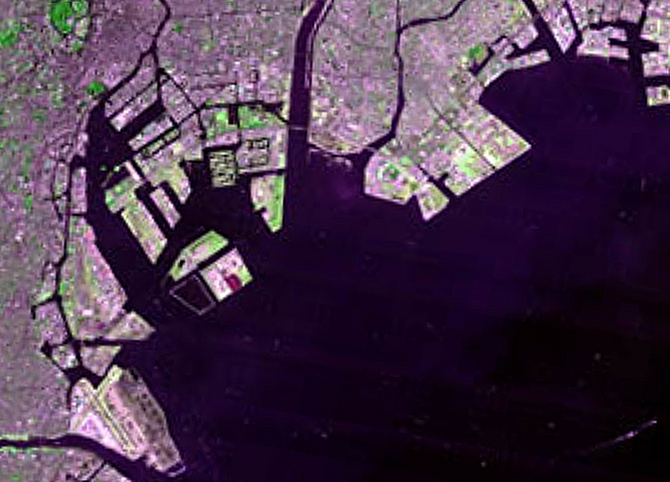
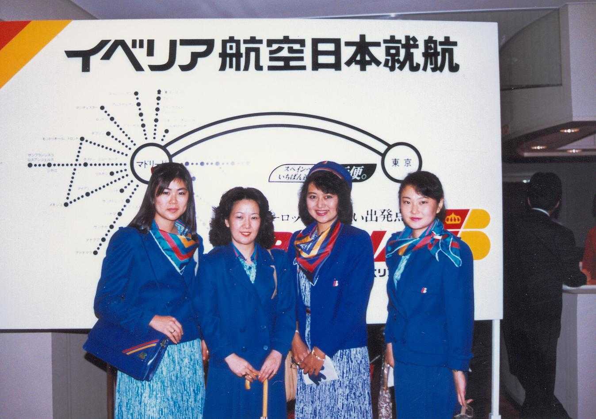
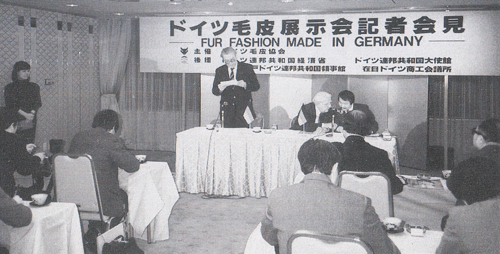

40年前の今日、1986年11月25日。東京・有楽町の中心街で、白昼堂々と現金輸送車が襲われ、現金約3億3000万円と有価証券が奪われる前代未聞の強奪事件が発生しました。通勤客が行き交う朝のオフィス街を揺るがしたニュースは、瞬く間に日本全国を駆け巡りました。

## 朝のオフィス街を襲った白昼の強奪劇

1986年11月25日の午前8時頃、東京都千代田区有楽町の東京交通会館路面側に位置していた三菱銀行有楽町支店で事件は起きました。店舗前に到着した現金輸送車が、突然現れた3人組の男たちに襲撃されたのです。

男たちは手際よく現金輸送車から現金約3億3000万円と有価証券を奪い取り、瞬く間に現場から逃走しました。人通りの多い都心のど真ん中で発生した大胆不敵な犯行に、現場周辺は一時騒然となり、通報を受けた警視庁は直ちに緊急配備を敷いて行方を追いました。

## 「第二の三億円事件」と呼ばれた理由

この事件が報じられるやいなや、世間の注目は一気に高まりました。輸送中の現金輸送車が狙撃・強奪された手口、そして奪われた被害額が約3億円にのぼるという事実が、18年前の1968年12月に発生した「府中三億円事件」と酷似していたためです。

府中事件は警察の懸命な捜査にもかかわらず犯人を特定できないまま時効を迎えており、昭和史に残る未解決事件の筆頭でした。そのため、今回の有楽町での強奪事件はマスコミ各社から「第二の三億円事件」と大々的に呼ばれ、治安神話が揺らぐ社会的な衝撃をもたらしました。

*Tokyo port ca.1986 — 写真: File:Tokyo Landsat.jpg: created by NASA derivative work: Sho / Public domain*

## 決定打となった指紋と国際捜査網

未解決の悪夢を繰り返すわけにはいかない警視庁は、執念の捜査を展開しました。現場に残された遺留品の検証が進められ、事件解決への決定的な転機は事件から約1年後の1987年10月に訪れます。

フランス警察から送られてきた指紋リストと現場の指紋を照合した結果、フランス人3人とアルジェリア人1人からなる国際強盗グループの犯行であることが突き止められたのです。このグループは事件の数年前にも、海外の美術館から盗んだ絵画を密売する目的で日本に入国していた経歴がありました。警視庁はICPO（国際刑事警察機構）を通じて国際指名手配を行いました。

*Vuelo Iberia Madrid- Tokio (1986) (5811683974) — 写真: Iberia Airlines / CC BY 2.0*

## 国境を越えた逮捕劇と「18年越しのリベンジ」

国際手配を受けた主犯格以外の3人は、フランス国内で相次いで逮捕されました。残る主犯格の男も逃亡を続けましたが、1988年4月、潜伏先のメキシコで身柄を拘束されました。

国境を越えた執念の追跡により、犯人グループ全員の逮捕という完全解決を成し遂げました。府中三億円事件で煮え湯を飲まされていた警視庁にとって、この事件のスピード解決は「18年越しのリベンジ」として捜査史に刻まれることになりました。

*Fur fashion made in Germany, press conference in Tokyo, 1986 — 写真: Kurt Lindemann / CC BY 3.0*

## テレビ速報のハプニングと人々の記憶

事件当日の朝、テレビのワイドショーでも緊迫した速報が生放送で伝えられました。フジテレビ系の情報番組『おはよう!ナイスデイ』では、報道センターから事件の一報を伝える際、映像の切り替えトラブルによって司会の露木茂アナウンサーがスタッフと談笑する姿がそのまま放送されてしまうという有名なハプニングも記録されています。

突如として舞い込んだ大事件の速報と、当時のテレビ画面の空気感は、多くの視聴者の記憶に鮮烈に残ることとなりました。

## 40年後の現場と今に残る痕跡

事件の現場となった三菱銀行有楽町支店は、その後の銀行再編に伴い銀座一丁目駅最寄りの東京三菱銀行京橋支店へと統合され、建物には別のテナントが入居しました。

かつて現金輸送車が襲撃された東京交通会館の一角は、2階に「有楽町第二クイックコーナー」としてATMのみが設置された後、現在は三菱UFJ銀行「ATMコーナー有楽町」として利用されています。多くの通勤客や買い物客が行き交う穏やかな街並みの中に、昭和末期を揺るがした大事件の記憶が今も静かに息づいています。

### 参考資料

- <https://ja.wikipedia.org/wiki/11%E6%9C%8825%E6%97%A5>
- <https://commons.wikimedia.org/wiki/File:Tokyo_Landsat.jpg>
- <https://commons.wikimedia.org/wiki/File:Tokyo_port_ca.1986.jpg>
- <https://commons.wikimedia.org/wiki/File:Vuelo_Iberia_Madrid-_Tokio_(1986)_(5811683974).jpg>
- <https://commons.wikimedia.org/wiki/File:Fur_fashion_made_in_Germany,_press_conference_in_Tokyo,_1986.jpg>
