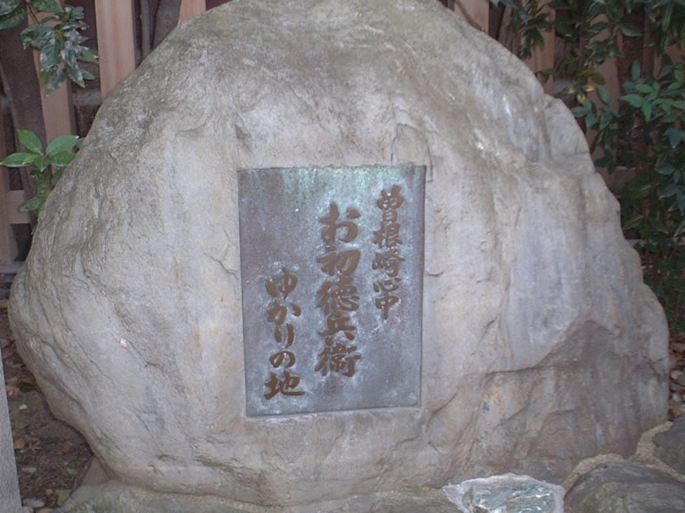
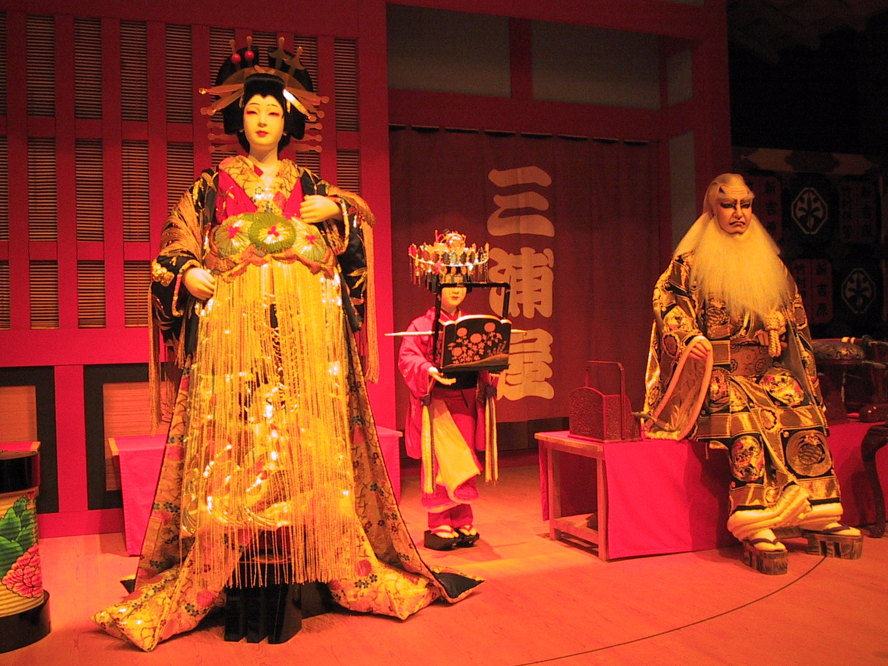
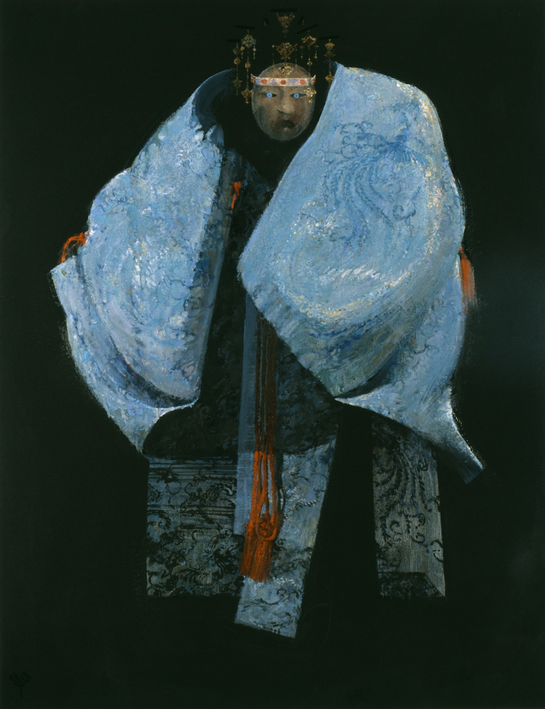

21年前の今日、2005年11月25日。日本の伝統芸能である歌舞伎が、ユネスコ（国際連合教育科学文化機関）による「人類の口承及び無形遺産の傑作」として宣言されることが決定しました。形ある建造物などを対象としてきた従来の世界遺産とは異なり、人から人へと受け継がれる芸能や口承伝統を保護する国際的な枠組みの中で、日本の誇る演劇文化が世界的な評価を受けた画期的な出来事でした。

## 有形から無形へ――文化を護る新たな枠組み

1972年に採択された世界遺産条約は、歴史的な建造物や遺跡、豊かな自然環境など、有形の文化遺産や自然遺産を保護の対象としてきました。しかし、世界各地には建造物のような形を持たず、民族の暮らしや精神の営みの中で受け継がれてきた音楽、舞踏、祭り、儀式、伝統工芸技術などが数多く存在していました。

こうした無形の文化財は、社会の近代化や生活様式の変化によって消滅の危機に直面しやすいという課題を抱えていました。そこでユネスコは、有形遺産とは異なる新しい保護の仕組みを作るべく、2003年の第32回総会で無形文化遺産の保護に関する条約を採択しました。条約が発効するまでの間、たぐいない価値を有する文化を称えるために始められたのが「人類の口承及び無形遺産の傑作の宣言」でした。

## 慶長8年からの歩み――かぶき踊りから洗練された演劇へ

歌舞伎の源流は、慶長8年（1603年）5月6日に女院御所で披露された記録が残る、出雲阿国による「かぶき踊」にあります。京都で一世を風靡した阿国の踊りは、当時の社会で異形を好み常軌を逸した行動をとる「かぶき者」の斬新な動きや派手な装いを取り入れたものでした。

その後、遊女歌舞伎や12歳から17、18歳の少年による若衆歌舞伎が流行したものの、風紀上の理由から幕府の規制を受け、成年男子が演じる形へと変化していきました。元禄年間（1688年から1704年）には、江戸で初代市川團十郎が荒事を創始し、上方では初代坂田藤十郎が活躍するなど、演技や役柄が洗練されていきました。さらに享保3年（1718年）に舞台へ屋根がつけられ、花道や廻り舞台といった独自の舞台機構が発展し、世界でも類を見ない総合演劇へと成熟していったのです。

*Ohatu Tokubei — 写真: 利用者:Suguri F（すぐり） / CC BY-SA 3.0*

## 2005年11月25日――第3回傑作宣言で選ばれた43件

ユネスコが実施した「人類の口承及び無形遺産の傑作の宣言」は、2001年から隔年で3回にわたって行われました。2001年5月18日の第1回では19件、2003年11月7日の第2回では28件が宣言され、世界各地の多様な民族芸能や儀礼が選考基準を満たす傑作として国際的に顕彰されていきました。

そして2005年11月25日、最後となる第3回の宣言が行われ、世界各地から43件の無形遺産が選出されました。その中に、日本が誇る伝統芸能である歌舞伎が含まれていたのです。歴史、芸術、文学の観点からたぐいない価値を有し、人類の創造的才能の傑作として卓越した技術と共同体の伝統を体現していることが、国際的に高く評価された瞬間でした。

*Kabuki in a museum — 写真: Amaury Laporte / CC BY 2.0*

## 代表一覧表への統合と国際条約の発効

無形文化遺産条約は、締約国が30か国に達した時点から3か月後に発効する規定となっており、採択から約3年を経た2006年4月20日に正式に発効を迎えました。これに伴い、2001年から2005年までの3回の宣言で選出された合計90件の傑作は、新たな条約に基づく「人類の無形文化遺産の代表的な一覧表」へと統合されることになりました。

歌舞伎もまた、2008年9月に代表一覧表へ記載され、恒久的な保護と継承の枠組みの中に位置づけられました。日本国内ではすでに1965年4月20日に国の重要無形文化財に指定されていましたが、ユネスコの代表一覧表に記載されたことで、日本国民の文化財であると同時に、全人類が共有すべき貴重な財産として国際社会に認知されたのです。

*NO12 — 写真: Theindel / CC BY-SA 4.0*

## 世代を超えて現代に息づく伝統の舞台

無形文化遺産の本質は、過去の遺物を保存することにとどまらず、現在を生きる人々によって技と精神が継承され続ける点にあります。歌舞伎は出雲阿国のかぶき踊り以来、時代の変化や幕府による厳しい法令などの制約を乗り越えながら、舞台機構や演出を工夫し、人々の心を惹きつけてきました。

2005年の決定から年月を経た今も、歌舞伎座をはじめとする全国の劇場で伝統の技が磨かれ、多くの観客を魅了し続けています。形ある建物のように静止した遺産ではなく、舞台上で生きた役者たちの声と所作によって演じ継がれる歌舞伎は、日本の精神文化を象徴する無形遺産として、次の世代へと確かに手渡されています。

### 参考資料

- <https://ja.wikipedia.org/wiki/%E5%9B%BD%E9%9A%9B%E9%80%A3%E5%90%88%E6%95%99%E8%82%B2%E7%A7%91%E5%AD%A6%E6%96%87%E5%8C%96%E6%A9%9F%E9%96%A2>
- <https://commons.wikimedia.org/wiki/File:Tokyo_Kabuki-za-Theatre_1831.jpg>
- <https://commons.wikimedia.org/wiki/File:Ohatu_Tokubei.jpg>
- <https://commons.wikimedia.org/wiki/File:Kabuki_in_a_museum.jpg>
- <https://commons.wikimedia.org/wiki/File:NO12.jpg>
