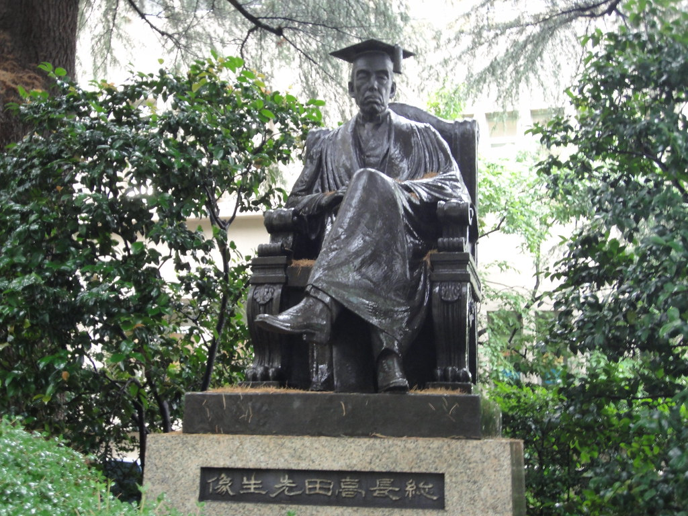

28年前の今日、1998年11月25日、トップアイドルとして社会現象を巻き起こしていた広末涼子さんが、早稲田大学に合格しました。当時高校3年生だった彼女の合格は、芸能界の枠を超えて日本中から大きな注目を集めました。

## ポケベルのCMから始まった「ヒロスエブーム」

高知県出身の広末涼子さんは、1994年に雑誌で見つけたCMオーディションでグランプリを獲得し、芸能界入りを果たしました。1996年春に上京して品川女子学院高等部に進学すると、NTTドコモのポケベルのCMに出演。「広末涼子、ポケベルはじめる」というキャッチコピーとともに、ショートカットと透明感のある笑顔で一躍時代の寵児となりました。

広末さんが女子高生だった1996年から1999年にかけては「ヒロスエブーム」と呼ばれ、同年に発売されたファースト写真集『H』と『R』は2冊合わせて46万8000部を記録する異例の大ヒットとなりました。彼女の爽やかな存在感は、1990年代後半の若者文化の象徴として社会を席巻していきました。

## 歌手デビューと17年ぶりの快挙

ブームの勢いは留まることを知りませんでした。1997年4月には、シンガーソングライターの竹内まりやさんが手掛けたシングル「MajiでKoiする5秒前」で歌手デビューを飾り、約60万枚を売り上げるヒットを記録します。続く岡本真夜さんプロデュースのセカンドシングル「大スキ!」ではオリコンチャートで1位を獲得しました。

さらに映画『20世紀ノスタルジア』で主演を務め、数々の新人賞を受賞。年末の『第48回NHK紅白歌合戦』にはデビュー年での初出場を果たしました。女性アイドル歌手がデビュー年に紅白へ出場したのは、1980年の松田聖子さんや岩崎良美さん以来17年ぶりの快挙でした。

*当日の写真ではありません · 事件当時の写真ではありません · イメージ写真 — 写真: ignartonosbg / Pixabay Content License*

## 1998年11月25日、早稲田大学教育学部に合格

テレビドラマや映画、CM、さらには舞台への初出演と多忙を極めるなか、現役の女子高生として学業との両立を模索していた広末さんが選んだのは、大学進学という道でした。

そして1998年11月25日、早稲田大学教育学部国語国文学科の自己推薦入試に合格したことが発表されました。現役の国民的トップアイドルが私立の名門校である早稲田大学に合格したという知らせは、スポーツ紙やワイドショーを連日賑わせる一大ニュースとなりました。

*当日の写真ではありません · 事件当時の写真ではありません · イメージ写真 — 写真: Namden / Pixabay Content License*

## 熱狂のキャンパスと女優業への専念

翌1999年4月に早稲田大学へ入学した広末さんでしたが、多忙な芸能活動などから3か月間登校できなかったことで世間の関心と批判を集めることになります。入学から3か月後に行われた初登校の際には、キャンパス周辺に100人を超える報道陣が押し寄せるなど、前代未聞の騒動となりました。

この年、広末さんは映画『秘密』や『鉄道員（ぽっぽや）』に出演し、演技派としての評価を確かなものにしていきます。その後、学業と芸能活動の両立に悩んだ末、2003年10月に「女優業に専念したい」という理由で早稲田大学を中退する決断を下しました。

*Waseda University, Waseda Campus: Statue of Takata Sanae — 写真: Dick Thomas Johnson / CC BY 2.0*

## 世界が認めた名作へ、いまも輝く歩み

大学を離れて女優業に邁進した広末さんは、2008年に出演映画『おくりびと』が第32回モントリオール世界映画祭でグランプリを獲得。翌2009年2月には、アメリカ・ハリウッドで開催された第81回アカデミー賞において、日本映画として初となる外国語映画賞を受賞しました。授賞式の舞台に登壇した広末さんの姿は、世界的な栄誉として日本中に報じられました。

アイドルとして日本中を熱狂させた1998年の早稲田大学合格のニュースから長い年月が流れました。時代のアイコンとして駆け抜け、女優としての確固たる地位を築いた広末涼子さんの歩みは、今も多くの人々の記憶に色濃く残っています。

### 参考資料

- <https://ja.wikipedia.org/wiki/%E3%82%A2%E3%82%A4%E3%83%89%E3%83%AB>
- <https://commons.wikimedia.org/wiki/File:Photograph_of_President_William_J._Clinton_Addressing_Students_and_Faculty_at_Waseda_University_in_Japan_-_DPLA_-_c12e9fc6b2acbd1a434651bb5aaf48a2.jpg>
- <https://pixabay.com/photos/rice-field-paddy-field-agriculture-7890204/>
- <https://pixabay.com/photos/vietnam-m%C3%B9-cang-ch%E1%BA%A3i-rice-field-9963155/>
- <https://www.flickr.com/photos/31029865@N06/8006084466>
