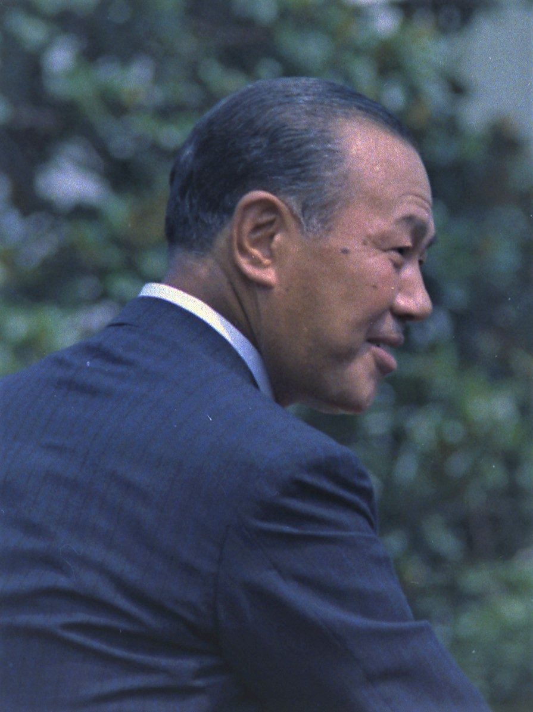
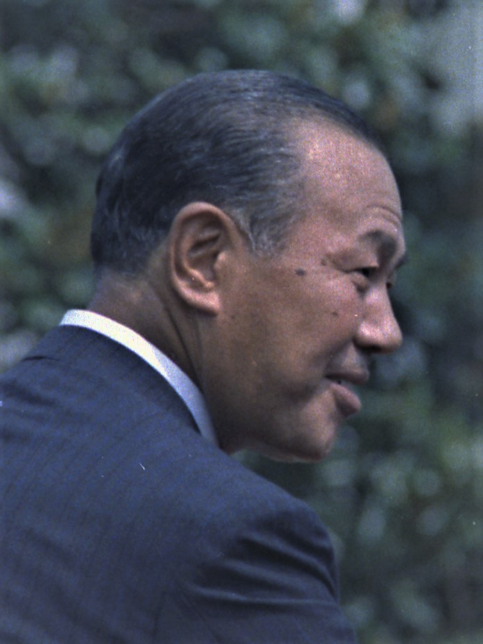
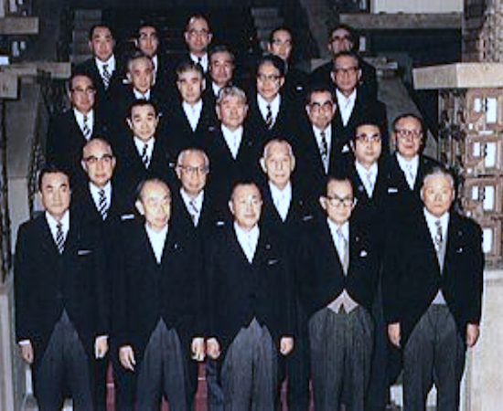

52年前の今日、1974年11月26日。田中角栄首相が、自らの金脈問題を理由に退陣を表明しました。竹下登官房長官によって読み上げられた談話は、日本中に大きな衝撃を与え、戦後政治を象徴する指導者の退陣劇として歴史に刻まれました。

## 官房長官が代読した退陣声明

1974年11月26日、首相官邸で竹下登官房長官が記者団の前に立ち、田中角栄首相の言葉を代読しました。「私個人の問題で、世間の誤解を招いたことは公人として不明、不徳のいたすところ」「私は国政の最高責任者として政治的、道義的責任を痛感しております」。自らの金脈をめぐる疑惑に決着をつけるため、政権の座を退く決断が公式に伝えられた瞬間でした。

## 「今太閤」の誕生と日本列島改造論

田中角栄は高等小学校を卒業後、土木建築の現場から身を起こし、実業家を経て政界に進出しました。その卓越した記憶力と実行力から「コンピュータ付きブルドーザー」と称され、1972年には佐藤栄作の後の自民党総裁選を制して首相に就任します。

学歴社会のなかで頂点に立った姿は「今太閤」「庶民宰相」と歓迎され、就任直後には日本列島改造論のブームを巻き起こし、日中国交正常化を成し遂げるなど国民的な支持を集めました。

*1973年の資料 — 写真: White House Photo Office / Public domain*

## 『文藝春秋』が暴いた巨大な金脈と人脈

政権への風向きが決定的に変わったのは、1974年10月9日に発売された月刊誌『文藝春秋』11月号でした。誌上では60ページに及ぶ大型特集が組まれ、立花隆による「田中角栄研究―その金脈と人脈」、そして児玉隆也による「淋しき越山会の女王」が掲載されたのです。

記事は、信濃川河川敷をめぐる土地取引などの資産形成の手法や、資金管理団体「越山会」の金庫番である佐藤昭との関係を暴き出し、田中の権力の背後にある不透明な資金の流れを白日の下に晒しました。

*1973年の資料 — 写真: White House Photo Office / Public domain*

## 海外メディアの着目と外国人記者クラブの追及

当初、田中首相はノーコメントを貫いていましたが、疑惑は国外メディアによって大きく報じられました。10月13日発売の『ニューズウィーク』をはじめ、『ボルチモアサン』や『ワシントン・ポスト』が金脈問題を相次いで報道します。

10月22日、丸の内プレスクラブで行われた外国人記者会見には約300人の記者が詰めかけました。田中の演説そっちのけで金脈問題に質問が集中し、首相は釈明に終始することになります。これが翌朝の国内各紙のトップを飾り、問題は政権を揺るがす国民的な疑惑へと拡大しました。

*1973年の資料 — 写真: 内閣官房内閣広報室 / Cabinet Secretariat Public Relations Office / CC BY 4.0*

## 内閣改造から退陣表明、そして総辞職へ

内閣支持率が急落するなか、田中首相は11月11日に内閣改造を行い、局面の打開を図りました。しかし、野党は金脈関係者の国会招致を強く要求し、追及の手を緩めませんでした。

これ以上の政権維持は困難と判断した田中は、11月26日に退陣を表明し、12月9日に内閣総辞職を行いました。後に田中ファミリー企業「新星企業」の幹部らが起訴されるなど捜査の手が伸び、田中政治の暗部はさらなる事件へと繋がっていくことになります。

## 調査報道の力と今に遺る教訓

フリージャーナリストたちが登記簿や政治資金報告書といった公開情報を徹底的に調査し、時の最高権力者を退陣に追い込んだこの出来事は、日本のメディア史と政治史に極めて大きな足跡を残しました。権力と資金をめぐる問題は、半世紀以上が過ぎた現在の政治の世界においても、決して色あせることのない重い問いを投げかけ続けています。

### 参考資料

- <https://ja.wikipedia.org/wiki/%E7%94%B0%E4%B8%AD%E8%A7%92%E6%A0%84>
- <https://commons.wikimedia.org/wiki/File:President_Gerald_R._Ford_Meeting_with_Prime_Minister_Kakuei_Tanaka_at_Akasaka_Palace_in_Tokyo,_Japan_-_NARA_-_45644155.jpg>
- <https://commons.wikimedia.org/wiki/File:Tanaka_1973.jpg>
- <https://commons.wikimedia.org/wiki/File:Tanaka_Kakuei.jpg>
- <https://commons.wikimedia.org/wiki/File:Kakuei_Tanaka_Cabinet_19731125.jpg>
