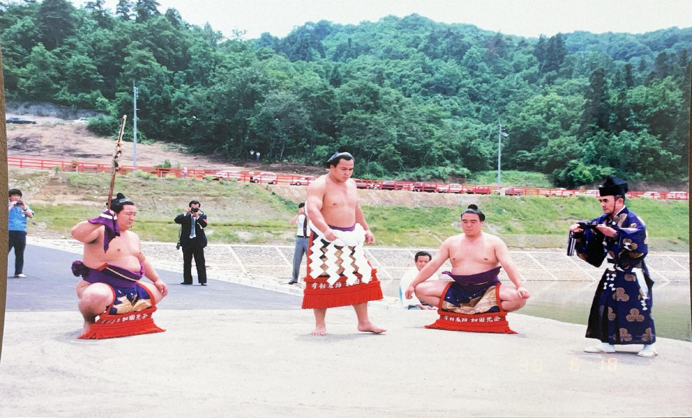
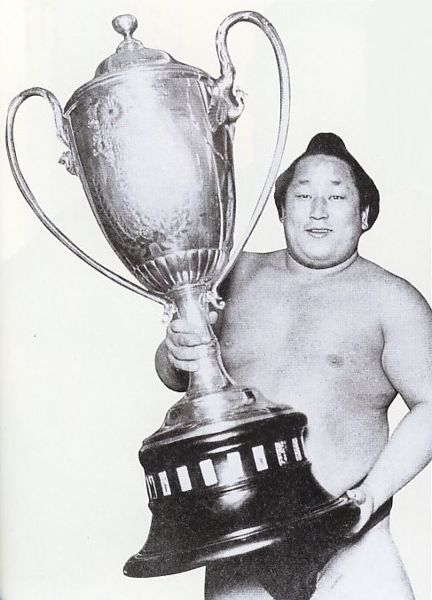
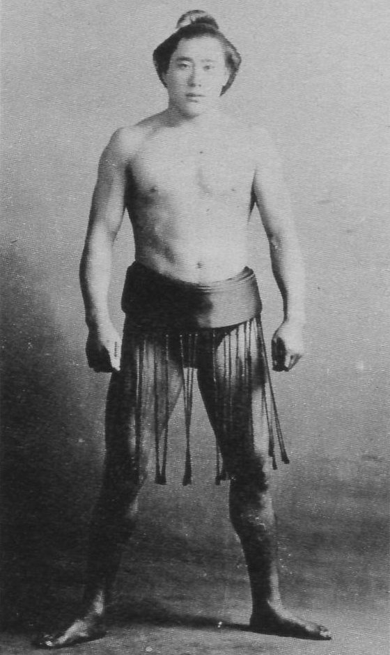

31年前の今日、1995年11月26日。福岡国際センターで行われた大相撲九州場所の千秋楽で、大関・若乃花と横綱・貴乃花による、大相撲史上初となる兄弟同士の幕内優勝決定戦が行われました。日本中を巻き込んだ「若貴ブーム」の頂点ともいえる劇的な一番は、今も語り草となっています。

## 本割では絶対に組まれない「兄弟対決」

大相撲には、同じ相撲部屋に所属する力士や、4親等以内の親族同士は本割で対戦を組まないという厳格な規則があります。二子山部屋に所属する実の兄弟である若乃花と貴乃花が土俵の上で直接顔を合わせることは、通常の本場所ではあり得ないことでした。

ふたりが対決できる唯一の可能性が、千秋楽を終えた時点で最高成績で並び、優勝決定戦に突入することでした。1993年7月場所では横綱・曙を交えた3人による優勝決定巴戦に進出したものの、曙が連勝したため直接対決は実現せず、多くの相撲ファンが「いつか土俵で激突する日」を待ち望んでいました。

## 千秋楽のドラマ、風呂場直前での急展開

1995年九州場所、兄弟はともに12勝2敗の好成績で千秋楽を迎えました。先に土俵に上がったのは兄の大関・若乃花でした。関脇・武双山との取組に敗れて12勝3敗となり、この時点で自力優勝の可能性は消滅しました。

結びの一番には12勝2敗の横綱・貴乃花が控えており、若乃花は「弟が勝つだろうから、優勝決定戦はないだろう」と確信していました。支度部屋に戻った若乃花は、すでにまわしを解いて風呂に入ろうと準備を進めていたといいます。

*山本山貯水池にて土俵入りする千代の富士 — 写真: ojiya / CC BY (Japan Search)*

## 「貴乃花も敗れた」付き人の声にあわてて締め直したまわし

ところが、結びの一番で大波乱が起きました。横綱・貴乃花が大関・武蔵丸に寄り倒されて敗れ、12勝3敗で兄と並んだのです。

風呂場へ向かおうとしていた若乃花のもとに、付き人が駆け込んできて貴乃花の敗戦を告げました。優勝決定戦が行われることになり、若乃花は驚きながらあわててまわしを締め直し、再び土俵裏の控えへと向かうことになりました。

*Tamanishiki with The Emperor's Cup — 写真: Unknown authorUnknown author / Public domain*

## がっぷり四つの攻防、右下手投げで決着

館内が異様な熱気に包まれるなか、史上初の兄弟による幕内優勝決定戦が始まりました。制限時間が一杯になり、両者が立ち合います。

若乃花が右を差し、左上手を深く引いて寄り立てました。貴乃花も懸命に残そうとしますが、若乃花が右から厳しい下手投げを繰り出すと、貴乃花は右膝から崩れ落ちました。若乃花が弟を破り、1993年3月場所以来となる2回目の幕内最高優勝を果たした瞬間でした。

*Kiyomigawa Scan10055 — 写真: Unknown authorUnknown author / Public domain*

## 「一番大好きな弟と」兄が抱いていた複雑な本音

土俵上では激しい勝負を見せた若乃花でしたが、胸中には複雑な葛藤がありました。のちにテレビ番組などで当時を振り返った花田虎上（元若乃花）は、「最悪だと思った。やりたくない。一番大好きな弟が相手になって、いつもなら憎しみを込めて行くのに、この時は無理だった。プロとして情けない」と語っています。

さらに優勝パレードのオープンカーに乗り込む前、弟に優勝賞金を半分ずつ分けようと提案して断られたという、実の兄弟ならではの率直なエピソードも明かされています。

## 史上初の兄弟横綱へ、いまも輝く平成の名勝負

この優勝を経て、若乃花は1998年に第66代横綱へ昇進を果たします。弟の貴乃花とともに、大相撲の歴史上初となる「兄弟横綱」として一時代を築き上げました。

偶然の一致と勝負の綾が重なり合って実現した、1995年11月26日の優勝決定戦。福岡の土俵で繰り広げられた若貴対決は、平成の大相撲ブームを象徴する屈指の名場面として、今もファンの記憶に鮮やかに刻まれています。

### 参考資料

- <https://ja.wikipedia.org/wiki/%E5%A4%A7%E7%9B%B8%E6%92%B2>
- <https://commons.wikimedia.org/wiki/File:Sumo-Azumafuji-Kin%27ichi-with-Emperors-Cup-c1950.png>
- <https://jmapps.ne.jp/ojiya_archive/det.html?data_id=5144>
- <https://commons.wikimedia.org/wiki/File:Tamanishiki_with_The_Emperor%27s_Cup.jpg>
- <https://commons.wikimedia.org/wiki/File:Kiyomigawa_Scan10055.JPG>
