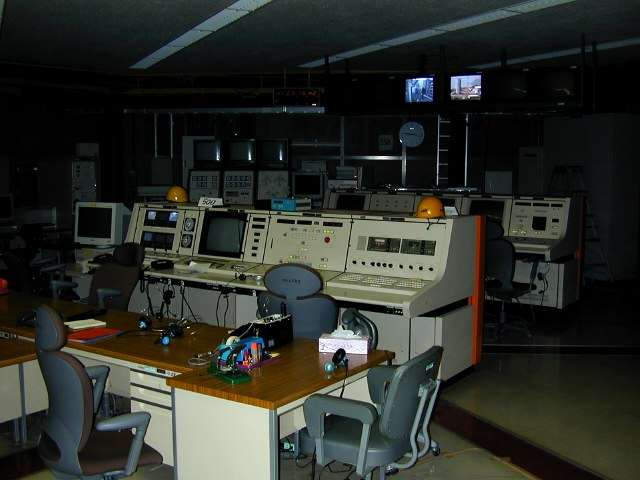
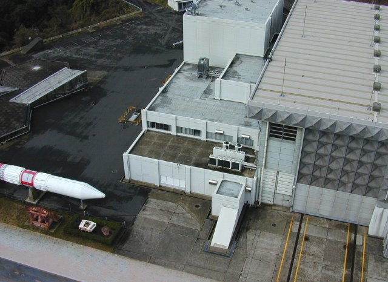
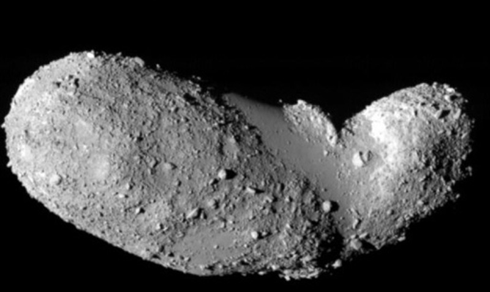

21年前の今日、2005年11月26日。日本の小惑星探査機「はやぶさ」が、地球から遠く離れた小惑星イトカワへの着陸に挑みました。地球の重力圏外にある天体の固体表面に着陸し、その岩石試料を持ち帰るという、世界初の大胆な工学実験でした。

## 幾重の変更を乗り越えて決まった目的地

はやぶさ（MUSES-C）の計画は、1980年代半ばから日本の宇宙科学者たちによって検討が重ねられてきました。当初目指していた小惑星はネレウスでしたが、探査機の重量制限から別の小惑星への変更を余儀なくされ、さらに2000年のロケット打ち上げ失敗の影響で打ち上げが延期された結果、第3の候補として選ばれたのが小惑星「1998 SF36」でした。

この天体は後に、日本のロケット開発の父と呼ばれる糸川英夫にちなんで「イトカワ」と名付けられました。長径500メートルあまり、平均半径約160メートルという極めて小さな天体であり、これまで探査機が訪れた天体の中で最も小さい部類に入りました。

## 内之浦からの旅立ちと革新のイオンエンジン

はやぶさは2003年5月9日、鹿児島県の内之浦宇宙空間観測所からM-Vロケット5号機によって打ち上げられました。目的地へ向かう主推進器として搭載されたのは、キセノンガスを燃料とするマイクロ波放電式イオンエンジン「μ10」でした。

イオンエンジンは従来の化学燃料ロケットに比べて圧倒的に少ない燃料で長時間の加速を続けることができます。はやぶさはイオンエンジンによる推進と地球の引力を利用するスイングバイを組み合わせた独自の軌道設計を駆使し、太陽の周りを巡りながらイトカワへと接近していきました。

*Bunker at Uchinoura Space Center — 写真: NASA / Public domain*

## 2005年11月26日、イトカワへの着地

2005年9月、はやぶさはついにイトカワとのランデブーに成功しました。地球からの電波が往復するのに時間がかかるため、探査機本体がカメラやセンサーの情報を頼りに自律制御で降下しなければなりませんでした。

そして11月26日、はやぶさはイトカワ表面への接地を行い、試料採取を試みました。微小重力の小惑星表面に一瞬接地し、弾丸を発射して舞い上がった岩石のかけらをカプセルに収める設計でした。着陸時の制御や機器の動作には数多くの不確定要素が伴いましたが、探査機は見事に未知の天体表面への接触を果たしました。

*Assembly building in Uchinoura Space Center — 写真: NASA / Public domain*

## 度重なる危機と奇跡の帰還劇

着陸の後、はやぶさは幾多の過酷な試練に直面しました。燃料漏れによる姿勢制御の喪失、通信途絶、バッテリーの故障、そしてイオンエンジン4基すべての機能停止という絶望的な状況が次々に襲いかかりました。

しかし、運用チームは地上からの遠隔操作と予備回路の組み合わせという知恵を絞り、奇跡的に姿勢と推進力を取り戻しました。当初2007年夏を予定していた帰還は2010年へと延期されましたが、はやぶさは満身創痍の状態で約60億キロメートルの旅を続けました。

*Itokawa06 hayabusa — 写真: ISAS, JAXA / CC BY 4.0*

## オーストラリアの夜空を照らした光と遺産

2010年6月13日、はやぶさは南オーストラリアのウーメラ砂漠上空で大気圏に再突入しました。探査機本体は激しい摩擦熱によって夜空にまばゆい光を放ちながら燃え尽き、切り離されたカプセルだけがパラシュートで無事に地上へ着地しました。

回収されたカプセルからは、イトカワ表面の岩石質微粒子が多数確認されました。地球外の天体固体表面からサンプルを持ち帰る「サンプルリターン」は世界初の快挙であり、この成功は後継機「はやぶさ2」によるさらなる探査へと受け継がれていくことになります。

### 参考資料

- <https://ja.wikipedia.org/wiki/11%E6%9C%8826%E6%97%A5>
- <https://commons.wikimedia.org/wiki/File:Mu_Rocket_Launcher_plete.jpg>
- <https://commons.wikimedia.org/wiki/File:Bunker_at_Uchinoura_Space_Center.jpeg>
- <https://commons.wikimedia.org/wiki/File:Assembly_building_in_Uchinoura_Space_Center.jpeg>
- <https://commons.wikimedia.org/wiki/File:Itokawa06_hayabusa.jpg>
