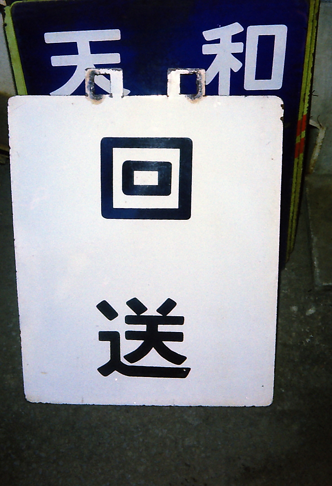
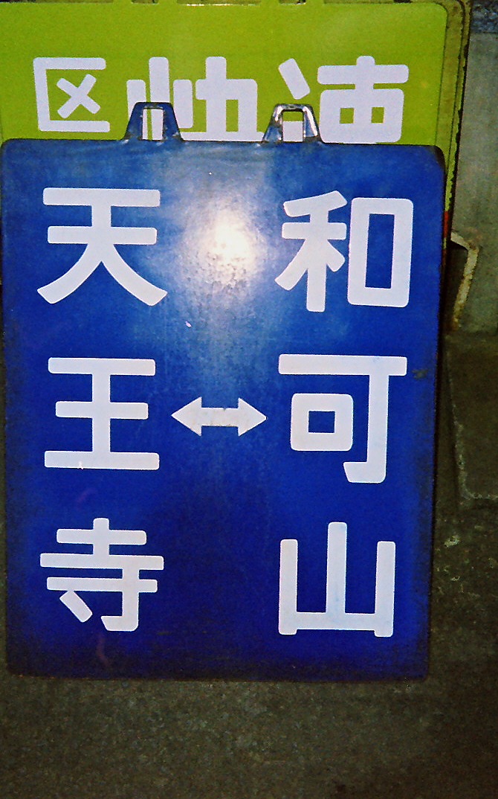
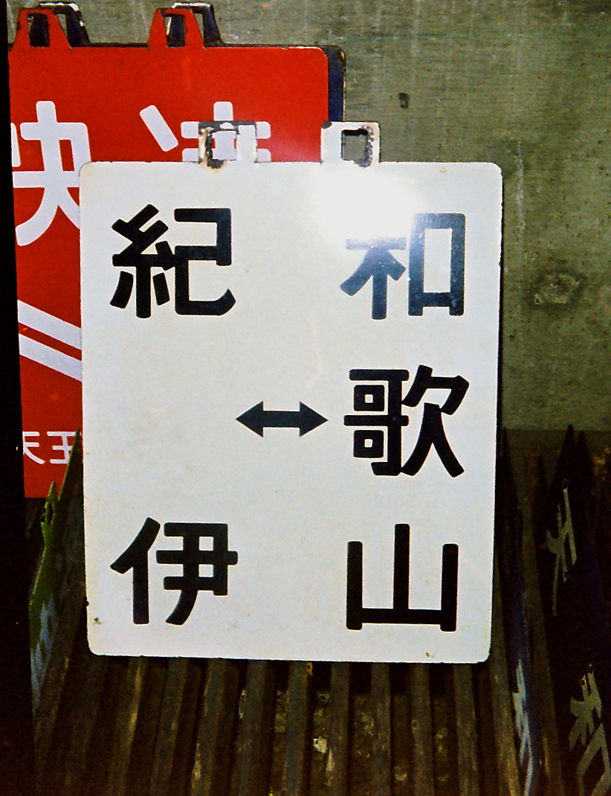

51年前の今日、1975年11月26日。日本国有鉄道（国鉄）の主要な労働組合が、ストライキを行う権利の回復を求めて全国一斉の大規模ストライキに突入しました。のちに「スト権スト」と呼ばれるこの争議は、8日間にわたって続き、通勤や物流に壊滅的な影響を与えました。

## なぜストライキ権が禁止されていたのか

戦後の1948年、GHQの意向を受けた政令201号により、公務員および公共企業体職員の争議行為は禁止されました。国鉄が1949年に独立採算制の公共企業体として発足した後も、公共企業体等労働関係法（公労法）によってストライキは法的に認められていませんでした。

その代替措置として調停や仲裁制度が設けられていましたが、政府が財政難を理由に仲裁裁定の実施を見送る事例が相次ぎました。これにより、現場の労働組合は次第に不満を募らせ、「順法闘争」や職場集会などを通じた実質的な抗議行動を繰り返すようになっていきました。

## 深まる対立と「スト権奪還」への道

1964年に国鉄の経営収支が赤字へ転落すると、当局は合理化を推し進め、これに反発する組合側との間で激しい対立が生まれました。組合が争議を起こせば当局が大量処分を行い、組合はさらにその処分撤回を求めて闘争を行うという悪循環に陥っていたのです。

1974年の春闘では、政府と労組の間でスト権問題の結論を速やかに出すという合意が交わされ、1975年秋が問題解決の山場と見なされていました。三木武夫内閣のもとで設置された閣僚協議会や専門委員懇談会で議論が重ねられましたが、世論調査では国鉄へのスト権付与反対が過半数を占めるなど、議論は難航していました。

*阪和線 行先標01 — 写真: Gohachiyasu1214 / CC BY-SA 4.0*

## 11月26日、全国の鉄道が一斉に停止

1975年11月26日、公労協は要求が受け入れられないとして、ついに全面ストライキへと踏み切りました。同日発表された閣僚協議会の答申は、経営形態の抜本的見直しを優先すべきだとするもので、スト権の即時付与を事実上退ける内容でした。

スト突入初日、国鉄が運行できた旅客列車は全体の約3パーセント、わずか660本に過ぎませんでした。1日に約5100本運行されていた貨物列車もほぼ全面的に運休し、列島を縦断する物流網は完全に遮断されました。駅の改札口は閉ざされ、静まり返ったホームが全国で報じられました。

*阪和線 行先標02 — 写真: Gohachiyasu1214 / CC BY-SA 4.0*

## 麻痺する都市交通とサラリーマンの苦闘

国鉄への依存度が高かった大都市圏では、朝から記録的な混乱が生じました。首都圏では国鉄線の利用客が並行する大手私鉄や地下鉄へと殺到しました。朝のラッシュ時、京王井の頭線では通常の7割増、東急東横線では6割増、営団地下鉄銀座線でも5割から6割増という激しい混雑が記録されました。

さらに東京都交通局の労組による支援ストが重なり、都営地下鉄や都営バスが運休したことで、都内だけでも500万人以上の足が奪われました。横浜や名古屋、京都、神戸など全国主要都市でも同様の支援ストが行われ、会社近くの旅館に泊まり込むサラリーマンや、徒歩で長距離を通勤する人々の姿が日常となりました。

*阪和線 行先標03 — 写真: Gohachiyasu1214 / CC BY-SA 4.0*

## 8日間の結末と国鉄分割民営化への転換点

当初の計画を越えて長期化したストライキでしたが、政府側は違法ストに対して妥協しない姿勢を崩しませんでした。長引く運休に対する国民の怒りは激しさを増し、世論の強い反発を受けた公労協は、12月3日に至ってストの中止を余儀なくされました。

要求を何一つ勝ち取れずに終わったスト権ストは、結果として労働組合側の完全な敗北となりました。利用者の激しい失望と不信感を招いたことで「国鉄離れ」が加速し、赤字経営は一段と深刻化していきました。この大混乱は、1987年4月に行われる国鉄の分割民営化、すなわち現在のJRグループ誕生へとつながる最大の契機となったのです。

### 参考資料

- <https://ja.wikipedia.org/wiki/%E3%82%B9%E3%83%88%E6%A8%A9%E3%82%B9%E3%83%88>
- <https://commons.wikimedia.org/wiki/File:%E5%9B%BD%E9%89%84DD50%E5%BD%A2%E3%83%87%E3%82%A3%E3%83%BC%E3%82%BC%E3%83%AB%E6%A9%9F%E9%96%A2%E8%BB%8A.jpg>
- <https://commons.wikimedia.org/wiki/File:%E9%98%AA%E5%92%8C%E7%B7%9A_%E8%A1%8C%E5%85%88%E6%A8%9901.jpg>
- <https://commons.wikimedia.org/wiki/File:%E9%98%AA%E5%92%8C%E7%B7%9A_%E8%A1%8C%E5%85%88%E6%A8%9902.jpg>
- <https://commons.wikimedia.org/wiki/File:%E9%98%AA%E5%92%8C%E7%B7%9A_%E8%A1%8C%E5%85%88%E6%A8%9903.jpg>
