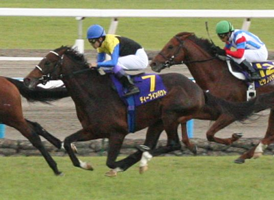
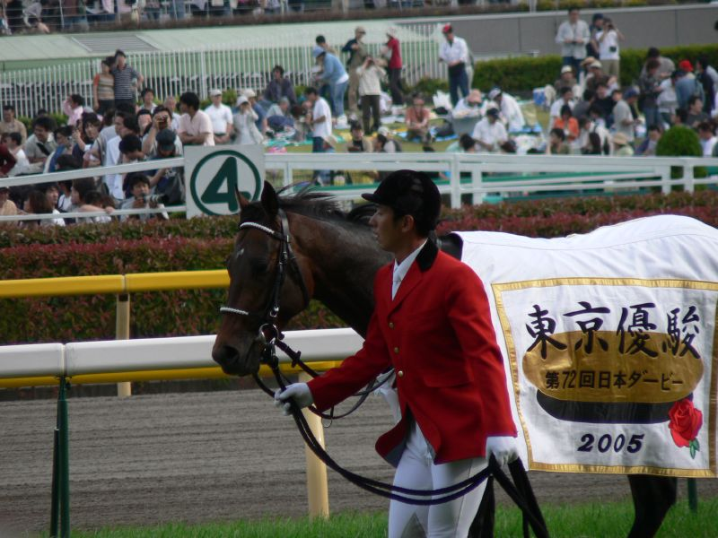
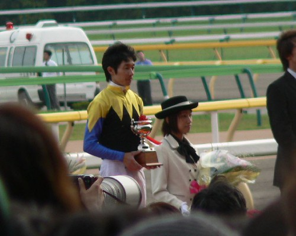

20年前の今日、2006年11月26日。東京競馬場で第26回ジャパンカップが開催され、武豊騎乗のディープインパクトが見事な勝利を飾りました。国内外の強豪が集まる国際舞台で圧倒的な強さを見せつけたその走りは、多くの競馬ファンの胸に深く刻まれています。

## 7000万円の落札から始まった伝説

ディープインパクトは2002年3月25日、北海道早来町のノーザンファームで誕生しました。父は偉大な種牡馬サンデーサイレンス、母はウインドインハーヘアです。0歳時のセレクトセールに上場された際、馬体が薄かったこともあり、上場されたサンデーサイレンス産駒14頭の中で9番目の価格となる7000万円で金子真人に落札されました。金子氏は「瞳の中に吸い込まれそうな感覚に襲われた」と語り、多くの人々に強い衝撃を与える馬になってほしいという願いを込めて「ディープインパクト」と命名しました。

育成時代から小柄ながら抜群の柔軟性を示し、2004年に栗東トレーニングセンターの池江泰郎厩舎に入厩しました。初めて調教でタイムを計った際、指示よりもはるかに速い好時計を叩き出しながら息一つ乱さず涼しい顔をしていたことから、関係者を驚かせました。デビュー戦を前に初めて手綱を取った武豊騎手も、その背中の感触に「この馬、ちょっとやばいかも」と興奮を隠せなかったといいます。

## 「走っているというより、飛んでいる」無敗の三冠達成

2004年12月の新馬戦を圧勝したディープインパクトは、年が明けた2005年のクラシック戦線で破竹の快進撃を続けます。皐月賞ではスタート直後に落馬寸前の体勢を崩すアクシデントがありながら、直線で豪快に差し切って完勝。レース後、武豊騎手は「走っているというより、飛んでいるような感じ」と語り、その表現は一躍流行語となりました。

続く東京優駿（日本ダービー）では14万人を超える観衆が東京競馬場に詰めかける中、レースレコードタイの快時計で5馬身差の圧勝を飾りました。そして秋の菊花賞でも単勝オッズ1.0倍の圧倒的支持に応えて勝利。1984年のシンボリルドルフ以来、日本競馬史上2頭目となる無敗でのクラシック三冠を達成し、関西テレビの馬場鉄志アナウンサーによる「世界のホースマンよ見てくれ、これが日本近代競馬の結晶だ」という名実況とともに語り継がれることとなりました。

*事件当時の写真ではありません · 2003年 — 写真: Goki / CC BY-SA 3.0*

## 初黒星の悔しさと世界一への飛翔

三冠達成の直後、2005年末の有馬記念ではハーツクライの2着に敗れ、デビュー8戦目にして初めての黒星を喫しました。武豊騎手は「今日は飛ぶような走りではなかった」と悔しさを滲ませましたが、英雄の挑戦はそこで終わりませんでした。

古馬となった2006年、ディープインパクトはさらなる成長を遂げます。阪神大賞典、天皇賞（春）、宝塚記念と国内のビッグレースを連勝。この年には日本調教馬として史上初めて、芝部門・長距離部門で世界ランキング1位に選出される快挙を成し遂げました。

*Deep Impact 003 — 写真: Flickr user nakashi / CC BY-SA 2.0*

## 2006年11月26日、ジャパンカップの衝撃

迎えた2006年11月26日、第26回ジャパンカップ。東京競馬場の芝2400メートルに、国内外の実力馬たちが顔を揃えました。多くのファンが固唾をのんで見守る中、ディープインパクトは武豊騎手とともにゲートインしました。

道中は後方でしっかりと折り合いをつけ、最後の直線へ。大外に持ち出されたディープインパクトは、武豊騎手のゴーサインに応えてまさに「飛ぶような」末脚を爆発させました。他馬を一気に抜き去ると、影をも踏ませぬ走りで先頭でゴール板を駆け抜けました。東京競馬場を揺るがした万雷の拍手と歓声は、日本が誇る最強馬への最大の賛辞でした。

*Japanese Derby Winning Jockey: Yutaka Take — 写真: nakashi / CC BY-SA 2.0*

## 「世界に追いつけ」から始まったジャパンカップの歴史

ジャパンカップは、1981年に「世界に通用する強い馬づくり」を目指して創設された日本初の国際GI競走です。創設当初の10年間は外国からの招待馬が8勝を挙げ、日本馬はカツラギエースとシンボリルドルフの2勝にとどまり、「日本馬は海外の強豪に永遠に勝てないのではないか」とまで囁かれていました。

しかし、日本の競馬関係者たちのたゆまぬ努力により、徐々に日本馬が互角以上に渡り合えるようになり、2000年代以降は日本馬の勝利が定着していきました。ディープインパクトが制した第26回大会は、まさに日本競馬が世界の頂点に立ったことを象徴する歴史的な転換点となったのです。

## 受け継がれる血統と世界初の偉業

現役引退後、ディープインパクトは種牡馬としても空前絶後の成功を収めました。2012年から2022年まで11年連続で日本のリーディングサイアーに輝き、日本のみならずイギリス、フランス、アイルランドの4カ国でダービー馬を輩出。国内クラシック競走で歴代最多の24勝を挙げました。

2020年には産駒のコントレイルが無敗でクラシック三冠を達成し、世界初となる「父子2世代での無敗三冠」という不滅の金字塔を打ち立てました。2019年に世を去った英雄の血は、今も世界中の競馬場で脈々と息づいています。

### 参考資料

- <https://ja.wikipedia.org/wiki/%E3%82%B8%E3%83%A3%E3%83%91%E3%83%B3%E3%82%AB%E3%83%83%E3%83%97>
- <https://commons.wikimedia.org/wiki/File:Deep_Impact_001.jpg>
- <https://commons.wikimedia.org/wiki/File:Deep_Impact(horse)_20051023_3.jpg>
- <https://commons.wikimedia.org/wiki/File:Deep_Impact_003.jpg>
- <https://www.flickr.com/photos/81497476@N00/16201506>
