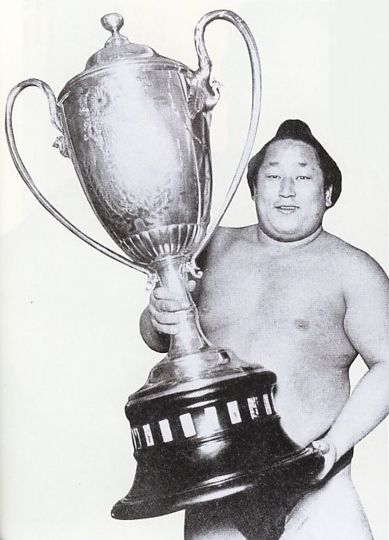
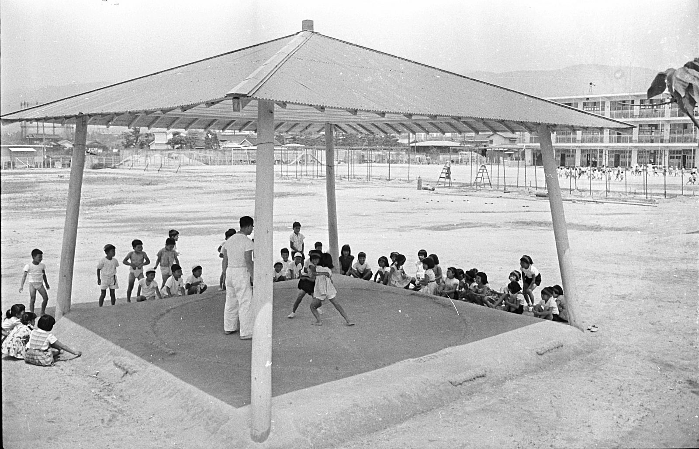
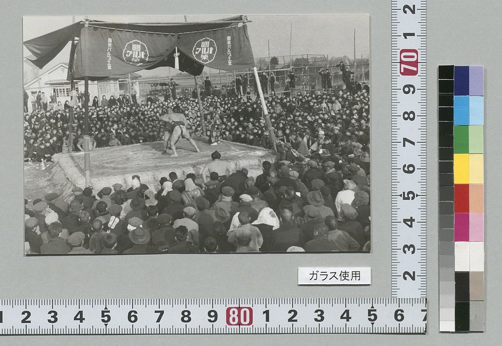

37年前の今日、1989年11月26日。大相撲11月場所の千秋楽で、大関・小錦が念願の幕内初優勝を果たしました。外国出身力士による幕内最高優勝は、1972年7月場所の高見山以来、実に17年ぶり史上2人目の快挙でした。昭和から平成へと移り変わった節目の年に、大相撲の歴史を塗り替える瞬間が訪れたのです。

## 5000円札1枚を手に海を渡った少年時代

サモアからの移民の家庭に生まれ、ハワイで育った小錦は、敬虔な両親のもとで厳しく育てられました。高校時代はアメリカンフットボール部の主将を務め、パワーリフティングではスーパーヘビー級の州王者になるなど抜群の運動能力を誇り、将来は大学に進んで弁護士を目指していました。転機となったのは1982年5月、ホノルルを訪れた高見山からの熱心な勧誘でした。泣いて反対する母を説得し、同年6月に来日。成田空港に降り立った小錦の手荷物は、服と聖書、家族の写真、そして母が持たせてくれた5000円札1枚だけでした。

## 体重計を2台並べた新弟子検査と厳しい稽古の日々

1982年7月場所で初土俵を踏んだ小錦ですが、入門時の新弟子検査から規格外の存在でした。当時の体重計は150キロまでしか測れず目盛を振り切ってしまったため、急遽2台を用意して片足ずつ乗せ、「105キロ＋70キロ」の175キロと記録されたという逸話が残っています。入門後は高砂親方（元横綱・朝潮）から徹底的に押し相撲の基礎を叩き込まれました。言葉や文化の違いに戸惑い、兄弟子からの厳しい仕打ちに遭いながらも、小錦はその悔しさを土俵の稽古で相手を圧倒することで跳ね返していきました。

*Tamanishiki with The Emperor's Cup — 写真: Unknown authorUnknown author / Public domain*

## 横綱を連破した「黒船来航」と選手生命を脅かす大怪我

1984年7月場所で新入幕を果たすと、翌9月場所には前頭6枚目の地位で千代の富士と隆の里の両横綱から初金星を奪い、12勝3敗で殊勲賞と敢闘賞を受賞。「黒船来航」「小錦旋風」と呼ばれ、角界に衝撃を与えました。200キロを超える巨体でありながら素早い出足と強烈な突き押しを誇り、一気に大関候補へと名乗りを上げます。しかし大関昇進を懸けた1986年5月場所、ライバルの北尾との取組で鯖折りを受け、右膝の靱帯損傷と骨折という致命的な大怪我を負ってしまいます。

*香櫨園小学校 : 土俵場ができる — 写真: 西宮市 : ニシノミヤシ / CC BY (Japan Search)*

## 平幕転落の挫折から掴み取った外国出身初の大関昇進

2場所連続休場を余儀なくされた小錦は平幕へと転落し、大関への道は完全に振り出しに戻りました。大相撲史上最重量となったその身体は、完治しない右膝への大きな負担となり、好不調の波に苦しむ日々が続きます。それでも小錦は腐ることなく土俵へ上がり続け、不屈の精神で這い上がっていきました。1986年9月場所に12勝を挙げて三役に復帰すると、白星を積み重ねて1987年には外国出身力士として史上初となる大関昇進を果たしました。

*高砂部屋の力士が大相撲（越ケ谷中） — 写真: ndl / CC BY (Japan Search)*

## 1989年11月26日、17年ぶりに鳴り響いた歓声

大関昇進後も膝の故障と闘いながら土俵を務めていた小錦に、最高の瞬間が訪れたのが1989年11月場所でした。初日から力強い押し相撲で勝ち進み、迎えた千秋楽のこの日、ついに悲願であった幕内最高優勝を掴み取ったのです。外国出身力士の優勝は、かつて自身をスカウトし相撲の道を開いてくれた師匠格の高見山が1972年に達成して以来、17年ぶり2人目となる歴史的瞬間でした。表彰式で授与された重い天皇賜杯を抱きかかえる小錦の姿は、日本中のファンの胸を打ちました。

## 曙や武蔵丸へ受け継がれた国際化のバトン

小錦が切り拓いた道は、大相撲の新たな時代の幕開けとなりました。1990年代に入ると、同じハワイ出身の曙や武蔵丸が相次いで横綱へと昇進し、若乃花や貴乃花らとともに大相撲の黄金期を築き上げていくことになります。自らの怪我や困難を乗り越え、不屈の闘志で掴み取った小錦の初優勝は、伝統ある国技が広く世界へと扉を開く大きな礎となったのです。

### 参考資料

- <https://ja.wikipedia.org/wiki/%E5%A4%A7%E7%9B%B8%E6%92%B2>
- <https://commons.wikimedia.org/wiki/File:Sumo-Azumafuji-Kin%27ichi-with-Emperors-Cup-c1950.png>
- <https://commons.wikimedia.org/wiki/File:Tamanishiki_with_The_Emperor%27s_Cup.jpg>
- <https://adeac.jp/nishinomiya-city/catalog/0100000887>
- <https://adeac.jp/koshigaya-city-digital-archives/catalog/mp213310-200011>
