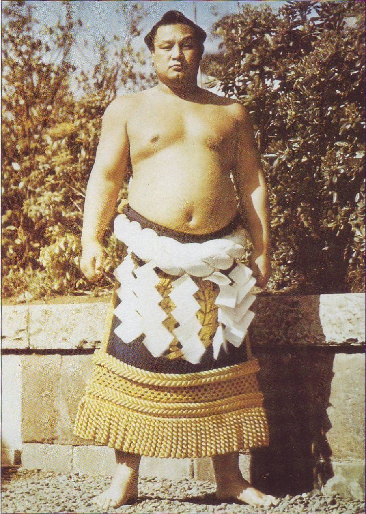
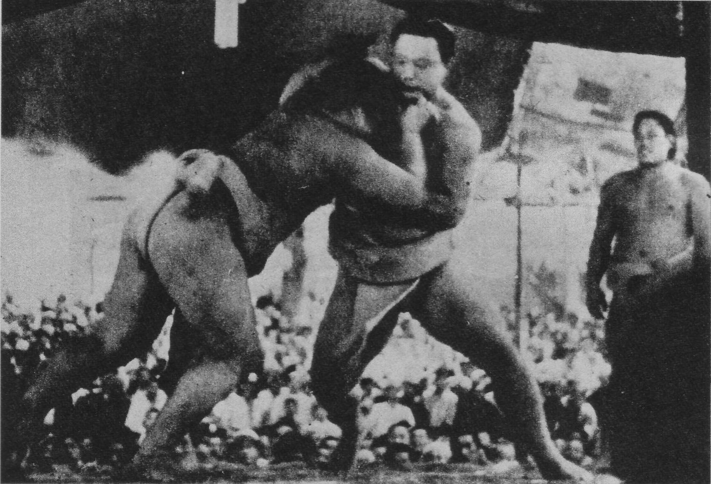
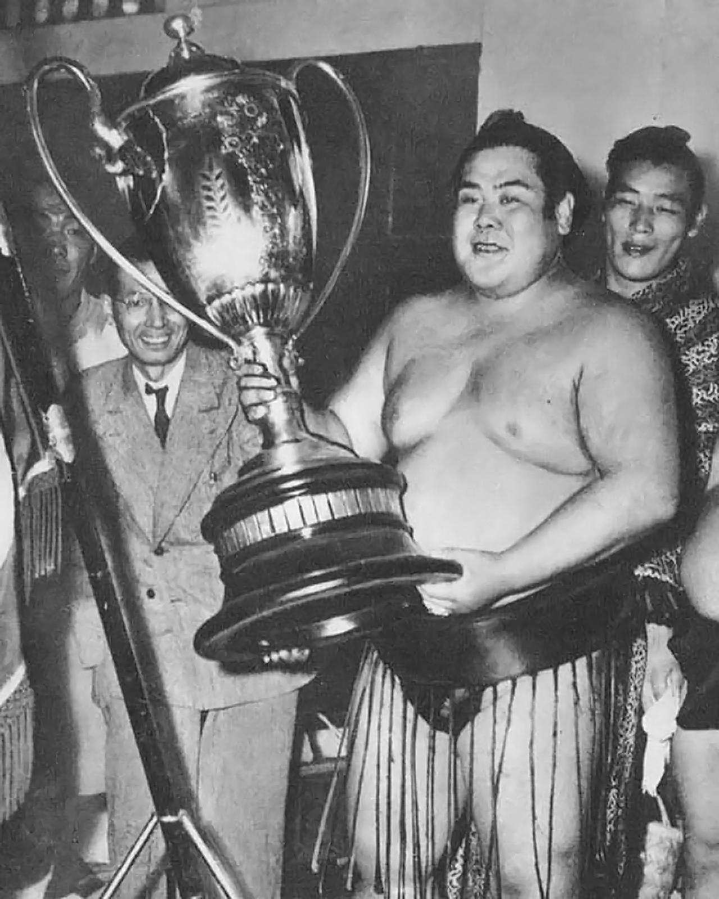

38年前の今日、1988年11月27日。大相撲九州場所の千秋楽結びの一番で、横綱・千代の富士の連勝記録が「53」でストップしました。前日に通算26回目の幕内最高優勝を決めていた大横綱の敗戦に、日本中が大きなどよめきに包まれました。昭和の大横綱・双葉山の69連勝に迫る大記録は、なぜこの日、どのようにして途切れたのでしょうか。

## 北海道から角界へ、「ウルフ」と呼ばれた力士の原点

千代の富士（本名・秋元貢）は1955年6月1日、北海道松前郡福島町の漁師の家に生まれました。幼少期から漁業を手伝って足腰を鍛え、福島中学校時代は陸上競技部で走り高跳び1メートル62、三段跳び12メートル58を記録するなど抜群の運動神経を誇っていました。相撲は大嫌いでしたが、中学1年生の盲腸炎の手術をきっかけに九重親方（元横綱・千代の山）から熱心に勧誘され、「飛行機に乗せてあげる」という言葉に惹かれて入門を決意しました。

1970年9月場所に初土俵を踏み、1974年11月場所には19歳5か月で十両に昇進し、史上初となる五文字四股名の関取となりました。ちゃんこ番で魚をさばく姿から「ウルフ」の愛称がつき、気性の激しい取り口で頭角を現していきます。しかし、幕下時代から度重なる左肩の脱臼に苦しめられ、一時は幕下まで番付を落とす挫折も味わいました。その苦難を強靱な筋力トレーニングで克服し、第58代横綱へと登りつめたのです。

## 夏場所から始まった快進撃と「53連勝」の軌跡

千代の富士の驚異的な連勝劇が始まったのは、1988年の夏場所7日目でした。ここから千代の富士は圧倒的な強さを見せ、秋場所、そして11月の九州場所にかけて白星を積み重ねていきました。大相撲の本場所は1958年以降、1年に6場所、1場所15日間で行われる制度が定着しています。その年6場所制の歴史において、これほど長く勝ち続けた力士は誰一人として存在しませんでした。

土俵を見つめる日本中が注目したのは、昭和戦前に双葉山が打ち立てた不滅の記録「69連勝」にどこまで迫れるかという点でした。千代の富士は九州場所14日目にも勝利を収め、通算26回目の幕内最高優勝を千秋楽を待たずに自らの手で確定させました。この時点で連勝は「53」に達し、双葉山に次ぐ歴代2位の連勝記録となっていました。千秋楽の結びの一番に勝てば、全勝優勝とともにさらなる大記録への道が開かれるはずでした。

*Futabayama Color Photo 1940 Scan10003 — 写真: Unknown authorUnknown author / Public domain*

## 1988年11月27日、九州場所千秋楽結びの一番

迎えた1988年11月27日、九州場所千秋楽。土俵の進行は終盤を迎え、午後5時頃の「これより三役」の揃い踏みを経て、いよいよ最後の「結びの一番」がやってきました。電光掲示板に両力士の赤いランプが点灯し、東方と西方から土俵に上がったのは、千代の富士と同じく横綱の地位にあった大乃国でした。

大相撲の最高位である横綱同士の対決に、満員の観客席は異様な熱気に包まれました。行司の掛け声とともに両者が激しく立ち合いましたが、勝負の軍配は大乃国に上がりました。千代の富士は大乃国に敗れ、同年夏場所7日目から半年以上にわたって続いていた連勝記録は、ついに「53」でストップしたのです。勝負が決した瞬間、館内には大きなどよめきが走りました。

*Futabayama in keiko Scan10053 — 写真: Unknown authorUnknown author / Public domain*

## 横綱という最高位の重みと土俵の誇り

大相撲において「横綱」とは、力士の最高位であり、神の依り代としての品格と抜群の力量が求められる特別な存在です。1791年に第11代将軍・徳川家斉の上覧相撲で谷風と小野川が土俵入りを披露したことに始まるとされ、明治時代を経て番付上の正式な最高地位となりました。横綱には月給300万円が支給され、単独での土俵入りや専用の付け人など破格の待遇が与えられますが、その一方で大関以下へ降格することは許されず、力量が衰えれば自ら引退を決断しなければならない厳しい責任を背負っています。

千代の富士の連勝を止めた大乃国もまた、そうした横綱としての重責を背負って土俵に上がっていました。前日に優勝を決めていた千代の富士に対し、横綱の意地を見せて立ちはだかった大乃国の勝利は、最高位に立つ力士たちの誇りが激突した結果でもありました。大一番を終えた土俵の上では弓取式が行われ、昭和最後となる九州場所の全日程が幕を閉じました。

*Sumo-Azumafuji-Kin'ichi-with-Emperors-Cup-c1950 — 写真: Unknown authorUnknown author / Public domain*

## 昭和から受け継がれる大相撲の金字塔

千代の富士が残した「53連勝」という記録は、今もなお年6場所制（1958年以降）において破られていない歴代最多記録として大相撲の歴史に燦然と輝いています。双葉山の69連勝に次ぐ歴代2位という数字は、過密な本場所の日程と厳しい土俵の中で打ち立てられた驚異的な金字塔でした。

小兵ながら不屈の闘志で土俵に君臨した「ウルフ」千代の富士と、その連勝に終止符を打った大乃国。1988年11月27日の結びの一番は、昭和という時代が幕を下ろす直前に相撲史に深く刻まれた、屈指の名勝負として語り継がれています。

### 参考資料

- <https://ja.wikipedia.org/wiki/11%E6%9C%8827%E6%97%A5>
- <https://commons.wikimedia.org/wiki/File:Futabayama_defeated.jpg>
- <https://commons.wikimedia.org/wiki/File:Futabayama_Color_Photo_1940_Scan10003.JPG>
- <https://commons.wikimedia.org/wiki/File:Futabayama_in_keiko_Scan10053.JPG>
- <https://commons.wikimedia.org/wiki/File:Sumo-Azumafuji-Kin%27ichi-with-Emperors-Cup-c1950.png>
