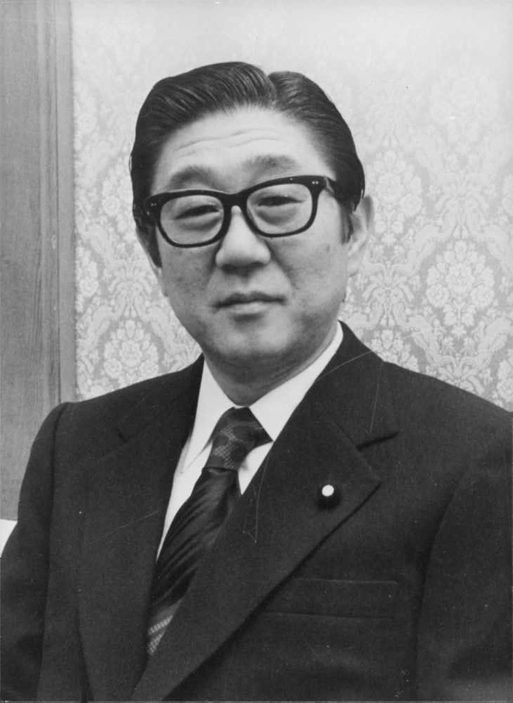
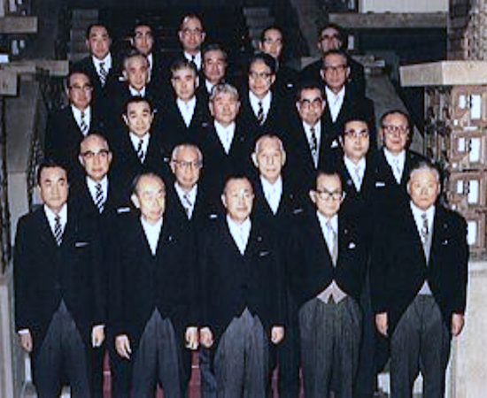
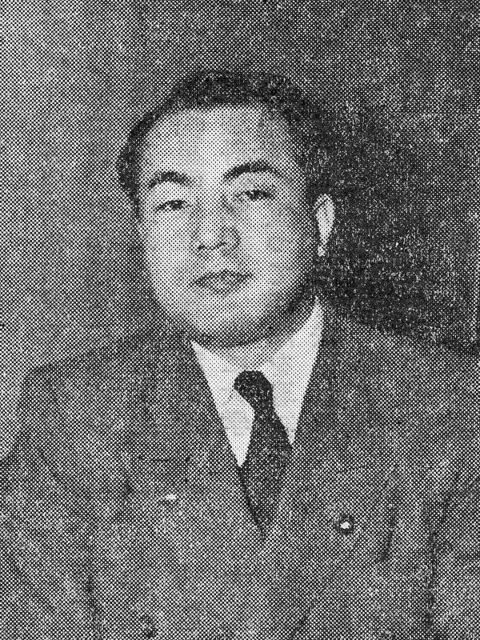

44年前の今日、1982年11月27日。自由民主党総裁の中曽根康弘が第71代内閣総理大臣に任命され、第1次中曽根内閣が正式に発足しました。

## 鈴木善幸の退陣と「闇将軍」の影

1982年秋、鈴木善幸首相の突然の退陣表明を受けて行われた自民党総裁選を制し、首相の座を射止めたのが中曽根康弘でした。中曽根は「戦後政治の総決算」を掲げて意気揚々と登板しましたが、その権力獲得の背景には自民党最大派閥を率いる田中角栄の強力な後押しがありました。

当時、田中角栄はロッキード事件で受託収賄罪などに問われ、刑事被告人として法廷闘争を続けていました。自民党の党籍を離れていたものの、100人を超える議員集団「木曜クラブ（田中派）」を従え、「闇将軍」として党内や政界全体に絶大な影響力を誇っていたのです。

## 異例の布陣、田中派から7人が入閣

11月27日に発表された組閣人事は、政界や世論に強い衝撃を与えました。内閣の大番頭であり総理の女房役とされる内閣官房長官には、通常なら首相の出身派閥から選ぶという慣例を破り、田中派の幹部である後藤田正晴が就任しました。

それだけにとどまらず、ロッキード裁判の検察側方針に批判的な立場を取っていた秦野章をわざわざ法務大臣に起用。閣僚20人のうち田中派からは実に7人が送り込まれ、重要ポストを同派が掌握する形となりました。

*1982年の資料 — 写真: Camera Press / Public domain*

## 飛び交う蔑称と支持率3割台の船出

この露骨ともいえる配慮に対し、野党やメディアは激しく反発しました。社会民主連合の楢崎弥之助が「中曽根内閣の上に田の字を付けて、田中曽根内閣」と皮肉ったのをはじめ、前代の大平内閣や鈴木内閣が「角影内閣」と呼ばれたのをもじって、田中の影響力がより直接的になったという意味で「直角内閣」とも呼ばれました。

ほかにも「風見鶏内閣」「ロッキードシフト内閣」「田中丸抱え内閣」など、前例がないほど数多くの蔑称がつけられました。新内閣発足時に恒例の「ご祝儀相場」はまったく見られず、世論調査の内閣支持率は3割台という、政権発足時としては異例の低水準を記録する波乱のスタートとなったのです。

*Kakuei Tanaka Cabinet 19731125 — 写真: 内閣官房内閣広報室 / Cabinet Secretariat Public Relations Office / CC BY 4.0*

## 総選挙の惨敗と長期政権への転換

発足翌年の1983年10月、東京地裁で田中角栄元首相に懲役4年の実刑判決が下されると、政界は激震に見舞われました。中曽根首相は衆議院を解散しましたが、同年12月の第37回衆議院議員総選挙で自民党は大敗を喫し、文部大臣や防衛庁長官など現職閣僚3人が落選する事態に追い込まれました。

しかし、中曽根は新自由クラブとの連立政権を組むことで危機を乗り切ります。当初は短命政権に終わると見られていたものの、行政改革の推進や外交舞台での存在感発揮により徐々に国民の支持を回復していきました。

*Nakasone Yasuhiro (before 1955) — 写真: 躍進群馬信交会 / Public domain*

## バブルの源流と昭和政治の記憶

第1次中曽根内閣の政策は、のちの日本社会にも大きな影響を与えました。政権は都市再開発を促進するため「アーバンルネッサンス計画」を立ち上げ、都心部を中心とする容積率の大幅な規制緩和に踏み切りました。この政策は民間活力の導入として歓迎された反面、その後の地価高騰を招き、バブル経済へとつながる根源的な要因の一つになったとも指摘されています。

派閥の数の論理が前面に出た1982年11月27日の組閣劇は、金権政治への批判と政権維持の現実がせめぎ合った、昭和政治の象徴的な断面として今も記憶されています。

### 参考資料

- <https://ja.wikipedia.org/wiki/%E7%AC%AC1%E6%AC%A1%E4%B8%AD%E6%9B%BD%E6%A0%B9%E5%86%85%E9%96%A3>
- <https://commons.wikimedia.org/wiki/File:(Wooden_structure_in_pond_outside_Sh%C5%8Dkintei_in_Katsura_Imperial_Villa,_Japan)_-_DPLA_-_4dae02e5e8d1dd21841f166bee7d9aec.jpg>
- <https://commons.wikimedia.org/wiki/File:Shintar%C5%8D_Abe_1982.jpg>
- <https://commons.wikimedia.org/wiki/File:Kakuei_Tanaka_Cabinet_19731125.jpg>
- <https://commons.wikimedia.org/wiki/File:Nakasone_Yasuhiro_(before_1955).jpg>
