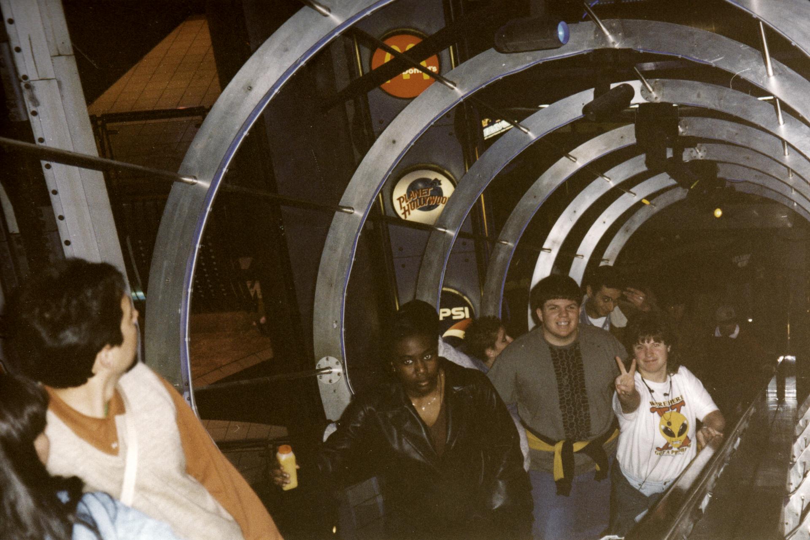
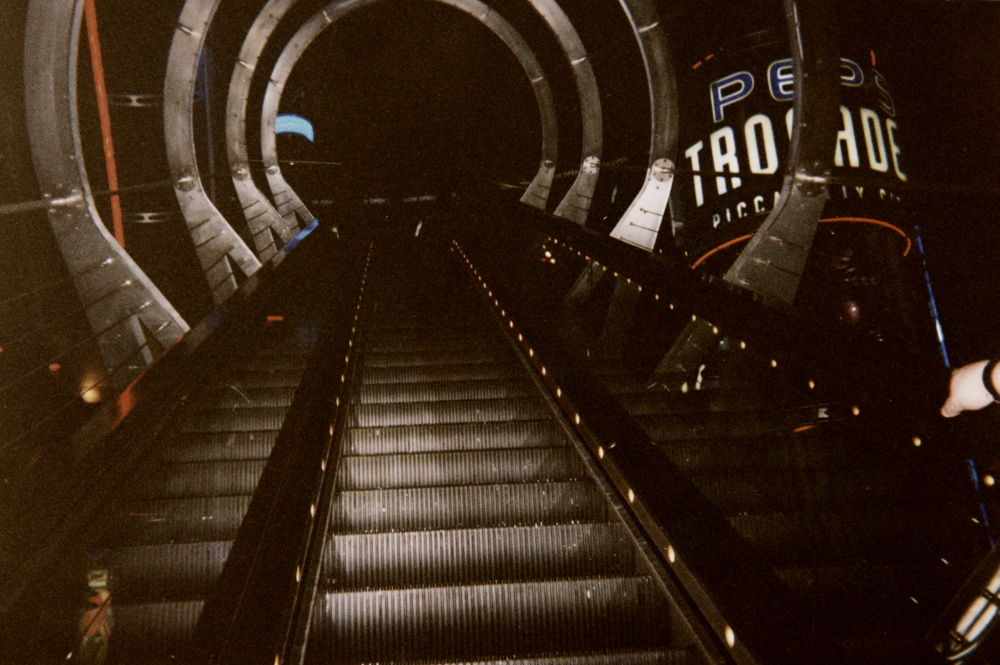

28年前の今日、1998年11月27日。セガ・エンタープライゼス（現・セガ）が、社運を賭けて開発した家庭用ゲーム機「ドリームキャスト」を日本国内で発売しました。ソニーの「プレイステーション」に奪われたシェアを奪還すべく送り出されたこのマシンは、先進的なインターネット通信機能を標準搭載し、時代の先を行く設計で登場しました。

## 劣勢を覆すために立ち上がった次世代プロジェクト

1990年代半ば、家庭用ゲーム市場ではソニー・コンピュータエンタテインメントの「プレイステーション」が圧倒的な強さを誇っていました。セガは前世代機である「セガサターン」で対抗したものの苦戦を強いられ、劣勢に立たされていました。この状況を打破するため、セガは1996年頃から新たな次世代機の開発に着手しました。

開発コードネームは「KATANA」。ライバルを倒して勝利をつかむという願いが込められていました。日立製作所が新開発した高性能CPU「SH-4」や、イギリスのビデオロジック社と日本電気半導体部門が共同開発したグラフィックスチップ「パワーブイアールツー」を採用。さらに米マイクロソフトと共同開発した基本ソフト「ウィンドウズCE」のカスタマイズ版に対応し、モデムを標準装備して本格的なインターネット接続を可能にするなど、まさに社運を賭けた最先端の仕様が詰め込まれました。

## 湯川専務のCM旋風と、立ちはだかった供給不足

1998年5月に正式発表されると、セガはかつてない規模の宣伝戦略を展開しました。専務執行役員の湯川英一が自ら出演し、子どもたちから「セガなんてだっせーよな、プレステのほうが面白いもん」と言われて落ち込む自虐的なテレビコマーシャルはお茶の間で大反響を呼び、「湯川専務」の知名度は急上昇しました。

ところが、本体の発売前から致命的な懸案が生じていました。グラフィックスチップ「パワーブイアールツー」の開発遅延に加え、製造ラインでの歩留まりが上がらず、十分な量のチップを確保できなかったのです。この影響で、当初1998年11月20日に予定されていた発売日は27日へと1週間延期され、事前予約キャンペーンも急遽取りやめとなるなど、「売りたくても売る物がない」という極めて苦しい立ち上がりを強いられました。

*事件当時の写真ではありません · 1998年 — 写真: Jane Schumin / CC BY-SA 3.0*

## 即日完売の熱狂と、解消されないソフト不足

11月27日の発売日当日、初回出荷分は宣伝効果も手伝って即日完売を記録しました。しかし、初期の出荷台数は当初計画を大幅に下回る水準にとどまりました。供給体制が整わない混乱の責任を取る形で、発売からわずか15日後の12月10日、湯川専務は常務執行役員へと降格処分を受け、以後は「湯川元専務」としてCMに出演を続けることになります。

さらに深刻だったのは、チップ開発の遅れに端を発したソフトウェアの開発遅延でした。本体の増産が進まないためにソフトメーカーも参入に慎重となり、魅力的なゲームソフトが揃わない悪循環に陥りました。1999年春には、インターネット通信機能を利用した応募者1万名に現金1万円をプレゼントする総額1億円のキャンペーンなどを実施して巻き返しを図りましたが、勢いをつけるには至りませんでした。

*事件当時の写真ではありません · 1998年 — 写真: Ben Schumin / CC BY-SA 3.0*

## 1万円の値下げと、マイクロソフトへの直談判

1999年6月、セガは販売台数を伸ばすため、本体の定価を2万9800円から1万9900円へと大幅に引き下げました。しかし、部品の製造コスト削減が追いついていなかったため、本体を1台売るごとに約1万円の赤字が出るという出血覚悟の決断でした。

当時セガの会長を務めていた大川功は、あらゆる手を尽くしてドリームキャストの活路を探りました。米マイクロソフトのビル・ゲイツ社長のもとへセガの看板クリエイターらを伴って何度も直談判に赴き、セガのゲーム資産を提供する代わりに、開発中だったゲーム機「Xbox」でドリームキャストの互換性を実現してほしいと掛け合いました。しかし、ネットワーク設計の思想の違いなどからこの交渉は破談に終わりました。

*10 Maid Cafe - Akihabara — 写真: avlxyz / CC BY-SA 2.0*

## 2001年1月、家庭用ゲーム機ハード事業からの撤退

2000年に入ると、ソニーから「PlayStation 2」が発売され、ドリームキャストは世界市場でも急速に失速していきました。セガは3期連続で300億円から400億円規模の連結純損失を計上し、経営は極めて危機的な状況に追い込まれました。

そして2001年1月31日、セガは記者会見を開き、ドリームキャストの製造中止と、家庭用ゲーム機ハードウェア事業からの完全撤退を正式に発表しました。今後はソニーのPlayStation 2や任天堂のゲーム機など、他社プラットフォームへゲームソフトを供給する企業へと転換する方針が示されました。この撤退に伴い、セガは約811億円という巨額の特別損失を計上しましたが、大川会長が約850億円にのぼる私財を寄付して損失を補填したことで、会社の破綻は間一髪で回避されました。

## 9900円での販売と、今に語り継がれる挑戦

撤退発表後、全世界で売れ残っていた約200万台の在庫は、国内で定価9900円という破格の値段で販売されました。その後も修理部品を活用した再生品などが公式通販で継続販売され、2007年にセガはハードウェアの製造・販売事業を完全に終了しました。

家庭用ゲーム機ビジネスの歴史において、ドリームキャストはセガが送り出した最後のゲーム機となりました。しかし、家庭用ゲーム機として初めて本格的なネットワークサービスを切り開き、独創的なゲームを多数生み出したその果敢な挑戦は、四半世紀以上が過ぎた今も世界中のゲームファンの間で色あせることなく語り継がれています。

### 参考資料

- <https://ja.wikipedia.org/wiki/%E3%82%BB%E3%82%AC>
- <https://commons.wikimedia.org/wiki/File:Mats_Sundin_and_Stefan_Lampinen.jpg>
- <https://commons.wikimedia.org/wiki/File:SegaWorld_London_Rocket_Entrance_3.png>
- <https://commons.wikimedia.org/wiki/File:SegaWorld_London_Rocket_Entrance_2.png>
- <https://www.flickr.com/photos/10559879@N00/162044261>
