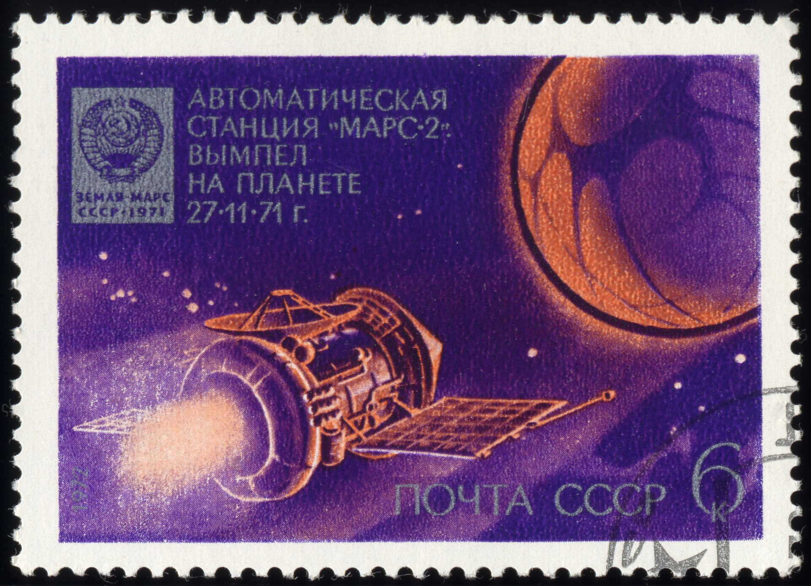
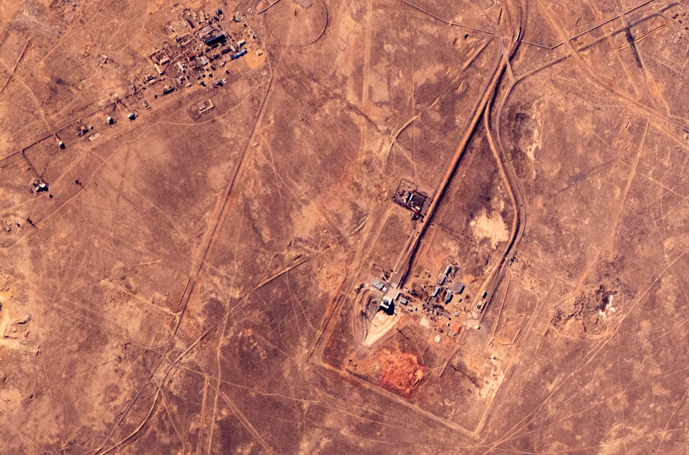

1971年11月27日、ソビエト連邦の無人探査機「マルス2号」の着陸機が火星表面に到達しました。大気圏突入時のトラブルにより軟着陸には至らず激突したものの、人類が地球から送り込んだ人工物として初めて火星の地に到達した歴史的な瞬間でした。

## 米ソ宇宙開発競争と火星への野心

1960年代から1970年代にかけて、アメリカとソビエト連邦は宇宙開発の分野で激しい競争を繰り広げていました。月への到達を果たした人類の目は、次なる目標として「赤い惑星」火星へと向けられます。地球と火星の距離が縮まり、少ないエネルギーで探査機を打ち上げられる軌道の巡り合わせ（ローンチウィンドウ）は約2.135年、およそ780日ごとにしか訪れません。ソビエト連邦はこの機会を捉え、1971年5月19日にプロトン-Kロケットによってマルス2号を打ち上げました。

## 周回軌道投入と高度な探査機能

マルス2号は、火星を周回しながら観測を行うオービターと、地表に降り立つランダー（着陸機）で構成されていました。打ち上げ時の総質量は4,650キログラムに及ぶ巨大な探査機でした。オービターは火星の表面や雲の撮影、温度や大気組成の測定、さらに着陸機から送られてくる電波を地球へ中継する役目を担っていました。また、ランダーには360度を撮影できる2台のカメラや気象センサー、有機物を探索するシャベルのほか、ソビエト連邦の国章が積まれていました。

*1971年の資料 — 写真: Post of Soviet Union / Public domain*

## 惑星規模の大砂嵐と突入の瞬間

しかし、マルス2号が火星に近づいたとき、火星では観測史上最大規模の猛烈な大砂嵐が発生していました。地表は厚い塵のローブに覆われ、宇宙からの視界を完全に遮っていました。当時の技術では地球からの再プログラムが難しく、マルス2号は到着の4.5時間前に予定通り着陸モジュールを放出しました。1971年11月27日、着陸機は約秒速6キロという猛スピードで火星大気圏へ突入しました。しかし搭載コンピューターの不調により、突入角度が計画よりも鋭すぎたため、パラシュートが開かない事態に陥りました。

*事件当時の写真ではありません · 1971年 — 写真: My grandfather Jean Morel (born 1929) / CC0*

## 激突と火星表面への初到達

減速することができなかった着陸機は、南緯45度、西経313度付近の火星表面にそのまま激突しました。軟着陸こそ果たせなかったものの、この激突によってマルス2号は「火星表面へ到達した人類史上最初の人工物」として記録されることになりました。母船であるオービターはその後も周回軌道に留まり、翌1972年にかけて火星の大気や磁場、表面温度などの貴重なデータを地球へ送り続け、火星表面の立体地図作成に大きく貢献しました。

*Baikonur Cosmodrome | Baikonur-Kosmodrom — 写真: Astro_Alex / CC BY-SA 2.0*

## 今も赤い惑星に眠る先駆の証し

その後、火星探査はアメリカのバイキング計画による本格的な着陸成功や、自走式ローバーによる精密調査へと発展していきました。マルス2号が激突した正確な地点は現在も特定されていませんが、地球から遥か数千万キロ離れた荒野のどこかに、最初に赤い大地へ飛び込んだ探査機の残骸が眠っています。未知の天体へ挑んだ人類の歩みにおいて、1971年11月27日は大きな足跡を残した一日でした。

### 参考資料

- <https://ja.wikipedia.org/wiki/%E7%81%AB%E6%98%9F%E6%8E%A2%E6%9F%BB%E6%A9%9F>
- <https://commons.wikimedia.org/wiki/File:Mars_3_surface_transmission.jpg>
- <https://commons.wikimedia.org/wiki/File:Soviet_Union-1972-Stamp-0.06._Mars_2.jpg>
- <https://commons.wikimedia.org/wiki/File:Temp%C3%AAte_du_si%C3%A8cle_(mars_1971),_maison_%C3%A0_Duvernay,_Laval,_Quebec_(2).jpg>
- <https://www.flickr.com/photos/72482589@N07/45562642951>
