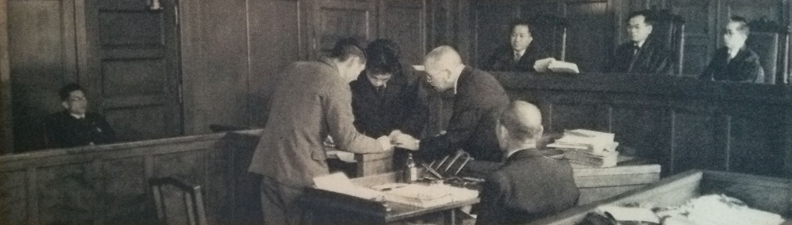
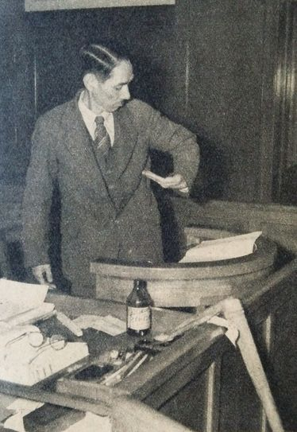
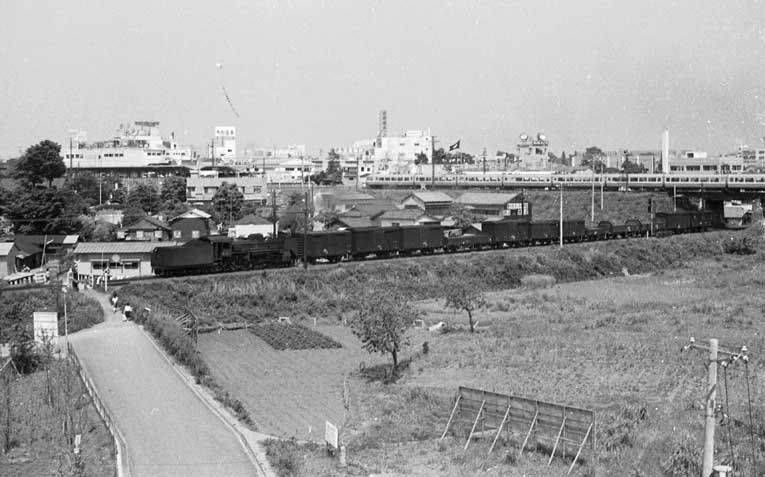

40年前の今日、1986年11月27日。東京都町田市にある日本共産党国際部長・緒方靖夫氏の自宅で、電話の通話内容がひそかに盗聴されていたことが明らかになりました。市民のプライバシーと通信の秘密を守るべき警察組織そのものが関与していたこの事件は、社会に大きな衝撃を与えました。

## 電話の雑音から見つかった100メートル先の秘密拠点

事件の発端は、緒方氏が自宅の電話を使う際に感じた異変でした。通話中に不自然な雑音が混じり、音質が著しく低下することに不審を抱いた緒方氏は、日本電信電話（NTT）町田電話局へ通報しました。

NTT職員が現地で回線の調査を進めたところ、緒方氏宅の外の電柱から不審な配線が伸びていることが判明します。その線をたどっていくと、緒方氏宅からわずか100メートルほど離れた近隣アパートの一室に行き着きました。室内には専用の機材が運び込まれており、組織的かつ計画的な盗聴が行われていた現場が白日の下にさらされたのです。

## 地元警察の捜査拒否と地検特捜部の異例の捜査

盗聴器が発見された直後、緒方氏らは警視庁町田警察署に通報しましたが、同署は当初捜査を拒否しました。NTTによる告発も一度は不受理とされ、11月29日になってようやく受理された後、12月1日に実況見分が行われました。この初動の遅れについては、警察による証拠隠滅が図られたのではないかという強い疑念が持たれました。

事態が動いたのは東京地方検察庁への告発でした。警察組織、とりわけ公安警察との癒着や情報漏洩を懸念した東京地検は、公安事件を扱う公安部ではなく、特別捜査部（特捜部）に捜査を担当させる異例の判断を下しました。

*2nd trial of Manno incident — 写真: 『』 1952年12月24日号 / Public domain*

## 浮かび上がった公安警察官と謎の組織「サクラ」

特捜部の捜査により、衝撃の事実が明らかになります。盗聴を実行していたのは、神奈川県警察警備部公安第一課に所属する複数の警察官たちでした。彼らは1985年の夏から1年以上にわたって盗聴を継続し、共産党本部や外国団体との連絡内容をひそかに傍受していたのです。

さらに捜査の過程で、警察大学校の内部に拠点を置き、公安警察による各種の非合法工作活動を統括する秘密部署、コードネーム「サクラ」が存在していることも明るみに出ました。国会の参考人質疑では、補聴器メーカーの技術者が「依頼を受けて盗聴器の試作品製作に携わった」と証言し、組織的犯行の裏付けが次々と示されました。

*Miyauchi Yoshinosuke — 写真: 朝日新聞社 / Public domain*

## 警察庁長官の虚偽答弁と幹部たちの引責辞任

事件が国会で追及される中、1987年5月7日の参議院予算委員会で警察庁長官の山田英雄氏は「警察におきましては、過去においても現在においても電話盗聴ということは行っておりません」と答弁し、組織的な関与を全面的に否定しました。

しかし、内部の動揺は隠せませんでした。翌6月には神奈川県警本部長が引責辞任し、その直後には警察庁警備局長も辞任に追い込まれました。さらに警備局公安第一課長や、「サクラ」を指揮していたとされる理事官が他部署へ配転されるなど、異例の人事異動が相次ぎました。

*C58 getrokken goederentrein en NSE, 1 januari 1965 a — 写真: M MDA / CC BY 3.0*

## 検察の苦悩と「不起訴」の波紋

警察庁は検察側に対して「二度と違法捜査を行わない」とする誓約を行いました。これを受け、東京地検は1987年8月4日、盗聴を実行した警察官たちを不起訴あるいは起訴猶予とする決定を下しました。この処分は世論から「警察に甘い」「お手盛り」と猛烈な批判を浴びることになります。

当時の検事総長であった伊藤栄樹氏は、後に著書『秋霜烈日』の中で、「検察は警察に勝てるか。治安維持上困った事態になるおそれがある」と記し、国家機関同士の衝突を避けるために苦渋の幕引きを図った内情を述懐しています。また、重要参考人として事情聴取を受けていた警察官の1人が聴取中に入院し、急死するという不穏な出来事も起きました。

## 法廷での長期戦と通信傍受法への道

不起訴処分に納得できない緒方氏は、裁判所の審判に委ねる付審判請求を行いました。しかし1989年3月14日、最高裁判所は警察官による盗聴の事実自体は認定したものの、「何人に対しても警察官であることを装わない行動をとっていた」として、公務員職権濫用罪には当たらないとして請求を棄却しました。

一方、緒方氏が国や神奈川県、実行犯の警察官らを訴えた民事訴訟では司法が違法性を認めました。事件発覚から10年以上が経過した1997年6月26日、東京高等裁判所は国と県に対して404万円余りの損害賠償を支払うよう命じる判決を下しました。この事件を契機に捜査機関の傍受に関する議論が過熱し、1999年の「犯罪捜査のための通信傍受に関する法律」制定へとつながっていきました。

### 参考資料

- <https://ja.wikipedia.org/wiki/%E6%97%A5%E6%9C%AC%E5%85%B1%E7%94%A3%E5%85%9A%E5%B9%B9%E9%83%A8%E5%AE%85%E7%9B%97%E8%81%B4%E4%BA%8B%E4%BB%B6>
- <https://commons.wikimedia.org/wiki/File:33rd_anniversary_ceremony_of_JCP.JPG>
- <https://commons.wikimedia.org/wiki/File:2nd_trial_of_Manno_incident.JPG>
- <https://commons.wikimedia.org/wiki/File:Miyauchi_Yoshinosuke.JPG>
- <https://commons.wikimedia.org/wiki/File:C58_getrokken_goederentrein_en_NSE,_1_januari_1965_a.jpg>
