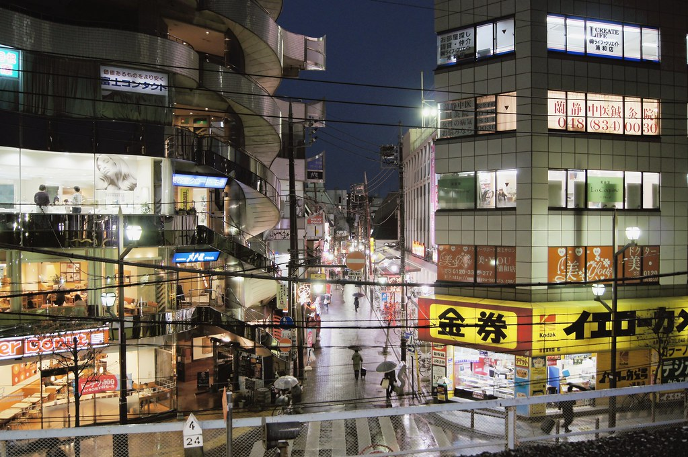
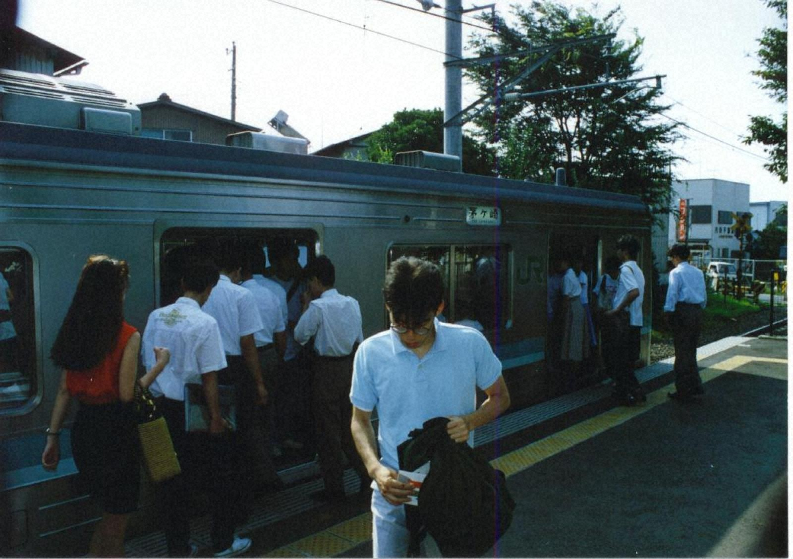
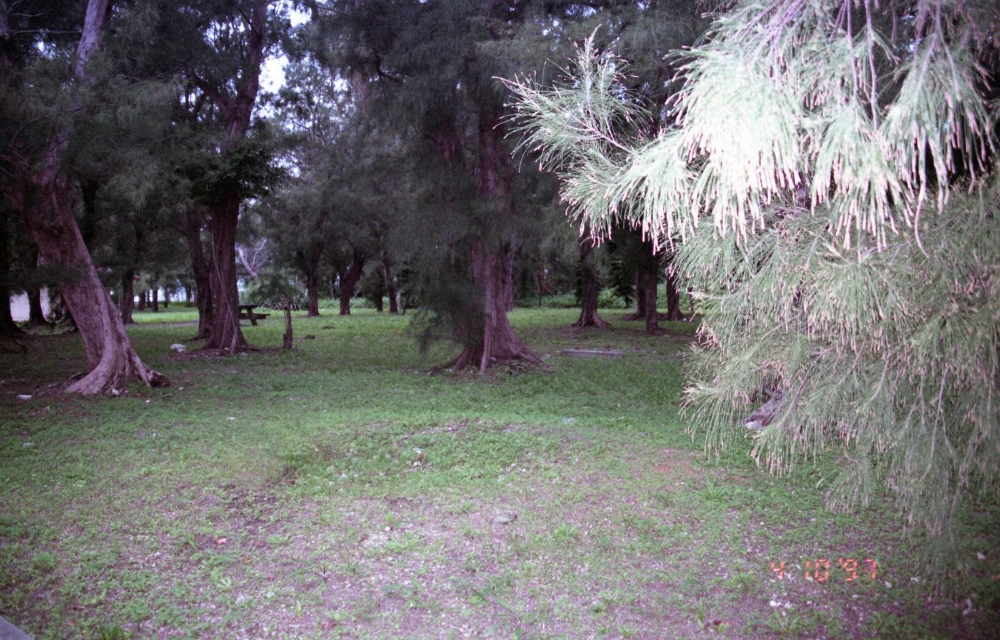

27年前の今日、1999年11月27日。JリーグのJ1セカンドステージ最終節で、浦和レッズのJ2降格が決定しました。延長戦の末にVゴールを決めて勝利を収めながら、ピッチ上の選手たちが泣き崩れたあの光景は、日本サッカー史に残る悲劇のドラマとして今も記憶されています。

## 初めて導入された2部制と名門の誤算

1999年のJリーグは、大きな変革の年でした。このシーズンからトップリーグのJ1（16クラブ）と下部リーグのJ2（10クラブ）による2部制がスタートし、J1の年間総合成績で下位2クラブが自動降格するレギュレーションが敷かれたのです。前年に下位に低迷していたベルマーレ平塚がいち早く降格を決める中、もう一つの枠を巡って思わぬ名門クラブが巻き込まれることになりました。

前年の1998年セカンドステージで3位に躍進し、優勝争いも期待されていた浦和レッズでした。しかしこの年は主力若手選手の代表遠征が重なり、ファーストステージは13位と低迷します。巻き返しを図って迎えたセカンドステージでも、シドニー五輪予選でエースの小野伸二選手が膝を重傷して長期離脱するなど苦難が続き、チームは延長Vゴール負けを4試合連続で喫するなど残留争いの泥沼へとはまり込んでいきました。

## 勝ち点と得失点差が絡み合う最終節の条件

シーズン終盤、残留争いは浦和レッズ、ジェフユナイテッド市原、アビスパ福岡の3クラブに絞られました。第14節の直接対決で市原が福岡に5対0と大勝したことで、勝ち点差が一気に縮まり、運命は最終節へと委ねられます。当時のルールでは、90分勝利で勝ち点3、延長戦勝利で勝ち点2、引き分けで勝ち点1が与えられる仕組みでした。

最終節を迎えた段階で、浦和が自力で残留を決めるためには、ホームで行われるサンフレッチェ広島戦で「90分以内に勝利」することが絶対条件でした。浦和は市原や福岡と比べて得失点差で4点下回っていたため、延長戦勝利による勝ち点2の獲得では、他会場の結果次第で並ばれた際に得失点差で下回ってしまう可能性が極めて高かったのです。

*Urawa Nakamachi-dori street 浦和なかまち通り — 写真: Urawa Zero / CC BY 2.0*

## 駒場スタジアムの90分間と無情のタイムアップ

1999年11月27日、浦和市駒場スタジアムには超満員のサポーターが詰めかけました。浦和は岡野雅行選手らを欠き、対する広島も主力を欠く布陣での対戦となりました。前半から一進一退の攻防が続き、両者無得点のまま試合は後半へ進みます。

後半15分、他会場の万博記念競技場で市原がガンバ大阪から先制点を奪ったという一報が駒場のベンチに入ります。浦和のア・デモス監督はすぐさま攻撃的な交代カードを切り、後半34分にはベンチスタートだったベテランの福田正博選手をピッチに送り込みました。小野選手や山田暢久選手を中心に広島ゴールへと幾度も怒濤の攻撃を仕掛けましたが、ゴールネットを揺らすことはできず、スコアレスのまま90分のホイッスルが鳴り響きました。

*朝の香川駅ホーム乗降風景 — 写真: chigamu / CC BY (Japan Search)*

## 歓喜なき歓声「世界で一番悲しいVゴール」

この90分終了の瞬間、他会場では市原が1対0で勝利し、福岡は横浜F・マリノスに0対2で敗れて試合を終えていました。この結果、福岡と市原の勝ち点は28。浦和は延長戦で勝利しても勝ち点28で並ぶものの、得失点差で両クラブに及ばないため、90分が終了した時点で浦和の年間15位以下とJ2降格が完全に確定してしまいました。

しかし、当時のルールに従い、勝敗を決めるための延長戦が行われました。すでに降格が決まったことを知る選手たちと、状況を把握しきれていない選手たちが入り交じる中、延長後半1分に試合が動きます。小野選手のショートコーナーからペトロビッチ選手がクロスを配給し、中央で福田選手がゴールを決めました。勝敗を決する劇的なVゴールでした。

その瞬間、状況を知らずに残留が決まったと信じて駆け寄り抱きついてきた若手の池田学選手を、福田選手は手荒に突き放しました。ベンチ前では小野選手や岡野選手が顔を覆って号泣し、ペトロビッチ選手はピッチに突っ伏して立ち上がることができませんでした。勝利の歓喜が一切存在しないスタジアムの光景は、のちに「世界で一番悲しいVゴール」と呼ばれることになります。

*冨祖崎公園 — 写真: 南城市教育委員会 / CC BY (Japan Search)*

## 悲劇の痛みを力に変えて築いた黄金期

オリジナル10の一角としてJリーグ創設期から熱烈なサポーターに支えられてきた浦和にとって、J2降格はクラブ史上最大の屈辱であり悲劇でした。しかし、この底知れぬ痛みがクラブを根本から生まれ変わらせる原動力となりました。

浦和は翌2000年のJ2を戦い抜き、わずか1年でJ1復帰を果たします。その後は着実に戦力を整え、2003年のナビスコカップ初制覇を皮切りに、2006年には悲願のJ1リーグ初優勝を達成。さらに2007年には日本勢として初めてAFCチャンピオンズリーグを制覇し、アジアの頂点へと上り詰めました。駒場のピッチで流されたあの日の悔し涙は、日本を代表するビッグクラブへと成長するための忘れられない原点として、今もサポーターの心に刻まれています。

### 参考資料

- <https://ja.wikipedia.org/wiki/%E6%97%A5%E6%9C%AC%E3%83%97%E3%83%AD%E3%82%B5%E3%83%83%E3%82%AB%E3%83%BC%E3%83%AA%E3%83%BC%E3%82%B0>
- <https://commons.wikimedia.org/wiki/File:Oil_torpedo1999juli2.jpg>
- <https://www.flickr.com/photos/26202414@N08/11435859563>
- <https://jmapps.ne.jp/chigasaki_history/det.html?data_id=254>
- <https://nanjo-archive.jp/document/?detail=10865&genre=6>
