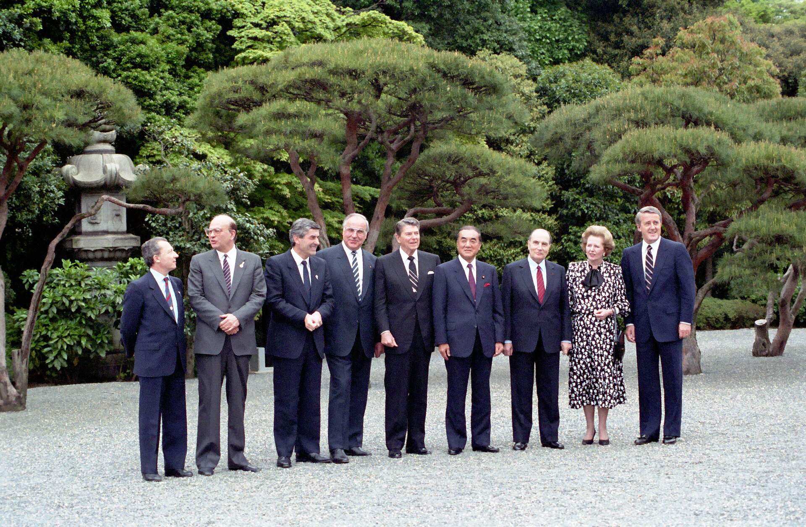
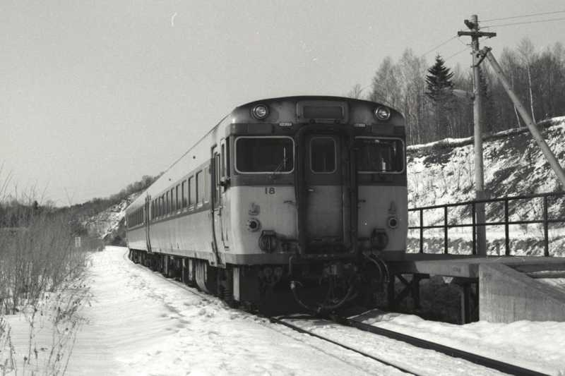

40年前の今日、1986年11月28日。日本の鉄道網を1世紀以上にわたって支えてきた日本国有鉄道を分割民営化するための「国鉄改革関連8法」が、国会で可決成立しました。かつて創業以来の黒字を誇った巨大公共企業体が、累積債務約37兆円という途方もない赤字を抱え、ついに組織を解体して新しい時代へ踏み出すことが決まった瞬間でした。

## 累積債務37兆円、破綻の淵に立った巨大組織

1872年（明治5年）の新橋・横浜間の鉄道開業以来、官営鉄道から引き継がれた日本の鉄道は長く国の誇りでした。しかし、戦後のモータリゼーションの進展による地方の国鉄離れに加え、戦争引揚者対策としての大量採用に伴う人件費の膨張などにより、1964年（昭和39年）に国鉄は赤字に転落します。奇しくもこの年は、夢の超特急と呼ばれた東海道新幹線が開業した年でもありました。

その後、首都圏の混雑緩和を目指した「通勤五方面作戦」や新幹線の建設などに巨額の資金が投じられましたが、政府からの直接補助は極めて乏しく、高利の鉄道債券などの借金で賄われました。さらに政治家による「我田引鉄」と呼ばれる赤字ローカル線の建設要求も重なり、昭和50年代以降に相次いだ運賃値上げも利用者の離反を招くだけでした。やがて累積債務は約37兆円にまで達し、年間の利払いだけで1兆円を超えるという、国家財政を揺るがす深刻な危機に陥ったのです。

## 土光臨調の提言と「改革三人組」の暗闘

1980年に成立した国鉄再建法による自主再建も限界を迎え、1981年に鈴木善幸内閣のもとで発足した第二次臨時行政調査会（土光敏夫会長）は、「増税なき財政再建」を旗印に本格的な切り込みを開始しました。1982年7月の基本答申で「5年以内の分割民営化」が正式に提言され、同年11月に発足した中曽根康弘内閣がその実現を強力に推進します。

国鉄の内部でも激しい路線対立が起きていました。全国一元管理の維持にこだわる経営陣の「国体護持派」に対し、松田昌士、葛西敬之、井手正敬のいわゆる「国鉄改革三人組」は、組織の分割民営化こそが鉄道再生の唯一の道であると主張しました。労使関係の荒廃や度重なるストライキ、職場規律の乱れに対する世論の厳しい批判も追い風となり、国鉄解体の流れは決定的なものとなっていきました。

*G-7 Economic Summit Leaders at The Imperial Palace Gardens in Tokyo Japan (Left to Right) Jacques Delors Bettino Craxi R — 写真: President (1981-1989 : Reagan). White House Photographic Off / Public domain*

## 1986年11月28日、参議院本会議での可決成立

1986年7月の衆参同日選挙で自由民主党が圧勝を収めたことを受け、第3次中曽根内閣は同年2月に提出していた国鉄改革関連法案の成立に全力を注ぎました。そして11月28日、自民党、公明党、民社党などの賛成多数により、日本国有鉄道改革法をはじめとする国鉄改革関連8法が可決成立しました。

成立した法律は、日本国有鉄道改革法のほか、旅客鉄道株式会社及び日本貨物鉄道株式会社に関する法律、新幹線鉄道保有機構法、日本国有鉄道清算事業団法など多岐にわたります。これにより、1872年以来続いてきた国の鉄道事業を、地域ごとの民間会社に切り分けるという前代未聞のスキームが法的に整ったのです。

*President Ronald Reagan Reviewing Troops with Prime Minister Nakasone at An Arrival Ceremony at Akasaka Palace in Tokyo — 写真: President (1981-1989 : Reagan). White House Photographic Off / Public domain*

## 7万5000人が職場を去った痛烈な痛み

新会社への移行において掲げられたのは「私鉄並みの生産性」でした。その結果、職員約9万4000人、実におよそ3人に1人が余剰人員と試算されることになります。国鉄は割増退職金による希望退職制度を導入し、約7万5000人もの職員が慣れ親しんだ職場を去る道を選びました。

残された鉄道事業は、北海道、東日本、東海、西日本、四国、九州の地域別旅客6社と日本貨物鉄道（JR貨物）など、計12の承継法人に引き継がれることになりました。さらに、鉄道総合技術研究所や鉄道情報システムなども発足し、長大だった全国組織はそれぞれの役割に応じて再出発を切ることとなったのです。

*1983年の資料 — 写真: Hanabi123 / CC BY-SA 3.0*

## 国鉄からJRへ、現代に残された光と影

法案成立の翌年、1987年4月1日に「JRグループ」が誕生し、日本国有鉄道は115年の歴史に正式に幕を下ろしました。その後、JR東日本、JR東海、JR西日本、JR九州は完全民営化を達成し、民間企業としての創意工夫により駅ナカ商業施設の展開や技術革新、サービスの向上を成し遂げました。

一方で、清算終了後も日本国有鉄道清算事業団に残った約16.7兆円の債務は最終的に国民の負担として処理されました。また、北海道や四国など人口減少が進む地域での鉄道維持の難しさなど、38年以上の歳月が流れた現在もなお議論が続く課題は少なくありません。あの日国会で下された決断は、日本の社会と人々の移動のあり方を根本から塗り替える大きな分水嶺となったのです。

### 参考資料

- <https://ja.wikipedia.org/wiki/11%E6%9C%8828%E6%97%A5>
- <https://commons.wikimedia.org/wiki/File:OER_Ticket_Vender_Machine_1986.jpg>
- <https://commons.wikimedia.org/wiki/File:G-7_Economic_Summit_Leaders_at_The_Imperial_Palace_Gardens_in_Tokyo_Japan_(Left_to_Right)_Jacques_Delors_Bettino_Craxi_Rudolphus_Lubbers_Helmut_Kohl_President_Ronald_Reagan_Yasuhiro_-_DPLA_-_a7b7a15e5f9dac619944223b213954fe.jpg>
- <https://commons.wikimedia.org/wiki/File:President_Ronald_Reagan_Reviewing_Troops_with_Prime_Minister_Nakasone_at_An_Arrival_Ceremony_at_Akasaka_Palace_in_Tokyo_Japan_-_DPLA_-_d70f664e3d04de85eb9879b2f6fe1c77.jpg>
- <https://commons.wikimedia.org/wiki/File:JNR-Hokushin-Sta-from-north-end.jpg>
