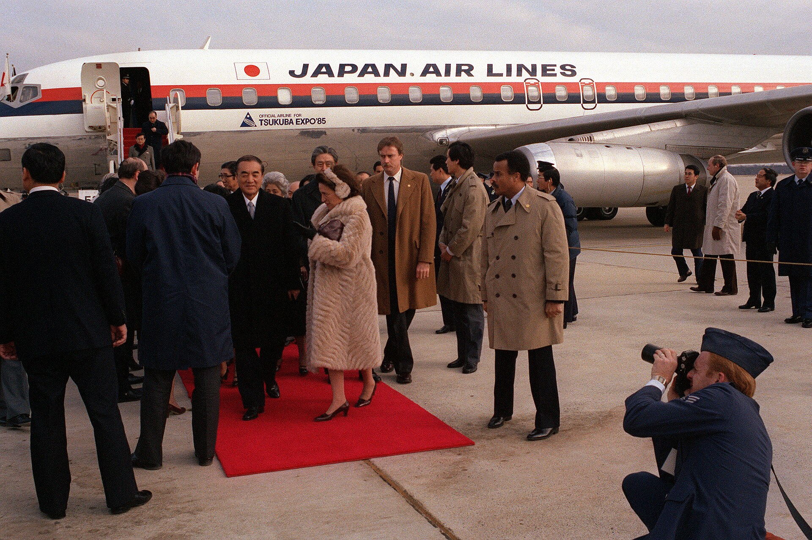
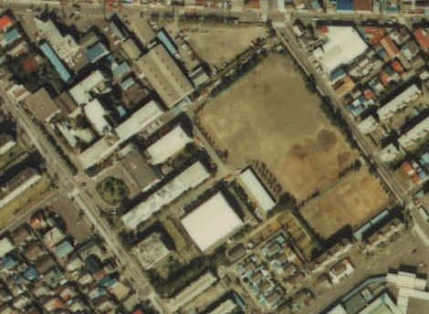
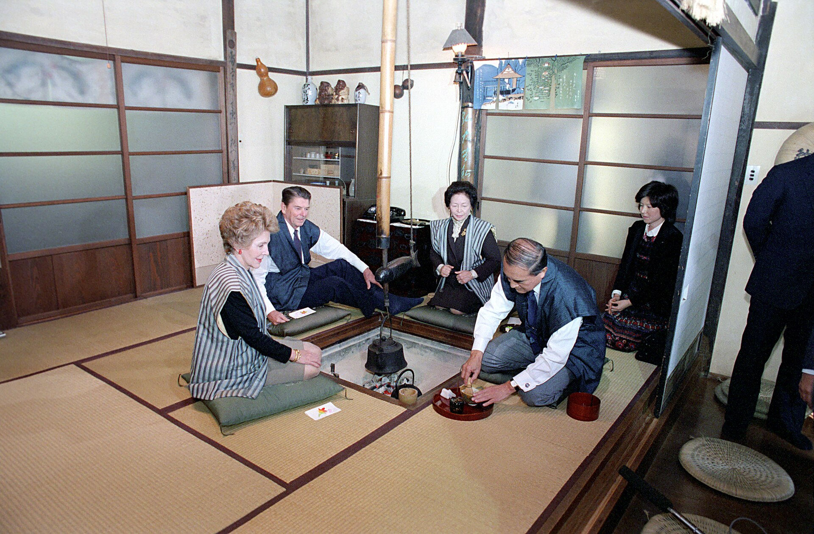

43年前の今日、1983年11月28日。中曽根康弘内閣のもとで衆議院が解散されました。政治史において「田中判決解散」と呼ばれるこの出来事は、戦後日本の政治力学を根底から揺るがす大きな転換点となりました。

## ロッキード事件の一審判決と田中の「所感」

事態の直接の引き金となったのは、解散の約1か月半前、1983年10月12日に東京地方裁判所で言い渡されたロッキード事件の第一審判決でした。被告人となった元内閣総理大臣の田中角栄に対し、裁判所が下したのは懲役4年、追徴金5億円の実刑判決でした。現職議員であり、党内最大派閥を率いて「闇将軍」と呼ばれた元首相への有罪判決は、日本中に巨大な衝撃を与えました。しかし田中氏は議員辞職を断固として拒絶し、即日控訴に踏み切ります。判決直後、目白の私邸から秘書を通じて発表された所感の中で田中氏は、「わが国の民主主義を守り、再び政治の暗黒を招かないためにも一歩もひくことなく前進を続ける」と宣言しました。

## 激昂する長老たちと麻痺する国会

自らを暗黒と戦う側に置いた田中氏の強硬な声明は、政界の内外に強い反発を引き起こしました。自民党内のライバルであった福田赳夫元首相は「気が違ったんじゃないか」と吐き捨て、三木武夫元首相も「政治の暗黒とは自分のことじゃないか」と厳しく批判の声を上げました。野党各党は一斉に田中氏への議員辞職勧告決議案の提出と採決を強硬に主張し、これに応じない与党との間で審議は完全にストップしました。国会機能が麻痺し、重要法案の審議がまったく進まない膠着状態が続くなかで、前回の総選挙からすでに3年以上が経過していたこともあり、衆議院の解散時期が最大の政治課題として浮上しました。

*DF-SC-83-10339 — 写真: Creator(s): Department of Defense. American Forces Informati / Public domain*

## 議長斡旋による妥協と11月28日の解散詔書

混迷を極める政局のなかで、田中角栄元首相自身が中曽根康弘首相に対して早期の解散を促しました。これを受けて事態打開に動いたのが、福田一衆議院議長と木村睦男参議院議長でした。両院議長は連名で斡旋案を提示し、野党に対して政府提出の重要法案を成立させることに合意させ、その成立を待って内閣が解散に踏み切るという道筋を整えました。こうして懸案の法案が可決されたのち、1983年11月28日、内閣は閣議決定を経て衆議院の解散を行いました。日本国憲法第7条に基づく解散詔書が本会議場で読み上げられ、議員たちは緊迫した面持ちで選挙戦へと突入していきました。

*Shizuoka College of Pharmacy 1983 — 写真: 国土交通省Copyright © 2007 National-Land Information Office. / Attribution*

## 新潟3区の熱狂と自民党の過半数割れ

12月18日に投開票が行われた第37回衆議院議員総選挙は、有権者の審判が残酷なまでに二極化した選挙でした。実刑判決を受けた田中角栄氏は、地元である新潟3区で猛烈な同情票と強固な後援会組織に支えられ、自身最多となる22万761票を獲得して圧倒的なトップ当選を果たしました。しかし、全国的な審判は極めて厳しいものでした。「政治とカネ」に対する国民の厳しい視線を受け、自民党は改選前の議席を大幅に減らして過半数を割り込む大敗を喫したのです。田中氏個人の選挙区での大勝とは裏腹に、自民党全体はかつてない窮地に追い込まれました。

*Trip to Japan, Lunch at Prime Minister Nakasone'S Private Retreat with Nancy Reagan, Yasuhiro Nakasone, Mrs. Nakasone - DPLA - 03aed679d368568770100faa1a8cafaa — 写真: President (1981-1989 : Reagan). White House Photographic Off / Public domain*

## 28年続いた単独政権の終焉と連立の発足

過半数を失った中曽根内閣が政権を維持するために下した決断は、新自由クラブとの連立でした。1955年の保守合同によって自由民主党が誕生して以来、28年間にわたって途切れることなく続いてきた「自民党単独政権」が、この敗北によって初めて幕を閉じることになりました。第2次中曽根内閣は連立政権として再出発を余儀なくされ、政界の力関係は大きく塗り替えられました。首相経験者の刑事判決が議会を揺るがし、解散を経て政治体制そのものを変容させた1983年のドラマは、今も憲政史における重い教訓として刻まれています。

### 参考資料

- <https://ja.wikipedia.org/wiki/%E8%A1%86%E8%AD%B0%E9%99%A2%E8%A7%A3%E6%95%A3>
- <https://commons.wikimedia.org/wiki/File:President_Reagan_and_Prime_Minister_Yasuhiro_Nakasone.jpg>
- <https://commons.wikimedia.org/wiki/File:DF-SC-83-10339.jpg>
- <https://commons.wikimedia.org/wiki/File:Shizuoka_College_of_Pharmacy_1983.jpg>
- <https://commons.wikimedia.org/wiki/File:Trip_to_Japan,_Lunch_at_Prime_Minister_Nakasone%27S_Private_Retreat_with_Nancy_Reagan,_Yasuhiro_Nakasone,_Mrs._Nakasone_-_DPLA_-_03aed679d368568770100faa1a8cafaa.jpg>
