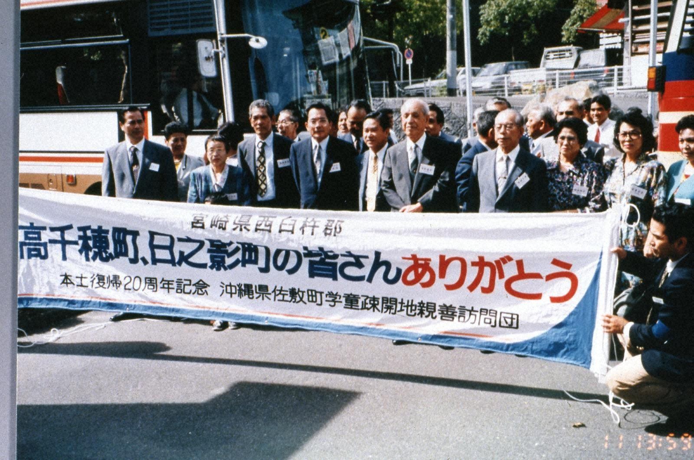
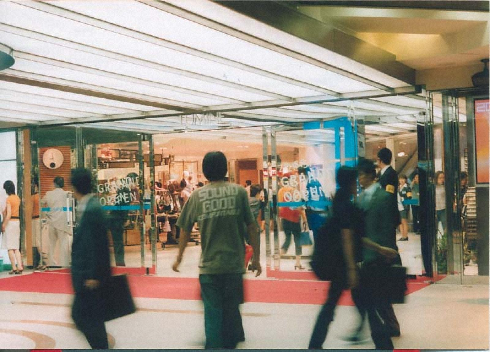

22年前の今日、2004年11月28日。日本女子ゴルフツアーのシーズン最終戦「LPGAツアーチャンピオンシップ リコーカップ」で、不動裕理選手が宮里藍選手との一騎討ちを制して優勝を飾り、5年連続の賞金女王に輝きました。社会現象となった「藍ちゃんフィーバー」と、絶対王者として君臨した不動選手の激突は、日本中を熱狂させました。

## 列島を揺るがした「藍ちゃんブーム」の到来

2004年の日本スポーツ界は、まさに宮里藍選手を中心に回っていました。前年の2003年秋、宮城・東北高校3年生のときにアマチュアとして「ミヤギテレビ杯ダンロップ女子オープン」で優勝し、史上初の高校生プロゴルファーとなった宮里選手。2004年3月に高校を卒業すると、開幕戦の「ダイキンオーキッドレディス」で早くもプロ初優勝を飾ります。明るい笑顔と丁寧なファンへの対応、そして小柄な体から放たれる正確なショットは、ゴルフファンのみならず日本中の人々を魅了しました。テレビのワイドショーでも連日大きく取り上げられ、女子ゴルフ中継の視聴率は軒並み上昇。男子ツアーをもしのぐ一大ブームを巻き起こしたのです。

## 立ちはだかる絶対女王・不動裕理の圧倒的な強さ

その宮里選手の前に立ちふさがったのが、熊本県出身の不動裕理選手でした。不動選手は2000年に年間6勝を挙げて日本女子ツアー史上初となる年間獲得賞金1億円を突破して以来、賞金女王の座を独占し続けていました。特に前年の2003年には、ツアー新記録となる年間10勝を達成。獲得賞金や平均ストロークなど主要9部門を完全制覇し、獲得賞金1億4932万円余りは男子の賞金王をも上回るという前代未聞の快挙を成し遂げていました。2004年7月には史上最年少の27歳285日で通算30勝に到達し、永久シード権を獲得。寡黙に自らのゴルフを貫き通すその姿は、ツアーの「絶対王者」として畏敬の念を集めていました。

*学童疎開地親善訪問団 — 写真: 南城市教育委員会 / CC BY (Japan Search)*

## 宮崎での最終決戦、賞金女王を懸けた一騎討ち

2004年シーズンは、まさに不動選手と宮里選手の2人による記録的なデッドヒートとなりました。宮里選手は11月のエリエールレディスオープンでシーズン5勝目を挙げ、不動選手に次ぐツアー史上2人目の年間獲得賞金1億円突破を果たします。一方の不動選手も着実に勝利を重ねて年間6勝をマーク。2人が勝利を分け合う形で、決着は宮崎県で開催された最終メジャー「LPGAツアーチャンピオンシップ リコーカップ」へと持ち越されました。その年のツアー優勝者と賞金上位者のみが出場を許されるエリート大会。会場には連日多くのギャラリーが詰めかけ、2人の直接対決に全国の視線が注がれました。

![Oni-no-sentakuita [ogre's washboard] on Nichinan-kaigan Coast of Miyazaki Prefecture](../images/2026-11-28-03-3.jpg)
*Oni-no-sentakuita [ogre's washboard] on Nichinan-kaigan Coast of Miyazaki Prefecture — 写真: AHLN / CC BY 2.0*

## 王者の誇りと貫禄を見せた不動裕理の逃げ切り

大会は期待通り、不動選手と宮里選手による激しい一騎討ちの様相を呈しました。若さと勢いでプレッシャーをかける宮里選手に対し、不動選手は持ち前の正確無比なショットと冷静沈着なパッティングで一歩も退きません。最終日、ピンチを迎えても動じることなく自らのリズムを保ち続けた不動選手が、宮里選手の猛追を振り切って通算成績でトップを守り、同大会2連覇を達成しました。この勝利によって不動選手はシーズン7勝目を挙げ、宮里選手を抑えて5年連続となる賞金女王を確定させました。敗れた宮里選手も堂々の単独2位に入り、1年目にして賞金ランキング2位という目覚ましい成績でシーズンを終えました。

*ルミネリニューアルオープン03 — 写真: chigamu / CC BY (Japan Search)*

## 歴史を創り、世界へと羽ばたいた2人の足跡

この年の激闘を経て、2人はそれぞれの道をさらに切り拓いていきました。不動選手は翌2005年も賞金女王の座を守り抜き、前人未到の「6年連続賞金女王」を達成。2008年には女子ツアー史上初となる生涯獲得賞金10億円を突破し、2011年には通算50勝を達成しました。一方の宮里選手はその後アメリカツアーへと主戦場を移し、2010年には日本人初となる世界ランキング1位に君臨するなど、世界最高峰の舞台で輝きを放ちました。2004年11月28日に宮崎で見せた2人のハイレベルな戦いは、その後の日本女子ゴルフ界の隆盛を決定づける歴史的な分水嶺となったのです。

### 参考資料

- <https://ja.wikipedia.org/wiki/JLPGA%E3%83%84%E3%82%A2%E3%83%BC%E3%83%81%E3%83%A3%E3%83%B3%E3%83%94%E3%82%AA%E3%83%B3%E3%82%B7%E3%83%83%E3%83%97>
- <https://commons.wikimedia.org/wiki/File:Tiverton_Golf_Club_,_Ball_on_the_15th_Fairway_-_geograph.org.uk_-_1123916.jpg>
- <https://nanjo-archive.jp/document/?detail=6945&genre=6>
- <https://www.flickr.com/photos/24265317@N00/3587111337>
- <https://jmapps.ne.jp/chigasaki_history/det.html?data_id=355>
