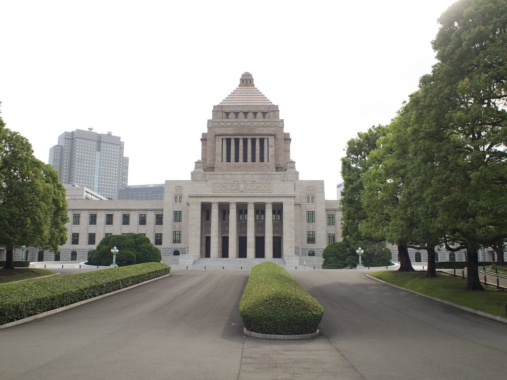
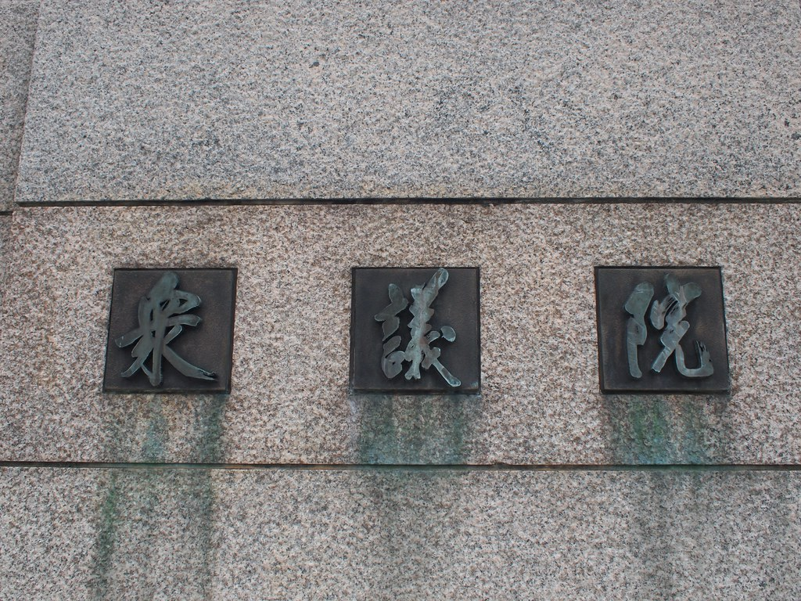
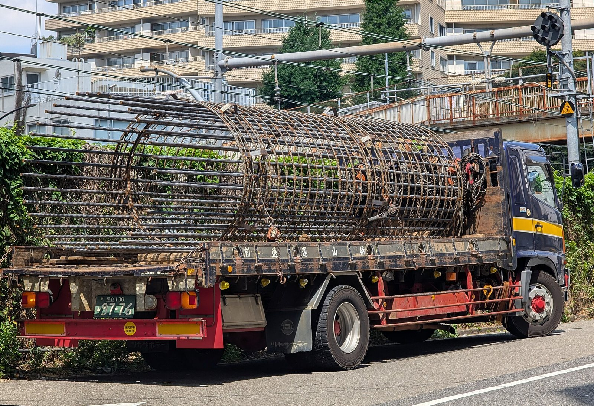

27年前の今日、1999年11月28日。東京都世田谷区の東名高速道路東京インターチェンジ付近で、飲酒運転の大型トラックが乗用車に追突する凄惨な交通事故が発生しました。行楽帰りだった一家4人が乗る車が大破炎上し、後部座席にいた幼い姉妹の命が奪われました。この悲劇と遺族たちの闘いは、のちに日本の交通法規を根底から変える大きな転換点となりました。

## 酩酊状態の12トントラック：ウイスキー1瓶を空けて運転

加害者は高知県高知市から東京へと向かっていた12トントラックの運転手でした。運転手は以前からの飲酒運転常習者で、この日も高知から大阪へ向かうフェリー船内や東名高速道路の海老名サービスエリアなどで、合わせて750ミリリットル入りのウイスキー1瓶と缶チューハイ1缶を飲んでいました。

事故当時の呼気中アルコール濃度は1リットルあたり0.63ミリグラムに達しており、車から降りると足元がおぼつかず、真っすぐ立つこともできないほどの極度の酩酊状態でした。

## 料金所手前での追突炎上：奪われた3歳と1歳の命

事故直前、蛇行運転を繰り返すトラックの様子は道路公団にも通報されていました。東京料金所で係員が運転手のふらつきに気づいて休憩を促したものの、運転手は「風邪薬を飲んだから大丈夫」と言い張り、休むことなく運転を再開しました。

その先にある首都高速用賀料金所の手前で、減速していた千葉市の会社員一家の乗用車にトラックが猛スピードで追突しました。乗用車は激しく大破して炎上。運転していた母親と助手席の父親は脱出・救出されたものの、後部座席に取り残された3歳と1歳の女児2人が命を落としました。

*National Diet Building (JAPAN) - 04 — 写真: beve4 / CC BY 2.0*

## 「最高で懲役5年」の壁：司法の判断と遺族の苦悩

当時、悪質な交通事故を処罰する法律としては刑法の業務上過失致死傷罪などが適用されていましたが、その法定刑の上限は懲役5年に過ぎませんでした。東京地方裁判所での第一審において、検察側は法定上限である懲役5年を求刑しましたが、判決は懲役4年でした。

検察側は「限りなく未必の故意に近い」として異例の控訴を行い、控訴審でも父親が法廷で厳罰を訴えましたが、東京高等裁判所も一審判決を支持して控訴を棄却。懲役4年の判決が確定しました。目の前で幼い我が子を奪われながら、これほど軽い罪でしか裁けない当時の法制度に対し、遺族は深い絶望と理不尽さに直面しました。

*National Diet Building (JAPAN) - 15 — 写真: beve4 / CC BY 2.0*

## 異例の定期金賠償：民事裁判で厳しく指弾された悪質性

刑事裁判の後、両親は運転手および勤務先の運送会社を相手取って民事訴訟を起こしました。2003年7月、東京地裁は被告側に対して総額約2億5000万円の賠償を命じる判決を下しました。

この判決では、亡くなった女児たちの命日に分割して将来の逸失利益を支払わせる「定期金賠償方式」という異例の支払いが認められました。判決文では加害者の行為を「走る凶器による危険極まりない運転行為」と強く断じ、事故の悲惨さと遺族の無念さに深く踏み込んだ判断が下されました。

*Truck carrying mesh structure for reinforced concrete pillar, stopped in Shibuya — 写真: Syced / CC0*

## 37万人の署名が集結：危険運転致死傷罪の新設へ

「命の重みが今の法律に反映されていない」。同じように悪質ドライバーによって大学生の一人息子を亡くした遺族が始めた法改正運動に、本事故の両親も合流しました。遺族たちは街頭に立ち続け、悪質な運転に対する厳罰化を求める署名を全国で集めました。

集まった署名は最終的に37万4339名分に達し、2001年10月に法務大臣へと提出されました。世論の強い後押しを受け、2001年11月、国会において刑法改正法案が全会一致で可決。最高刑を懲役15年とする「危険運転致死傷罪」が新たに創設されることとなったのです。

## 悲劇を風化させないために：現在へ受け継がれる教訓

東名高速の事故は、飲酒運転が単なる過失ではなく、他人の尊い命を奪う重大な犯罪であるという認識を日本社会に強く植え付けました。現在でも運転免許更新時に配られる教則本などに悲惨な事故の例として掲載され、ハンドルを握るすべてのドライバーへの戒めとして紹介されています。

理不尽な事故によって未来を奪われた幼い姉妹の命と、悲痛な苦しみの中から立ち上がった遺族たちの闘いは、今も交通安全を願う社会の規範として生き続けています。

### 参考資料

- <https://ja.wikipedia.org/wiki/11%E6%9C%8828%E6%97%A5>
- <https://commons.wikimedia.org/wiki/File:Tomei-Nihonzaka-Tunnel_1999-07-25.JPG>
- <https://www.flickr.com/photos/26958633@N02/4727600054>
- <https://www.flickr.com/photos/26958633@N02/4726958841>
- <https://commons.wikimedia.org/wiki/File:Truck_carrying_mesh_structure_for_reinforced_concrete_pillar,_stopped_in_Shibuya.jpg>
