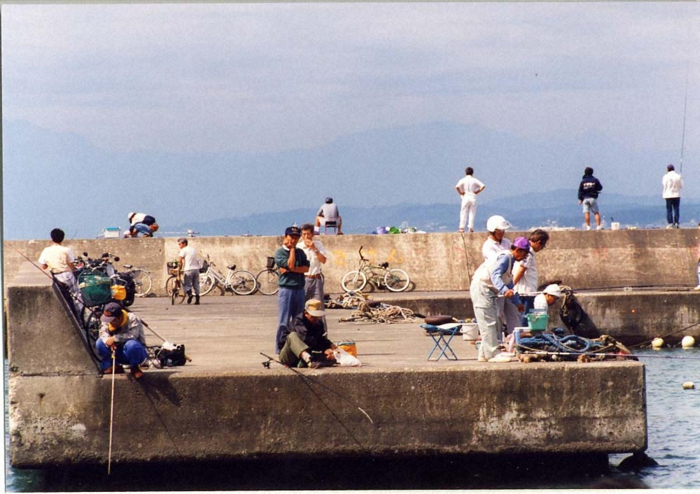
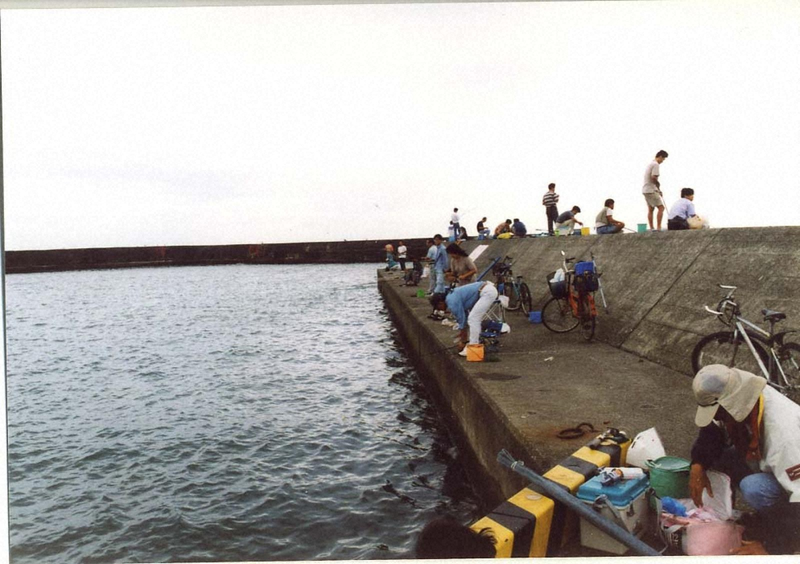
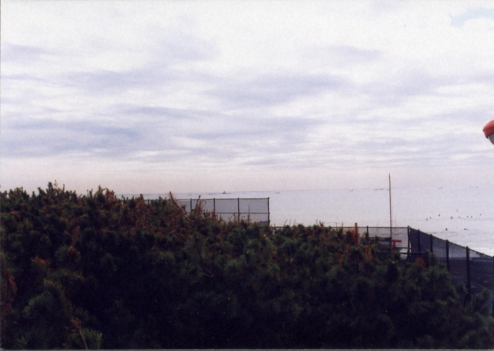

29年前の今日、1997年11月28日。鹿児島県の種子島宇宙センターから、純国産のH-IIロケット6号機が轟音とともに大空へ向けて飛び立ちました。この打ち上げで軌道へと投入されたのは、日本の宇宙開発の歴史において極めて重要な役割を果たすことになる2つの人工衛星でした。

## 日本の宇宙開発を担ったH-IIロケット6号機の発射

1997年11月28日、青空が広がる種子島宇宙センターの射場から、宇宙開発事業団（NASDA）のH-IIロケット6号機が打ち上げられました。H-IIは日本が独自に開発した第一段液体燃料エンジン「LE-7」を搭載した純国産主力ロケットであり、日本の大型人工衛星打ち上げの中核を担っていました。

この6号機には、性質も目的も異なる2機の大型衛星が搭載されていました。一つはアメリカ航空宇宙局（NASA）との共同プロジェクトである熱帯降雨観測衛星「TRMM」、そしてもう一つは日本が独自に開発を進めてきた技術試験衛星VII型「きく7号」です。2機を同時に所定の軌道へと正確に送り届けることが、この日の重大な任務でした。

## 宇宙から雨の構造を立体的に捉える「TRMM」

TRMM（Tropical Rainfall Measuring Mission）は、大気循環の原動力となる熱帯地域の降雨を宇宙から観測するために計画された日米共同ミッションです。地球規模の気候変動やエルニーニョ現象などのメカニズムを解明するには、広大な海洋や熱帯域の雨の降り方を知ることが不可欠でした。

この衛星において日本側（宇宙開発事業団と通信総合研究所）が担当したのが、世界初となる衛星搭載型の降雨レーダ（PR）です。電波を地表に向けて照射し、雨粒からの反射を測定することで、雲の中に潜む雨の立体的な強さや分布を高精度に把握できる画期的な観測機器でした。地上システムを含む日本の総開発費は約187億円に上り、世界最高峰の観測技術が注ぎ込まれました。

*茅ヶ崎港で釣りをする人々⑯ — 写真: chigamu / CC BY (Japan Search)*

## 「ひこぼし」と「おりひめ」が挑んだ世界初の無人合体

同時に打ち上げられた「きく7号」は、チェイサ衛星「ひこぼし」とターゲット衛星「おりひめ」という2つの衛星が合体した形で宇宙へ旅立ちました。総開発費432億円が投じられたこの衛星の目的は、軌道上での自動ランデブー・ドッキング技術と宇宙ロボット技術の獲得でした。

人が搭乗するアポロ宇宙船やスペースシャトルでのドッキングは以前から行われていましたが、機体の衝撃を最小限に抑えつつ、無人で自律的に接近して結合する技術は極めて難易度が高いものでした。「きく7号」は翌1998年7月、分離した「ひこぼし」と「おりひめ」を秒速1センチメートルという極めて繊細な速度で接近させ、見事に自動ドッキングを成功させました。宇宙空間における無人・自動でのドッキング成功は、世界で初めての快挙でした。

*茅ヶ崎港で釣りをする人々⑫ — 写真: chigamu / CC BY (Japan Search)*

## 設計寿命3年を大きく超えて17年間の長期観測へ

一方のTRMMも、当初の予想をはるかに上回る目覚ましい成果を挙げました。衛星本体や降雨レーダの設計寿命は3年と定められていましたが、機器はその後も極めて健全に動作を続けました。アメリカ海洋大気庁（NOAA）などの強い要望もあり、運用延長の決定が何度も重ねられることになります。

高度を約350キロメートルから大気抵抗の少ない402キロメートルへ引き上げる軌道修正などを経て、TRMMは1997年の打ち上げから2015年4月に運用を終えるまで、実に17年以上にわたって観測を継続しました。台風の進路や強度の予測、地球規模の水循環の解明など、気象学や防災に多大な貢献を果たしたTRMMは、2015年6月に大気圏へ再突入し、その長い役目を終えました。

*歩道橋より相模湾を望む#1 — 写真: chigamu / CC BY (Japan Search)*

## 宇宙ステーション補給機へと受け継がれた日本の技術

「きく7号」が実証した自動ドッキング技術とロボットアームの遠隔制御技術は、のちの宇宙開発に決定的な影響を与えました。この実験の成功により培われたランデブー技術は、国際宇宙ステーション（ISS）へ食料や実験機材を送り届ける無人補給機「こうのとり」の開発へと直接つながっていったのです。

宇宙ステーションへ安全に物資を届ける技術力は世界的に高く評価され、日本は有人宇宙探査の重要なパートナーとしての地位を確立しました。1997年11月28日に種子島から打ち上がった2つの衛星は、日本の宇宙技術が世界の最前線へと飛躍する確かな原動力となったのです。

### 参考資料

- <https://ja.wikipedia.org/wiki/%E5%AE%87%E5%AE%99%E9%96%8B%E7%99%BA%E4%BA%8B%E6%A5%AD%E5%9B%A3>
- <https://commons.wikimedia.org/wiki/File:Ceres_instrument.png>
- <https://jmapps.ne.jp/chigasaki_history/det.html?data_id=907>
- <https://jmapps.ne.jp/chigasaki_history/det.html?data_id=903>
- <https://jmapps.ne.jp/chigasaki_history/det.html?data_id=709>
