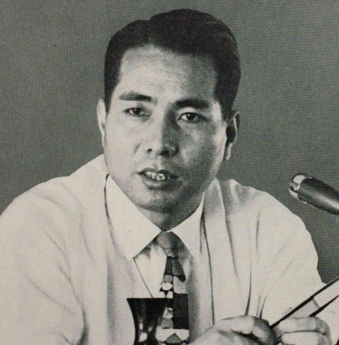
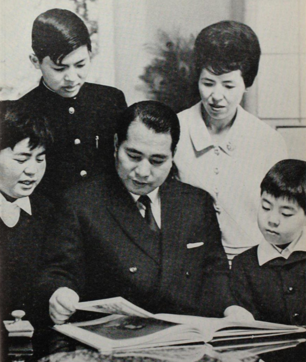
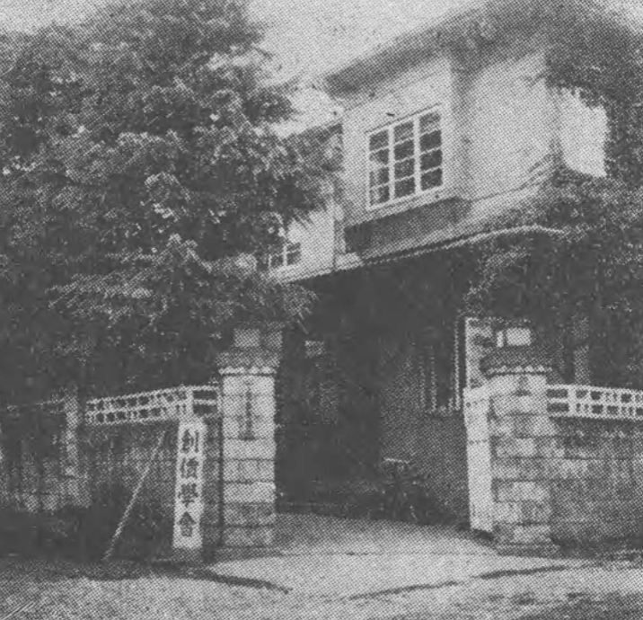

35年前の今日、1991年11月28日。静岡県富士宮市の大石寺を総本山とする仏教宗派の日蓮正宗が、国内最大の信徒組織であった創価学会、ならびにその国際組織である創価学会インタナショナル（SGI）に対して破門を通告しました。公称信者数1700万人を超えていた巨大な信仰の連携は、この日を境に決定的な決裂を迎えました。

## 信徒団体としての発足と戦後の急成長

創価学会は1930年11月18日、牧口常三郎と戸田城聖ら教育者によって「創価教育学会」として創立されました。1937年には日蓮正宗の信徒組織（法華講）の1つとして位置づけられます。戦時中の1943年、治安維持法違反並びに不敬罪で牧口や戸田が逮捕され、牧口は1944年に獄死しました。

戦後に釈放された戸田は組織名を「創価学会」へと改称し、1951年に第2代会長に就任しました。戸田のもとで75万世帯を目標に掲げた大規模な布教活動が展開され、組織は飛躍的に拡大します。1960年に池田大作が第3代会長に就任すると勢いはさらに加速し、日蓮正宗の宗門全体の規模も信徒団体の躍進とともに大きく膨らんでいきました。

## 表面化していった教義をめぐる亀裂

宗門と学会の協力関係は長く続きましたが、昭和50年代に入ると教義の解釈などをめぐって摩擦が目立ち始めます。1977年1月、創価学会は教学部大会において新たな路線を打ち出しました。これに対して日蓮正宗側は「教義からの逸脱である」と強く反発し、批判を展開しました。

翌年に創価学会側が謝罪して一時的な和解が図られたものの、宗門内の僧侶や信徒の間には不信感がくすぶり続けました。1970年代末から1980年代初頭にかけては、宗門側の僧侶有志による正信会が結成され、法主の地位などをめぐる訴訟や大量の懲戒処分に発展するなど、宗内の動揺は続いていました。

*Daisaku-Ikeda-1 — 写真: 創価学会 / Public domain*

## 1990年末の罷免から破門への秒読み

両者の関係が修復不能なまでに悪化したのは1990年12月のことでした。日蓮正宗宗門は12月27日付で、創価学会名誉会長の池田大作氏を信徒の筆頭役職である「法華講総講頭」から罷免しました。これを契機として、年が明けた1991年からは宗門と学会の間で激しい論戦と抗争が繰り広げられることになります。

1991年11月7日、日蓮正宗は創価学会に対して「宗門を誹謗し、化法・化儀を逸脱して外護団体の姿を失った」と判断し、解散勧告を通知しました。創価学会側がこれを受け入れない中、11月28日に日蓮正宗は創価学会および海外組織であるSGIに対する破門処分を正式に通告したのです。

*Daisaku-Ikeda-4 — 写真: Unknown authorUnknown author / Public domain*

## 決別がもたらした巨大な変化と記録

この破門処分により、両者の関係は完全に途絶えました。破門前の1990年における日蓮正宗の公称信者数は、創価学会員を含めて1784万人に達していました。しかし、学会の離脱に伴い、文化庁がまとめる2008年の宗教年鑑に記載された日蓮正宗の信者数は39万6000人へと激減することになります。

決別後、宗門側は1998年に宗規の一部を改正し、創価学会に所属する者を正式に除籍処分としました。さらに同年5月には、かつて学会員らの寄進によって建立された大石寺の巨大建築「正本堂」の解体が進められ、2002年10月には新たな「奉安堂」が完成しました。

*Soka-Gakkai-1 — 写真: 実業之世界社 / Public domain*

## 独自の道を歩んだ創価学会と現在の姿

破門を受けた創価学会もまた、宗門から独立した宗教団体として教団運営を再構築していきました。日蓮正宗からの本尊下付が停止されたことを受け、1993年以降は栃木県の淨圓寺所蔵である日寛書写の御本尊を会員に授与することを決定しました。

さらに海外組織のSGIは、1975年の設立当初の約150万人から世界190以上の国や地域へと広がりを見せました。日本の宗教史において極めて大きな転換点となった1991年11月28日の破門通告から、すでに長い歳月が流れています。

### 参考資料

- <https://ja.wikipedia.org/wiki/%E6%97%A5%E8%93%AE%E6%AD%A3%E5%AE%97>
- <https://commons.wikimedia.org/wiki/File:Daisaku_Ikeda_at_age_19.jpg>
- <https://commons.wikimedia.org/wiki/File:Daisaku-Ikeda-1.png>
- <https://commons.wikimedia.org/wiki/File:Daisaku-Ikeda-4.png>
- <https://commons.wikimedia.org/wiki/File:Soka-Gakkai-1.png>
