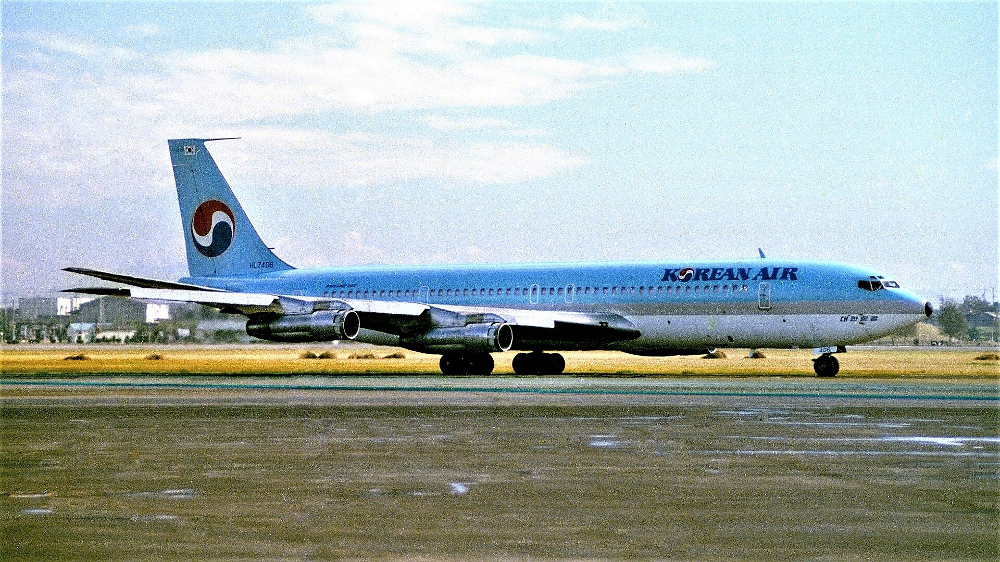
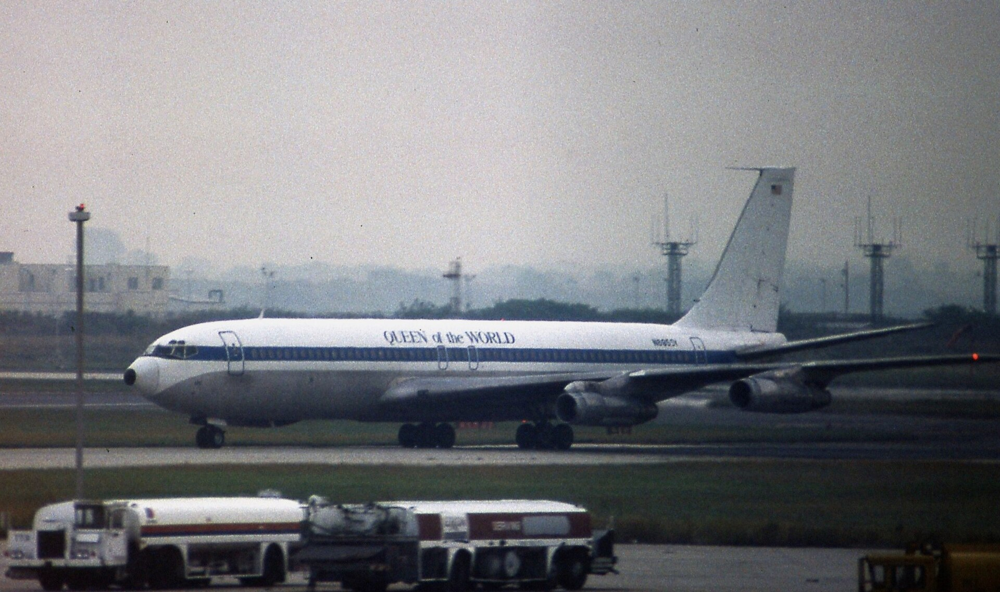
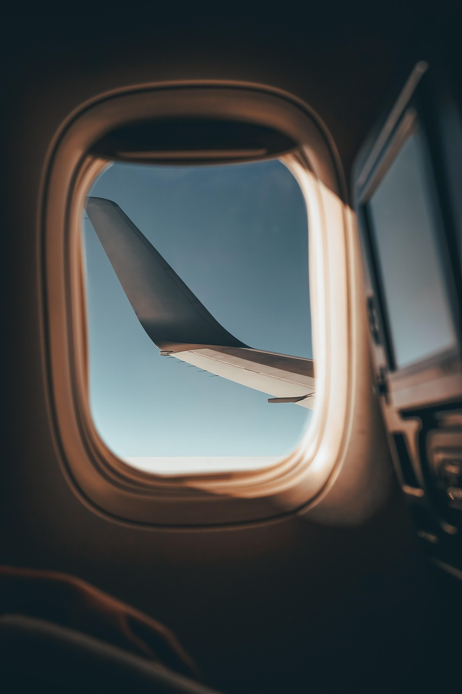

39年前の今日、1987年11月29日。イラクのバグダードを出発しソウルへ向かっていた大韓航空858便が、インド洋のアンダマン海上空で消息を絶ちました。翌年のソウルオリンピックを控えた時期に起きたこの惨劇は、北朝鮮工作員による前代未聞の爆破テロでした。

## アンダマン海上空で途絶えた交信

事件の被害に遭った大韓航空858便（ボーイング707-320B型機）は、イラクのバグダードを出発し、アラブ首長国連邦のアブダビ、タイのバンコクを経由して韓国の金浦国際空港へ向かう予定でした。搭乗していたのは乗員11人、乗客104人の計115人でした。

乗客のほとんどは、中近東の過酷な建設現場などに出稼ぎに出ていた韓国人労働者たちでした。過酷な労働を終え、祖国で待つ家族のもとへ帰国する途中の人々で機内は満たされていました。しかし、アブダビを離陸して4時間半が経過した現地時間午前11時22分、ラングーンから南約220キロのアンダマン海上空で機内に仕掛けられた爆弾が炸裂し、機体は空中分解して墜落しました。

## 残された爆弾と経由地での降機

大韓航空858便が空中分解に至った原因は、事前の周到な計画によるものでした。北朝鮮の工作員である金勝一（当時59歳）と金賢姫（当時25歳）の2人は、バグダードで同便に搭乗していました。

2人は時限装置付きのプラスチック爆弾を入れた携帯ラジオと、液体爆弾を入れた酒ビンを機内に持ち込み、前方の荷物ラックに忍ばせました。そして最初の経由地であるアブダビ空港で何食わぬ顔で降機し、そのまま飛行機へ戻りませんでした。無人の荷物棚に残された爆弾は、飛行機が洋上へ差し掛かった時刻に炸裂したのです。

*1987年の資料 — 写真: ハミングバードさん / CC BY-SA 4.0*

## バーレーン空港での拘束と服毒

アブダビで降りた男女2人は、ガルフ航空機でバーレーンへ移動し、首都マナーマのホテルに宿泊していました。彼らが所持していたのは「蜂谷真一」と「蜂谷真由美」という名義の日本のパスポートで、2人は旅行中の父親と娘を装っていました。

しかし、在バーレーン日本大使館員が入国記録を調べた際、航空券の英文の姓が抜けている点に不審を抱きます。外務省へ照会したところ、パスポート番号が徳島市在住の男性に発行されたものと同一であることが判明し、偽造が発覚しました。12月1日、ローマ行き便で出国しようとした2人をバーレーン当局と日本大使館員が押し留めました。身柄拘束の寸前、男は煙草の中に隠した青酸カリ入りカプセルを噛み砕いて即死しました。女も毒薬を奪って自殺を図りましたが、警察官に取り押さえられて一命を取りとめました。

*事件当時の写真ではありません · 1984年 — 写真: Pete Macklin / CC BY-SA 2.0*

## 日本に伸びていた北朝鮮工作の影

この事件は日本社会にも甚大な衝撃を与えました。犯人たちが使っていた偽造パスポートの名義人は実在する日本人男性でした。調査の結果、男性は過去に旅券と実印を貸し出しており、その背景には西新井事件など日本人拉致や戸籍乗っ取りに関与していた北朝鮮の補助工作員・李京雨の存在があったことが明らかになりました。

さらに自殺した男が所持していた日本製煙草は、数年前に製造が終了した古い品であり、工作活動用に準備された小道具であったことが判明します。日本政府は旅券法違反などの容疑を持ちながらも、大量殺人テロの重大性と旗国主義を考慮し、身柄引き渡し請求権を放棄。女の身柄は韓国側へと委託されることになりました。

*当日の写真ではありません · 事件当時の写真ではありません · イメージ写真 — 写真: Javaistan / Pixabay Content License*

## 自白と特赦、そして残された傷跡

12月15日、自殺防止用のマウスピースをはめられた状態でソウルに移送された女は、当初「百華恵」という中国人を装い尋問をかわそうとしました。しかし、日本の生活実態を問われて北朝鮮のテレビブランド「チンダルレ」と答えるなど矛盾が重なり、発展したソウルの街並みを目の当たりにして、ついに自らが北朝鮮工作員・金賢姫であることを自白しました。

1990年3月に死刑判決が確定した金賢姫でしたが、翌4月、盧泰愚大統領によって特赦されました。事件の生きた証人として北朝鮮の謀略を世に知らしめる役割を果たすためでした。しかし、アンダマン海の深くに消えた115人の命が戻ることはありません。冷戦末期に起きたこの未曾有の航空機爆破テロは、今なお東アジアの現代史に重い影を落としています。

### 参考資料

- <https://ja.wikipedia.org/wiki/11%E6%9C%8829%E6%97%A5>
- <https://commons.wikimedia.org/wiki/File:Boeing_707-3B5C_HL7406_at_Fukuoka_Airport,_August_1987.jpg>
- <https://commons.wikimedia.org/wiki/File:Korean_Air_HL7406_Boeing_707-3B5C_at_Nagoya_Airport,_October_1987.jpg>
- <https://commons.wikimedia.org/wiki/File:180_25-9-84_N895SY_Philadelphia_(54356865234).jpg>
- <https://pixabay.com/photos/airplane-travel-adventure-6867678/>
