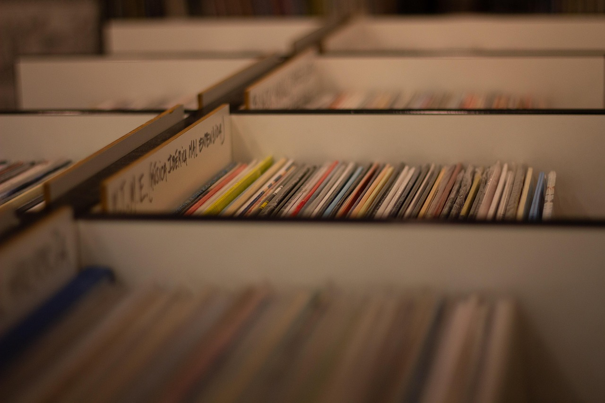
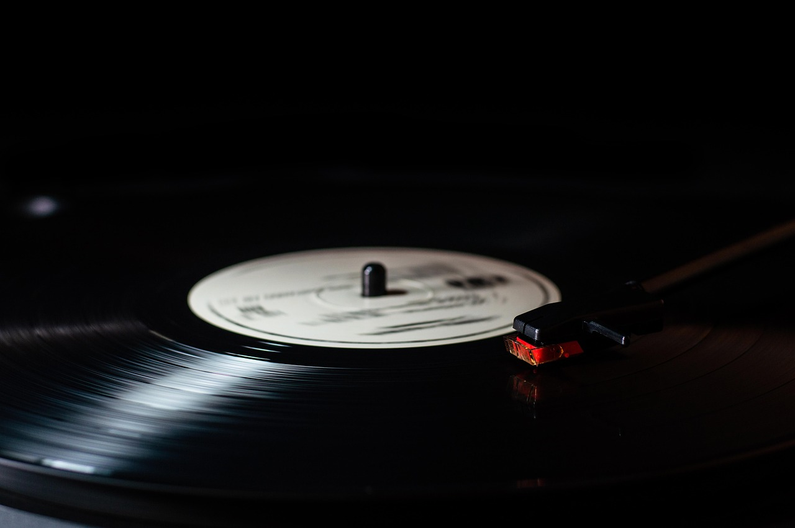
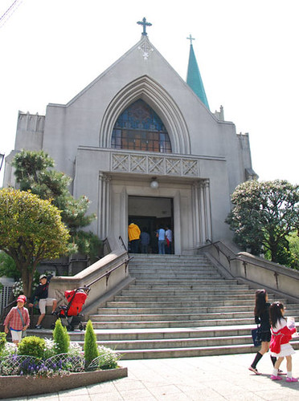

50年前の今日、1976年11月29日。シンガーソングライターの荒井由実さんと音楽プロデューサーの松任谷正隆さんが結婚し、神奈川県横浜市の山手教会で式を挙げました。時代を代表するトップアーティストの結婚は、大きな注目を集めました。

## 早熟な音楽少女から作曲家デビューへ

呉服屋を営む家に生まれた荒井由実さんは、6歳からピアノ、11歳から三味線、14歳からベースに親しみました。中学時代には文化人が集まるレストランに出入りし、イギリスのバンドであるプロコル・ハルムの「青い影」に衝撃を受け、自らも鍵盤によるポップミュージック作りにのめり込んでいきました。14歳のころには友人から「ユーミン」の愛称で呼ばれるようになり、高校3年生だった1971年には、自作のデモテープが採用されて加橋かつみさんに「愛は突然に...」を提供し、17歳で作曲家としてのスタートを切りました。

## デビューの苦難と深夜ラジオの追い風

多摩美術大学に進学した荒井さんは、アルファレコードを立ち上げた村井邦彦さんの勧めで、1972年7月5日にシングル「返事はいらない」で歌手としてデビューしました。しかし、このシングルは数百枚しか売れず、話題になることはありませんでした。1973年11月にはキャラメル・ママらとともに制作したファーストアルバム『ひこうき雲』を発表しますが、当初のセールスは約3000枚と低迷します。転機となったのは、TBSラジオの深夜番組「パックインミュージック」でした。パーソナリティの林美雄さんが熱心に紹介を続けたことでリスナーの間で評判が広がり、1974年4月にヤクルトホールで開かれた初のリサイタルも、ラジオの呼びかけをきっかけに満員となりました。

*当日の写真ではありません · 事件当時の写真ではありません · イメージ写真 — 写真: niro9 / Pixabay Content License*

## メガヒットの誕生と松任谷正隆との出会い

1975年、荒井さんが作詞・作曲した「卒業写真」やバンバンへの提供曲「『いちご白書』をもう一度」が相次いでヒットし、作家としての評価が不動のものとなります。さらに同年10月に発表したシングル「あの日にかえりたい」がテレビドラマの主題歌に起用され、自身初となるオリコンチャート1位を獲得しました。この時期、アレンジャーやプロデューサーとして活動していた松任谷正隆さんとの交流を通じて、荒井さんはアメリカンポップスのエッセンスを取り入れ、「ルージュの伝言」などの軽快な楽曲も生み出すようになっていきました。過去のアルバムも軒並み売り上げを伸ばし、1976年発売のベストアルバム『YUMING BRAND』は年間アルバムチャート3位を記録する社会現象となりました。

*当日の写真ではありません · 事件当時の写真ではありません · イメージ写真 — 写真: padrinan / Pixabay Content License*

## 1976年11月29日、横浜・山手教会での誓い

大ヒットを連発し、時代の頂点に立っていた荒井由実さんは、1976年11月29日、音楽制作を共にしてきた松任谷正隆さんと横浜市の山手教会で結婚式を挙げました。結婚に伴い本名が「松任谷由実」となり、以後の音楽活動もこの名義で行うことになります。当時、女性シンガーソングライターが自らの名前で社会に広く認知されること自体がまだ新しかった時代に、人気絶頂の中で結婚し、名前を改めて活動を続ける姿は大きな話題を呼びました。

*Sacred Heart Cathedral, Yokohama — 写真: sfbaywalk / CC BY 2.0*

## 6つの年代で頂点へ、受け継がれる記録

結婚後、松任谷正隆さんはプロデューサーとして妻の楽曲アレンジやステージ演出を一手に引き受け、二人は二人三脚で数多くの名作を世に送り出しました。松任谷由実さんは総売上枚数4000万枚を突破し、1970年代、1980年代、1990年代、2000年代、2010年代、2020年代と「6年代連続でアルバムチャート1位を獲得した最多記録」としてギネス世界記録に認定されています。2013年には紫綬褒章を受章し、2022年度にはシンガーソングライターとして初となる文化功労者にも選出されました。山手教会で結ばれたあの日の約束は、半世紀を経た今も、日本のポピュラー音楽の歴史に確かな輝きを残しています。

### 参考資料

- <https://ja.wikipedia.org/wiki/11%E6%9C%8829%E6%97%A5>
- <https://pixabay.com/photos/music-player-record-player-7792956/>
- <https://pixabay.com/photos/record-shop-vinyl-records-music-9180482/>
- <https://pixabay.com/photos/music-recording-vinyl-retro-disk-5705801/>
- <https://www.flickr.com/photos/9681213@N06/8049844074>
