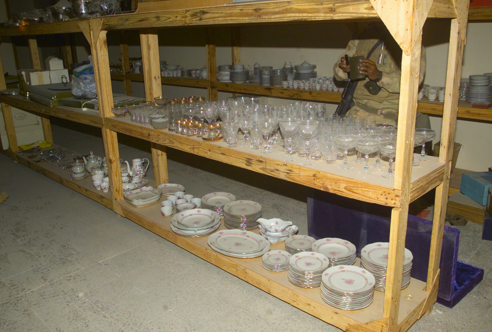
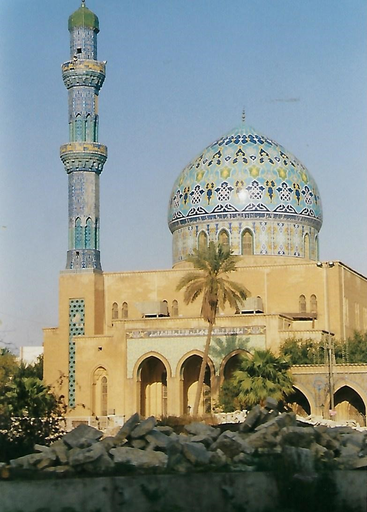
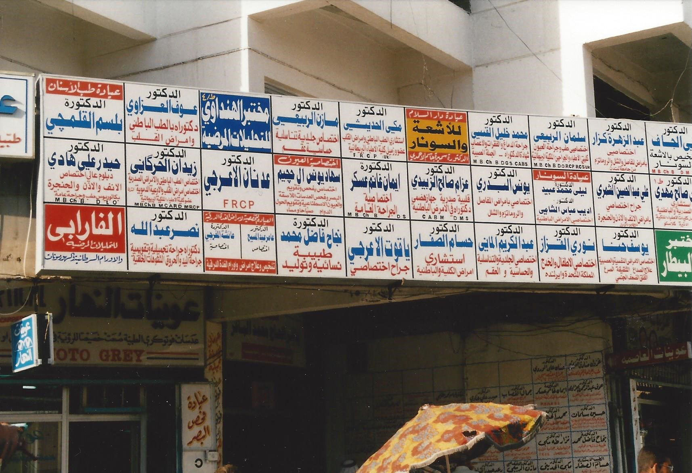

2003年11月29日、混迷を深めるイラクの地から、日本中を震撼させる悲報が届きました。首都バグダード北西のティクリート近郊で、日本大使館の車両が何者かによる銃撃を受け、乗っていた日本人外交官2人とイラク人運転手が殺害されたのです。イラク戦争終戦後における初めての日本人犠牲者となったこの事件は、日本社会に深い衝撃と悲しみをもたらしました。

## 政権崩壊後のイラクと復興支援の最前線

2003年、米英軍の攻撃を受けたイラクではサダム・フセイン独裁政権が崩壊し、新たな統治体制への移行が進められていました。しかし、国内では旧政権関係者や武装勢力による抵抗活動が激化し、治安は極めて不安定な状態に陥っていました。

こうした困難な状況下、現地には日本の在外公館から外交官たちが派遣されていました。彼らの任務は、現地の情勢を正確に把握し、荒廃したイラクの復興支援に向けた人脈構築や調整活動を担うことでした。危険と隣り合わせの環境のなかで、最前線に立って活動を続けていたのが、奥克彦駐英参事官と井ノ上正盛駐イラク三等書記官でした。

## 白昼の急襲　ティクリート近郊で起きた惨劇

2003年11月29日の現地時間午前11時頃、惨劇は起きました。奥参事官、井ノ上書記官、そしてイラク人運転手の3人が乗った日本大使館の公用車（トヨタ・ランドクルーザー）は、首都バグダードから北西に約140キロ離れたティクリートの南郊を走行していました。

その公用車に対し、後ろから猛スピードで追いついてきた別の車から、突如として銃弾が浴びせられました。集中砲火を浴びた車両はコントロールを失い、道路からおよそ30メートル先の農地へと突っ込みました。近くの店舗の店主が車が突入した異変に気づき、警察へ通報したことで事件が発覚しました。

*Various sets of crystal and chinaware found in the basement, in one of Saddam Hussein's palaces in Baghdad during Operation IRAQI FREEDOM - DPLA - 888141f5b68526a16b82b74ec2bf1d45 — 写真: Department of Defense. American Forces Information Service.  / Public domain*

## 車内に残された弾痕と3人の犠牲

通報から約1時間後、警察が現場に到着した際、凄惨な光景が広がっていました。左ハンドル車の運転席にいたイラク人運転手と、前方右座席に座っていた井ノ上書記官は、すでに命を落としていました。後部座席にいた奥参事官は意識不明ながら息があり、直ちにティクリートの病院へ搬送されて懸命な救命措置が行われましたが、午後2時前に死亡が確認されました。

警視庁の発表によると、奥参事官の死因は左側頭部に受けた銃弾による頭蓋内損傷、井ノ上書記官は左胸を撃たれたことによる失血死でした。使用された銃弾を鑑定した結果、口径7.62ミリで右回り4条の腔線を持つ銃器から発射されたものであることが明らかになりました。

*Moschee im Irak — 写真: Mehlauge / CC BY-SA 4.0*

## テロの断定と警視庁による前代未聞の捜査

事件発生を受け、日本政府も迅速な情報収集に追われました。福田康夫内閣官房長官は、弾丸の痕跡が車両の左側に集中している点、さらに車内の金銭や携行品などが一切奪われていなかった点から「テロの可能性が高い」と述べ、テロリストによる犯行との見解を示しました。一方、イラク暫定内閣のフーシュヤール・ズィバーリ外相は、旧フセイン政権の情報機関である情報総局の残党による犯行であると断定しました。

日本国内では、警視庁公安部外事三課が国外で日本人外交官が殺害された事態を重く見て、殺人容疑で捜査を開始しました。イラクに駐留する米軍などとも綿密な情報交換を行い、事件の全容解明と実行犯の特定に向けた調査を進める方針が打ち出されました。

*Ärztehaus in Bagdad (2001) — 写真: Mehlauge / CC BY-SA 3.0*

## 今も未解決のまま残る問いと刻まれた記憶

事件発生から長い年月が経過した現在も、実行犯の逮捕や首謀者の特定には至っておらず、事件は未解決のままとなっています。現場での不可解な状況や政府の対応を巡っては、さまざまな議論や検証が続けられてきました。

国際社会の平和とイラクの復興を願い、遠く離れた異国の地で職務に殉じたふたりの外交官と運転手。彼らの突然の死は、危険地域における在外公館の安全確保の厳しさと、外交活動の重い責任を日本社会に刻み込みました。あの日、激動の中東から届いた訃報は、今なお色あせることのない記憶として語り継がれています。

### 参考資料

- <https://ja.wikipedia.org/wiki/11%E6%9C%8829%E6%97%A5>
- <https://commons.wikimedia.org/wiki/File:Elaborately_decorated_wooden_doors_inside_the_Presidential_Palace_of_former_Iraqi_President_Saddam_Hussein_in_the_city_of_Tikrit,_Iraq,_during_Operation_IRAQI_FREEDOM_-_DPLA_-_048ae2b43f9e7f925cd1f185d4a0e132.jpeg>
- <https://commons.wikimedia.org/wiki/File:Various_sets_of_crystal_and_chinaware_found_in_the_basement,_in_one_of_Saddam_Hussein%27s_palaces_in_Baghdad_during_Operation_IRAQI_FREEDOM_-_DPLA_-_888141f5b68526a16b82b74ec2bf1d45.jpeg>
- <https://commons.wikimedia.org/wiki/File:Moschee_im_Irak.jpg>
- <https://commons.wikimedia.org/wiki/File:%C3%84rztehaus_in_Bagdad_(2001).jpg>
