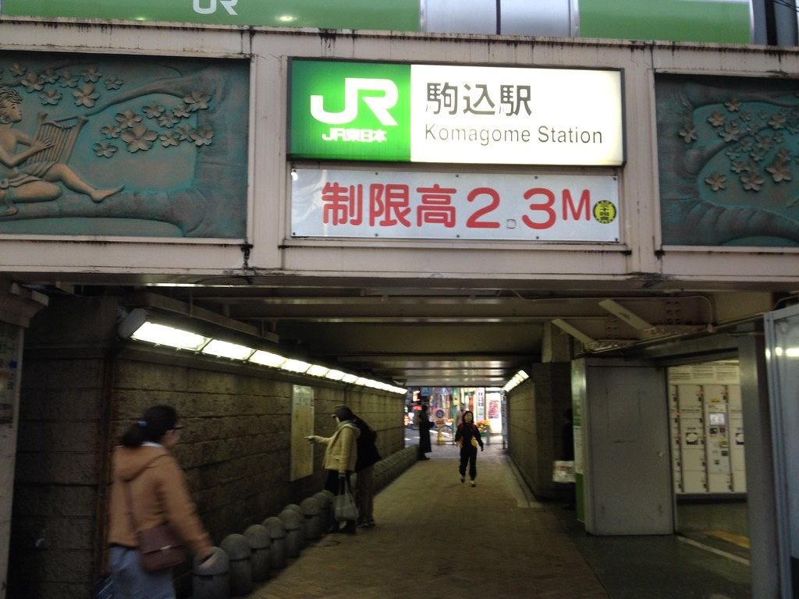
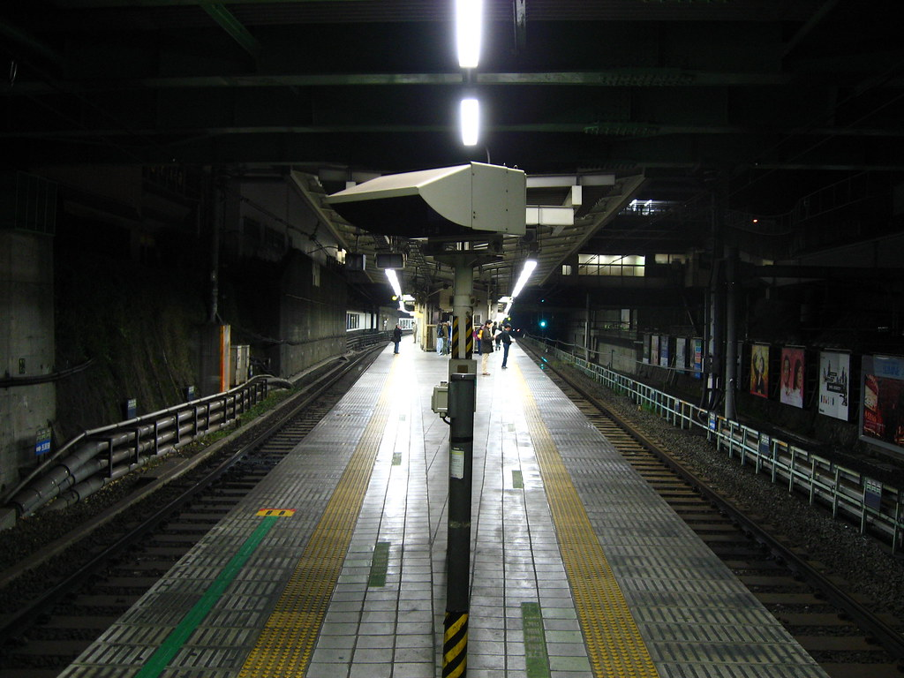
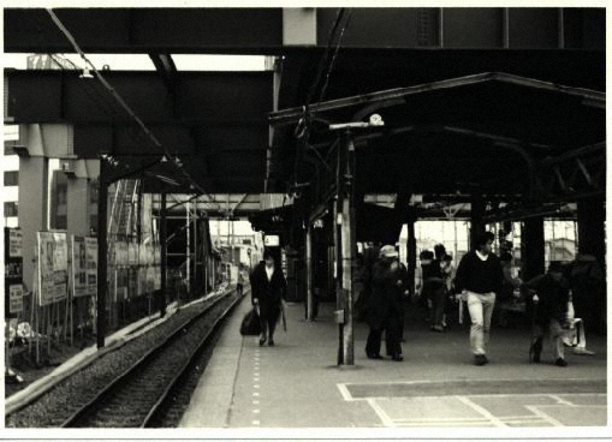

35年前の今日、1991年11月29日。帝都高速度交通営団（現在の東京メトロ）南北線の駒込駅から赤羽岩淵駅までの区間が開業しました。東京の地下鉄ネットワークに、最先端の安全設備と快適性を備えた全く新しい路線が誕生した瞬間でした。

## 免許申請から22年、待ち望まれた新路線の構想

南北線の原点は、1962年6月の都市交通審議会答申第6号にあります。この答申において、目黒方面から飯倉片町、永田町、市ケ谷、駒込、王子を経て赤羽方面へ至る路線として「東京7号線」が位置づけられました。同年に都市計画が決定し、営団地下鉄は上大崎（目黒）から赤羽町（桐ケ丘）までの地方鉄道敷設免許を申請しました。

しかし、その道のりは順風満帆ではありませんでした。1964年には東京都も同区間の敷設免許を申請して競願状態となり、さらに東京都北区内に予定されていた車両基地の設置場所をめぐる問題などから計画は一時中断を余儀なくされました。数々の調整を経て全線の路線免許が交付されたのは、申請から実に22年が経過した1984年4月20日のことでした。

## 「7号ビジョン」が描いた21世紀の地下鉄像

1986年にようやく着工を迎えた南北線の建設では、従来の地下鉄建設とは大きく異なる新しい方針が打ち出されました。高度経済成長期のような単なる輸送力の確保や経済性、採算性だけを追うのではなく、「21世紀を指向する便利で快適な魅力ある地下鉄」を目指す「7号ビジョン」が策定されたのです。

このビジョンでは、「利便性の向上・快適性の向上」「ワンマン運転の実施」「ホームドアの設置」「建設費・運営費の削減」が大きな柱として掲げられました。各駅に独自のステーションカラーを設定し、メディアウォールやシンボル柱などの新しい駅空間デザインを導入したほか、案内サインの規定も見直されるなど、これまでの地下鉄のイメージを一新する試みが随所に盛り込まれました。

*Komagome station — 写真: kemeko1971 / CC BY 2.0*

## 1991年11月29日、駒込〜赤羽岩淵間の先行開業

1991年11月29日、第1期工事区間として駒込駅〜赤羽岩淵駅間が先行開業を迎えました。赤羽岩淵駅は東京23区内にある営団の駅として最北端に位置し、地上のかつての都電赤羽電停跡地近くの地下深くに設けられました。

開業初日に駅を訪れた利用者を驚かせたのは、駅ホームと線路を完全に遮断するフルスクリーン式のホームドアシステムでした。線路への転落や列車との接触事故を物理的に防ぐこの仕組みは、乗客に圧倒的な安心感を与えました。さらに、運転士1名で安全に列車を走らせる自動列車運転装置（ATO）によるワンマン運転が実施され、全駅へのエスカレーターやエレベーター、車椅子対応トイレの完備など、交通弱者に配慮した設備が整えられていました。

*meguro station, 5:45 — 写真: randomidea / CC BY 2.0*

## 親しまれる名前を目指した社内公募と全線への延伸

この路線の名前である「南北線」は、開業に先立って営団職員から広く社内公募されたものでした。寄せられた3,830通（341の路線名）のうち、「南北線」はおよそ半数にあたる1,741通を占めました。地理的に東京を南北へ貫いていること、そして既に親しまれていた東西線と対比をなす名前として最もふさわしいことから正式に決定されました。

駒込〜赤羽岩淵間の先行開業後も工事は進められました。第2期区間では江戸時代の埋蔵文化財の発掘調査や既設路線との立体交差工事といった難工事が続き、1996年の四ツ谷延伸、1997年の溜池山王延伸を経て、2000年9月に目黒駅までの全線が開通しました。総額5,963億8,900万円の建設費が投じられた大事業でした。

*改良工事中の茅ヶ崎駅ホーム — 写真: chigamu / CC BY (Japan Search)*

## 都県境を越えて広がるネットワークと現在の姿

2001年3月28日には、赤羽岩淵駅から埼玉県方面へ延びる埼玉高速鉄道線が開業し、南北線との相互直通運転が始まりました。これにより、赤羽岩淵駅は東京メトロと埼玉高速鉄道の共同使用駅となり、都心と埼玉県南部を結ぶ重要な結節点としての役割を担うようになりました。

2004年4月1日には、帝都高速度交通営団の民営化に伴い、南北線は新設された東京地下鉄（東京メトロ）へと引き継がれました。開業時に導入された吉村弘作曲の発車メロディは2015年に駅独自のメロディへと更新されるなど時代に合わせた変化を続けながらも、フルスクリーン式ホームドアをはじめとする先進的な安全設計は、今も変わらず日々の安全な輸送を支え続けています。

### 参考資料

- <https://ja.wikipedia.org/wiki/11%E6%9C%8829%E6%97%A5>
- <https://pixabay.com/photos/tokyo-japan-city-urban-subway-9826329/>
- <https://www.flickr.com/photos/8868801@N03/7065920649>
- <https://www.flickr.com/photos/60904035@N00/321725611>
- <https://jmapps.ne.jp/chigasaki_history/det.html?data_id=206>
