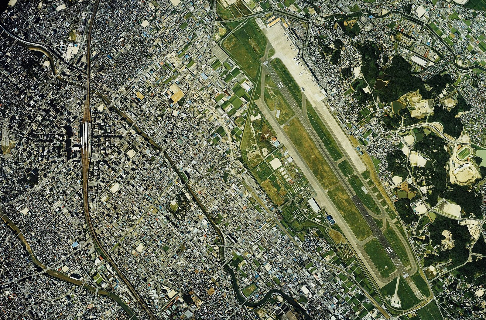
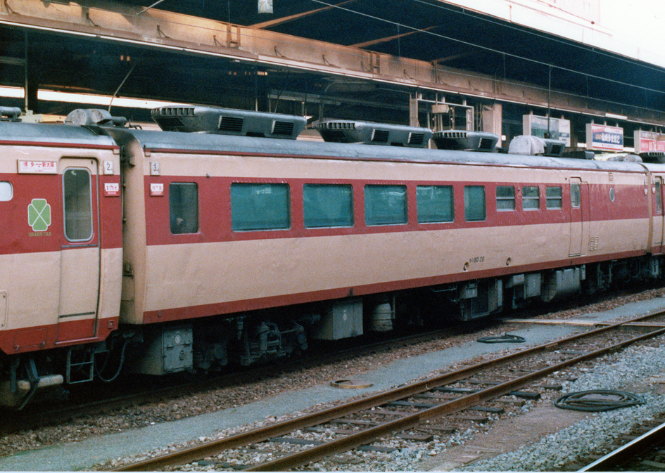
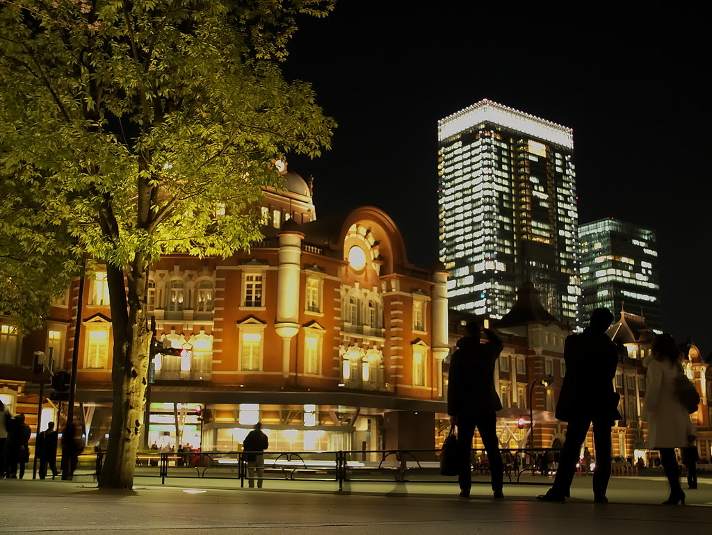

29年前の今日、1997年11月29日。JRの全国ダイヤ改正が行われ、新幹線の歴史に刻まれる大きな変化が訪れました。JR西日本が開発した流線形の新型車両「500系」が東海道新幹線への乗り入れを開始し、東京駅と博多駅の間が初めて5時間以内で結ばれたのです。さらに、長年注目を集めていた「名古屋飛ばし」のダイヤも、この日をもって解消されました。

## 戦闘機のような先頭形状、500系の誕生

山陽新幹線における航空機との競争力強化を目指し、JR西日本が開発したのが500系新幹線です。320 km/hでの営業運転を視野に入れ、トンネル突入時の微気圧波対策として全長27メートルの先頭車両のうち約15メートルにわたるロングノーズが採用されました。客室の断面積を絞るため、車体断面は円形に近い形状となり、旅客機や戦闘機を思わせる独特のデザインは子どもから鉄道ファンまで大きな人気を集めました。1997年3月22日に山陽新幹線で営業運転を始めていた500系は、この日ついに東海道新幹線へと乗り入れを果たしました。

## 東京と博多が5時間以内に結ばれた日

500系の東海道新幹線乗り入れにより、東京駅と博多駅の間は最速4時間49分で結ばれることになりました。日本の二大拠点を5時間以内で結ぶ運行は、鉄道の高速化において極めて象徴的な節目でした。軽量化のためにアルミハニカムパネル構造が使われ、製造費は1両あたり約3億円、16両の1編成で約46億円に達しました。その高い製造コストや独自の客室配置ゆえに、製造は全9編成・144両にとどまりましたが、新幹線の速さを象徴するフラッグシップとして強烈な印象を残しました。

*Fukuoka Airport and Hakata Station areas Aerial photograph — 写真: 国土交通省 / Attribution*

## 「名古屋飛ばし」と呼ばれたダイヤの終止符

この日のダイヤ改正におけるもう一つの大きな出来事が、「名古屋飛ばし」の解消でした。1992年3月に300系で新設された「のぞみ」は、東京駅から新大阪駅への最速運転を実現するため、早朝の下り1本（のぞみ301号）のみ名古屋駅と京都駅を通過する運行体系をとっていました。中京圏をはじめ各方面で大きな議論を呼んだこの早朝の通過ダイヤでしたが、1997年11月29日の改正によって、すべての「のぞみ」が名古屋駅と京都駅に停車することになりました。

*JNR kishi80 20 — 写真: spaceaero2 / CC BY 3.0*

## 在来線や停車駅にも及んだ見直し

1997年11月29日の改正では、スピードアップと効率化に伴い、さまざまな見直しが同時に行われました。山陽新幹線の「ひかり」の停車駅が再編され、東広島駅や新岩国駅が通過扱いとなったほか、在来線でも東京と九州を結ぶ寝台特急の運転区間が短縮されるなど、長距離輸送の主役が新幹線へと完全にシフトしていく過程を映し出す改正となりました。

*tokyo station — 写真: keroyama / CC BY 2.0*

## 今へと続く三大都市圏の鉄道輸送

現在、東海道新幹線のすべての定期旅客列車は名古屋駅と京都駅に停車し、東京・中京・京阪神の三大都市圏を安定して結んでいます。先頭車両の鋭いノーズや円形断面など、高速運転への挑戦が刻まれた500系の東海道直通開始と、停車パターンの統一。日本の大動脈が新たなスピードと秩序を手に入れた一日でした。

### 参考資料

- <https://ja.wikipedia.org/wiki/%E6%96%B0%E5%B9%B9%E7%B7%9A500%E7%B3%BB%E9%9B%BB%E8%BB%8A>
- <https://commons.wikimedia.org/wiki/File:951-1_RTRI_Kokubunji_199711.jpg>
- <https://commons.wikimedia.org/wiki/File:Fukuoka_Airport_and_Hakata_Station_areas_Aerial_photograph.jpg>
- <https://commons.wikimedia.org/wiki/File:JNR_kishi80_20.jpg>
- <https://www.flickr.com/photos/100144693@N08/11324073926>
