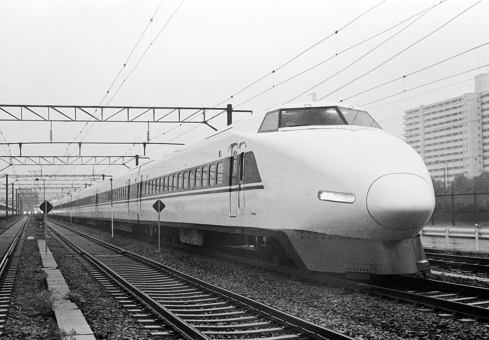
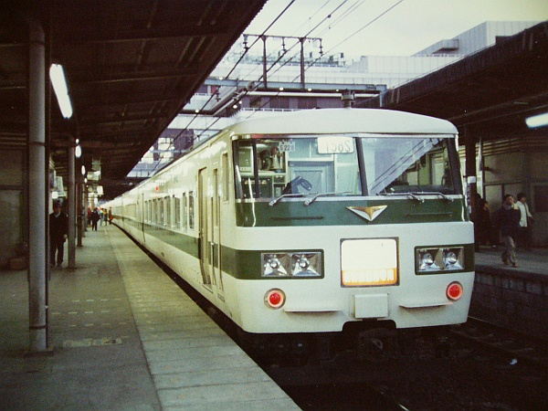
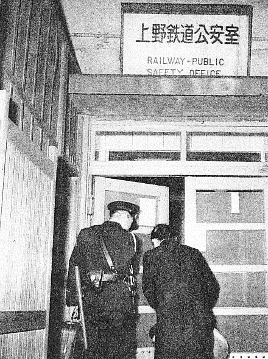

41年前の今日、1985年11月29日。首都圏と大阪を結ぶ国鉄の路線網で通信ケーブルが相次いで切断され、総武線の浅草橋駅が放火されるという前代未聞の同時多発ゲリラ事件が起きました。朝の通勤・通学時間帯を直撃したこの事件により、大都市の交通網は壊滅的な打撃を受けました。

## 国鉄改革をめぐる対立と緊迫の背景

1980年代半ば、中曽根康弘内閣のもとで赤字にあえぐ日本国有鉄道の分割民営化が強力に推進されていました。政府の方針に対し、国鉄労働組合や動労千葉などの労働組合は激しい反対闘争を展開していました。

こうした労組の動きと同調するように、新左翼党派である中核派が民営化阻止を掲げて過激な実力行使へと傾斜していきました。社会的な議論が紛糾するなかで、日常の市民生活を巻き込む形での暴発が懸念されていました。

## 未明の同時破壊工作と信号網の寸断

この日の午前3時ごろ、事態は一気に表面化しました。東京都、神奈川県、埼玉県、千葉県、大阪府など8都府県にまたがる国鉄施設の計33カ所で、通信用や信号用のケーブルが一斉に切断されたのです。

太い幹線ケーブルには釘を打ち込んでショートさせる手口が用いられ、8カ所の変電施設や信号所でも侵入や放火が行われました。指令所との通信が断たれた山手線や中央線など22の国鉄線区に加え、一部の私鉄でも運行が不能となりました。

*1985年の資料 — 写真: Shellparakeet / CC0*

## 浅草橋駅への乱入と火炎瓶による放火

通信網の麻痺に続き、午前6時45分ごろには東京都台東区の総武本線浅草橋駅で暴力行為が発生しました。ヘルメットをかぶった約120人の集団が駅のシャッターをこじ開けて構内に乱入したのです。

集団は駅舎の窓ガラスや施設を破壊し、火炎瓶を投げつけて火を放ちました。駅舎は炎と煙に包まれ、同駅の国鉄線はこの日、終日にわたって営業停止に追い込まれました。なお、同じ駅に乗り入れていた都営地下鉄浅草線には被害が及びませんでした。

*185-200 Shinkansen Relay Omiya 1982 — 写真: Peee at Japanese Wikipedia / CC BY-SA 3.0*

## 650万人以上の足が乱れた大混乱の朝

この一連の破壊活動により、首都圏で2896本、大阪地区で378本、合わせて3274本の列車が運休となりました。運休と大幅な遅延の影響を受けた乗客は、少なくとも650万人以上に達しました。

さらに、みどりの窓口を結ぶ座席予約システムであるマルスも通信途絶により一時全面停止しました。年末年始の指定券発売日を直前に控えた時期であり、全国の主要駅の窓口でも大きな混乱が生じました。

*Ueno Railway-Public Safety Office in 1950s — 写真: Unknown authorUnknown author / Public domain*

## 世論の反発と民営化への加速

事件の実行犯グループには、現役の国鉄職員や公務員が含まれていたことが警察の調べで明らかになりました。一般市民の足を奪い、駅舎を焼き払うという暴力行為に対して、世論からは強い批判と怒りの声が沸き起こりました。

それまで民営化に慎重だった層も含め、過激派の暴走への反感から改革推進を支持する流れが決定的なものとなりました。反対運動は社会的孤立を深め、結果として民営化の流れを一段と加速させる皮肉な結末を迎えました。

## 今日に残る教訓と鉄道インフラの防護

この事件から1年半余りを経た1987年4月1日、国鉄は分割民営化され、JRグループ各社が誕生しました。鉄道の運行管理や治安対策は大幅に強化され、重要ケーブルを保護するトラフの固縛など物理的な防護策が徹底されました。

都市の動脈である鉄道網が突如として奪われたあの朝の記憶は、インフラの脆弱性と安全確保の重要性を伝える歴史の一幕として今も刻まれています。

### 参考資料

- <https://ja.wikipedia.org/wiki/11%E6%9C%8829%E6%97%A5>
- <https://commons.wikimedia.org/wiki/File:100_series_X0_%26_Doctor_Yellow_set_T2.jpg>
- <https://commons.wikimedia.org/wiki/File:100_series_X0_(2).jpg>
- <https://commons.wikimedia.org/wiki/File:185-200_Shinkansen_Relay_Omiya_1982.jpg>
- <https://commons.wikimedia.org/wiki/File:Ueno_Railway-Public_Safety_Office_in_1950s.jpg>
