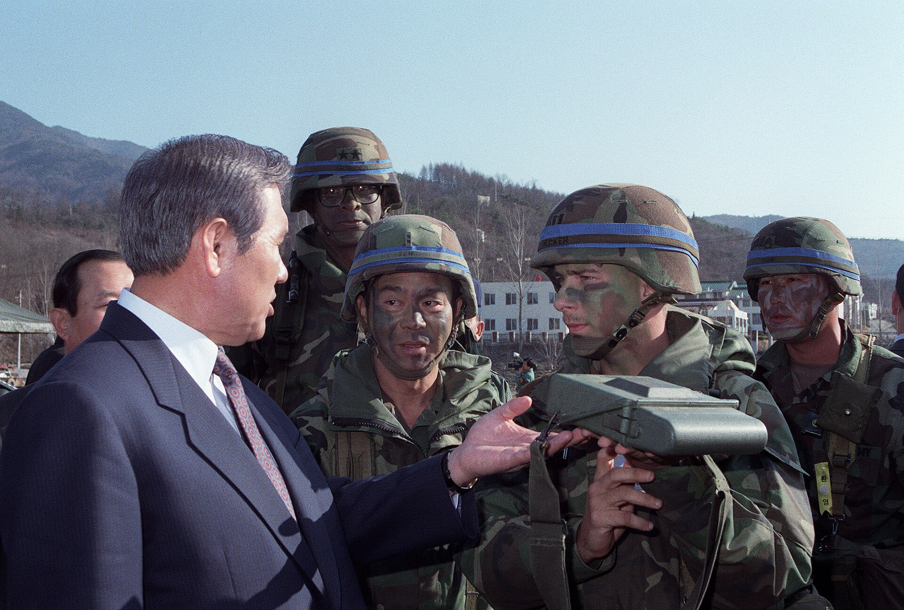
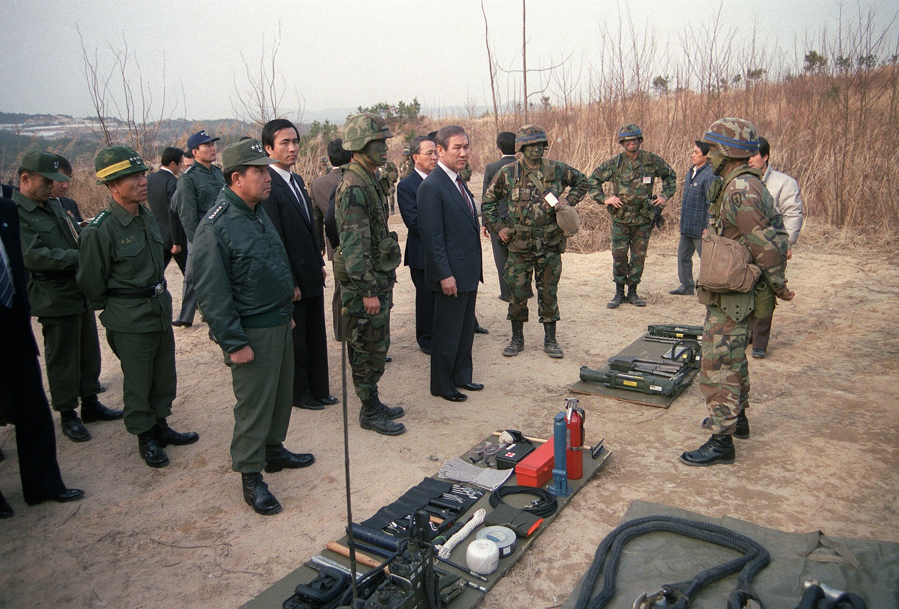
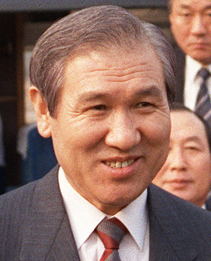

32년 전 오늘, 1994년 10월 30일 신문 1면에는 국민들의 눈을 의심케 하는 수사 결과가 일제히 실렸습니다. 1979년 12월 12일 밤 일어났던 군사 충돌을 수사해 온 검찰이 이를 '치밀한 계획에 따른 군사반란'으로 공식 규정하면서도, 주동자인 전두환·노태우 두 전직 대통령을 비롯한 가담자 전원을 재판에 넘기지 않기로 결정한 것입니다.

## 15년 만에 내려진 12·12 사태에 대한 사법 판단

1993년 문민정부가 출범하면서 과거 군사정권의 출발점이었던 12·12 사태에 대한 진상 규명 요구가 본격화되었습니다. 1993년 7월 19일, 당시 신군부에 의해 강제로 지휘권을 빼앗겼던 정승화 전 육군참모총장과 장태완 전 수도경비사령관 등 22명은 전두환·노태우 등 신군부 핵심 인사 34명을 군형법상 반란 및 내란 목적 살인 혐의로 서울지검에 고소했습니다. 10·26 사건 이후 신군부가 정권을 잡는 계기가 됐던 하극상 사건에 대해 15년 만에 사법적 조사가 시작된 것입니다.

## 검찰의 수사 결과: 치밀하게 계획된 군사반란

1994년 10월 29일 오전, 서울지검 조준웅 1차장검사는 1년 넘게 진행된 12·12 사건 최종 수사 결과를 발표했습니다. 검찰의 결론은 명확했습니다. 당시 전두환 합동수사본부장이 자신에 대한 인사 조치를 사전에 차단하고 소장 군부세력의 군내 입지를 보전하기 위해 정승화 육군참모총장을 제거하고 군의 주도권을 장악한 치밀한 군사반란이었다는 점을 공식 확인했습니다.

검찰은 반란의 구체적 근거로 여러 사실을 제시했습니다. 수사와 무관한 일선 사단장과 공수여단장 등을 경복궁 30경비단에 집결시킨 점, 거사 직전 육본 직할부대장들을 요정으로 유인해 발을 묶은 점, 최규하 대통령의 재가도 받지 않고 정 총장을 강제 연행한 점, 정규 지휘계통을 무시하고 부대를 동원해 중앙청과 국방부, 육군본부를 무력 점령한 점 등이 모두 드러났습니다.

*사건 당시 사진 아님 · 1990년 — 사진: CHERIE A. THURLBY / Public domain*

## “죄는 인정되나 처벌은 않는다”… 34명 전원 기소유예

검찰은 피고소·고발인 38명 가운데 전두환 전 대통령에게 군형법상 '반란수괴' 혐의를, 노태우 전 대통령 등에게는 '반란모의 참여 및 중요임무 종사', 불법진퇴, 상관살해, 초병살해 등의 혐의를 엄격히 적용했습니다. 사형이나 무기징역까지 가능한 중범죄 혐의였습니다.

하지만 검찰이 내놓은 최종 처분은 반전이었습니다. 적극 가담자 35명 중 이미 사망한 1명을 제외한 34명 전원을 '기소유예' 처분하고, 정호용 전 사단장 등 단순 가담자 3명에게는 공소시효 만료 등을 이유로 '공소권 없음' 결정을 내렸습니다. 검찰은 피의자들을 기소할 경우 재판 과정에서 국론 분열과 대립이 재연돼 국력을 소모할 우려가 있고, 지난 14년간 국가 발전에 기여한 점을 참작했다고 밝혔습니다.

*사건 당시 사진 아님 · 1989년 — 사진: Al Chang / Public domain*

## 거센 사회적 반발과 사법 정의 논란

명백한 군사반란이자 상관 살해 혐의를 인정하면서도 기소조차 하지 않겠다는 검찰의 발표는 사회에 막대한 충격을 안겼습니다. 언론과 학계, 시민단체는 '성공한 쿠데타에는 면죄부를 주는 것이냐', '검찰이 정치권력의 눈치를 보며 법을 버렸다'는 강도 높은 비판을 쏟아냈습니다.

피해 장성들과 시민들은 검찰의 자의적인 불기소 처분에 불복해 헌법재판소에 헌법소원을 제기했습니다. 군의 기강을 무너뜨리고 헌정 질서를 훼손한 행위를 정치적 고려로 덮을 수는 없다는 국민적 법감정이 거세게 들끓었습니다.

*사건 당시 사진 아님 · 1989년 — 사진: CHERIE A. THURLBY / Public domain*

## 뒤집힌 면죄부, 결국 법정에 서다

이 모순된 결정은 오래가지 못했습니다. 이듬해인 1995년 검찰이 5·18 사건에 대해서도 불기소 결정을 내리자 국민적 분노는 극에 달했습니다. 여기에 1995년 10월 노태우 전 대통령의 비자금 사건이 폭로되면서 정국은 급변했습니다. 헌법재판소는 성공한 쿠데타도 사법 심판의 대상이 될 수 있다는 판단을 내렸고, 국회는 5·18 특별법을 제정해 공소시효를 정지시켰습니다.

결국 1995년 12월 검찰은 전면 재수사에 착수해 전두환·노태우 두 전직 대통령을 구속했습니다. 대법원은 12·12를 군사반란으로, 5·17을 내란으로 최종 판결하며 주동자들에게 중형을 확정했습니다. 1994년 10월 검찰이 내렸던 '기소유예' 처분은 헌정사의 부끄러운 기록으로 남았지만, 역사를 바로잡고 불의를 단죄해야 한다는 거대한 국민적 요구를 촉발하는 도화선이 되었습니다.

### 참고 자료

- <https://newslibrary.naver.com/viewer/index.naver?articleId=1994103000329101001&editNo=20&printCount=1&publishDate=1994-10-30&officeId=00032&pageNo=1&printNo=15241&publishType=00010>
- <https://archive.org/details/sthkleafndsk001>
- <https://commons.wikimedia.org/wiki/File:Roh_Tae-woo_-_cropped,_1990-Mar-13.jpg>
- <https://commons.wikimedia.org/wiki/File:Roh_Tae-woo_-_cropped,_1989-Mar-13_05.jpg>
- <https://commons.wikimedia.org/wiki/File:Roh_Tae-woo_1989-03-13.jpg>
