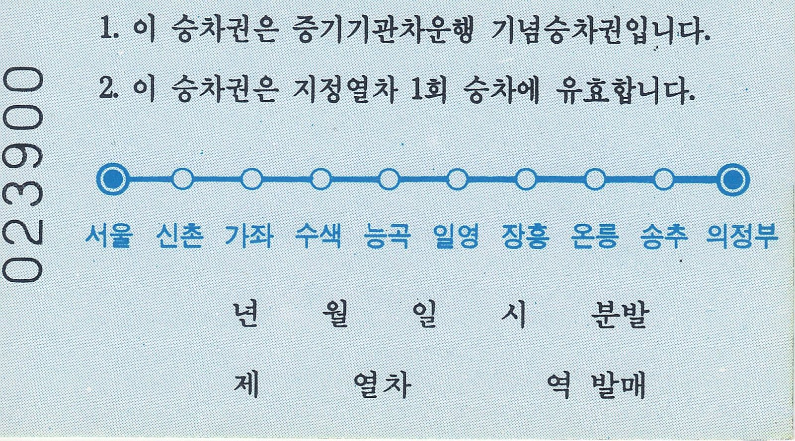
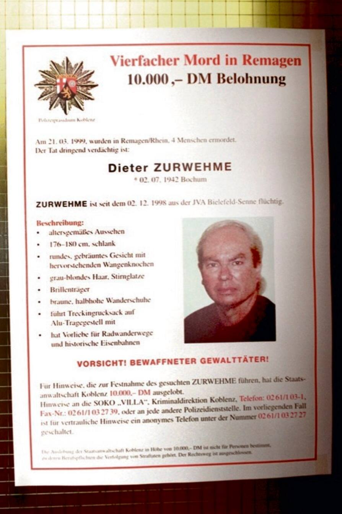

27년 전 오늘, 1999년 10월 30일. 10년 넘게 도피 생활을 이어오던 전직 경찰관 이근안이 불법감금과 독직가혹행위 혐의로 마침내 구속 수감됐습니다. 오랜 세월 수사망을 피해 숨어 있던 그가 제 발로 나타나 법의 심판대에 오른 순간이었습니다.

## 어둠 속에서 드러난 도피 10년의 전말

이근안은 1970년대부터 대공과 공안 수사관으로 활동하며 수많은 야당 인사와 학생 운동가들을 가혹하게 취조해 악명을 떨쳤습니다. 1988년 말 수배를 받자마자 종적을 감췄고, 이후 10년이 넘도록 자취를 찾지 못해 수사 당국의 추적은 번번이 허탕으로 끝났습니다. 사회적 공분을 샀던 대표적인 인물이 홀연히 사라진 채 세월이 흐르며 사건은 미궁에 빠지는 듯했습니다.

## 1999년 10월 28일 검찰 자수와 구속

상황은 1999년 10월 28일 급반전되었습니다. 61세의 이근안이 수원지검 성남지청에 직접 나타나 자수한 것입니다. 수원지법 성남지원 형사합의부는 10월 29일 납북어부 김성학 씨를 불법 감금하고 폭행 및 가혹행위를 저지른 혐의로 이근안에 대한 영장실질심사를 열었습니다. 재판부는 장기간 도피했고 증거를 없애거나 다시 도주할 우려가 있다고 판단해 직권으로 구속영장을 발부했습니다.

*1999 Gyooe line ticket-back — 사진: Jerrykim306 / CC BY-SA 4.0*

## 집 안 창고방 상자 뒤에 마련된 은신처

구속영장이 집행되면서 이근안은 성동구치소에 수감되었습니다. 검찰 조사에서 드러난 그의 도피 행각은 시민들에게 큰 충격을 안겼습니다. 이근안은 잠적 후 첫 1년 동안 기차를 타고 지방 여행을 다녔으며, 그 뒤로는 줄곧 서울 동대문구 용두동 자택에 마련한 비밀 은신처에서 숨어 지냈다고 털어놓았습니다. 검찰이 자택을 수색한 결과 창고방에 허술하게 쌓아 둔 상자 뒤편에서 실제 은신 공간이 확인되었습니다.

![[1823호] 민생치안 민생치안 (1990.10.17) 장면 2](../images/2026-10-30-03-3.jpg)
*[1823호] 민생치안 민생치안 (1990.10.17) 장면 2 — 사진: KTV 국민방송 e영상역사관 (미공개 대한뉴스) / KTV 공공저작물 — 영상 저작물 전면 개방(대통령실 2025-07-09), 출처 표시*

## 도피 비호 세력과 고문 윗선을 향한 수사

오랜 기간 동안 집 안에 숨어 지낼 수 있었던 배경을 두고 의혹이 쏟아졌습니다. 이근안은 도피 초기 동료들이 아내에게 매달 30만원가량의 생활비를 주었다고 진술했습니다. 검찰 강력부는 동료 경찰관들이 도피를 돕거나 은닉했는지 철저히 가리겠다고 밝혔습니다. 아울러 당시 김근태 씨 고문 사건 등 과거의 가혹행위를 지시한 윗선이 누구였는지에 대해서도 집중 조사를 벌였습니다.

*Dieter Zurwehme wanted poster — 사진: Unknown authorUnknown author / CC0*

## 역사의 상처와 뒤늦은 법의 심판

이근안은 이후 재판을 거쳐 징역 7년과 자격정지 7년 형을 확정받고 2006년 11월 만기 출소했습니다. 그가 남긴 고문의 상처는 피해자들과 그 가족들에게 평생 지울 수 없는 고통으로 남았습니다. 1999년 10월 30일 신문 지면을 가득 채웠던 고문기술자의 구속 소식은 부끄러운 어두운 과거사를 직시하게 만든 상징적인 사건으로 기록되어 있습니다.

### 참고 자료

- <https://newslibrary.naver.com/viewer/index.naver?articleId=1999103000289101001&editNo=6&printCount=1&publishDate=1999-10-30&officeId=00028&pageNo=1&printNo=3646&publishType=00010>
- <https://commons.wikimedia.org/wiki/File:1999_Gyooe_line_ticket.jpg>
- <https://commons.wikimedia.org/wiki/File:1999_Gyooe_line_ticket-back.jpg>
- <https://www.ehistory.go.kr/view/movie?mediasrcgbn=KV&mediaid=30000350&mediadtl=42724&mediagbn=DK#t=0.7>
- <https://commons.wikimedia.org/wiki/File:Dieter_Zurwehme_wanted_poster.jpg>
