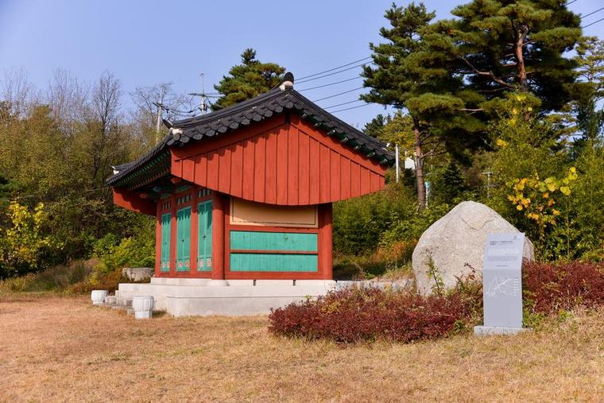
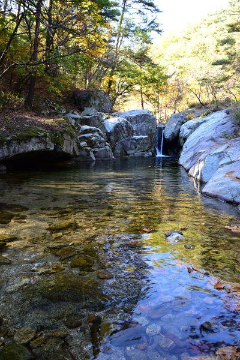

48년 전 오늘, 1978년 10월 30일. 강원도 산간과 제주도 한라산에 때이른 폭설이 쏟아졌습니다. 아직 가을의 정취가 남아 있던 10월 말, 대관령과 설악산 일대는 순식간에 은세계로 변하며 큰 혼란이 일어났습니다.

## 대관령과 한라산에 쏟아진 최고 70센티미터의 눈

주말이었던 1978년 10월 28일 밤부터 29일 사이, 강원도 영동산악지방과 제주도에 믿기 힘든 날씨가 닥쳤습니다. 대관령과 설악산을 비롯한 강원도 산간 지대, 그리고 제주도 한라산 일대에 최고 적설량 70센티미터에 이르는 엄청난 눈이 쏟아진 것입니다.

가을 단풍 구경이 한창이어야 할 시기에 산간 지역 전체가 두꺼운 눈으로 뒤덮였습니다. 눈은 그칠 줄 모르고 쏟아져 산간 마을과 고갯길을 순식간에 가로막았습니다.

## 현지 측후소가 전한 32년 만의 10월 기상이변

이례적인 눈 폭탄에 기상 관계자들도 놀라움을 감추지 못했습니다. 현지 측후소는 이 같은 10월 폭설이 무려 32년 만에 처음 발생한 일이라고 밝혔습니다.

통상 강원도 산간 지역이라 하더라도 10월 하순에 수십 센티미터의 폭설이 내리는 것은 매우 드문 일이었습니다. 32년 만에 찾아온 계절을 앞서간 눈 폭탄 소식은 당시 신문 1면을 장식하며 온 나라의 이목을 집중시켰습니다.

*사건 당시 사진 아님 — 사진: 강원특별자치도, 한국문화정보원 / KOGL Type 1 attribution*

## 서울~속초 간 육상교통 15시간 전면 마비

철이른 대폭설은 곧바로 심각한 교통 혼란으로 이어졌습니다. 험준한 산악 도로를 넘나들어야 했던 서울과 속초 간의 육상교통이 15시간 동안 완전히 마비되었습니다.

고갯길에 갑작스럽게 쌓인 눈 때문에 차량들이 옴짝달싹하지 못한 채 도로 위에 갇혔습니다. 제설 장비가 부족했던 당시 산길을 지나던 승객들과 운전자들은 15시간 동안 추위와 고립 속에서 큰 불편을 겪어야 했습니다.

*사건 당시 사진 아님 — 사진: 국가유산청 / KOGL Type 1 attribution*

## 영하 7도, 전방 고지까지 얼어붙은 늦가을 한파

폭설과 함께 전국적인 한파도 몰아닥쳤습니다. 지난 주말부터 전국적으로 내린 늦가을비가 그치자마자 찬 대륙성 기온이 밀려들며 전국의 수은주가 급격히 곤두박질쳤습니다.

10월 30일 아침, 중동부전선의 백암산은 기온이 영하 7도까지 내려갔습니다. 전방의 주요 고지들이 일제히 영하권을 기록하면서 국방의 최전선은 물론 전국 각지에서 겨울이 성큼 다가왔음을 실감해야 했습니다.

![[1171호] 제8회 회장컵 쟁탈 스키대회 제8회 회장 컵 쟁탈 스키대회 대관령 용평에서 열림 (1978.02.10) 장면 1](../images/2026-10-30-04-4.jpg)
*[1171호] 제8회 회장컵 쟁탈 스키대회 제8회 회장 컵 쟁탈 스키대회 대관령 용평에서 열림 (1978.02.10) 장면 1 — 사진: KTV 국민방송 e영상역사관 (대한뉴스) / KTV 공공저작물 — 영상 저작물 전면 개방(대통령실 2025-07-09), 출처 표시*

## 하늘에서 내려다본 대관령의 은세계

당시 동아일보의 취재 비행기인 보라매호는 곧바로 강원도 상공으로 날아올랐습니다. 안호원 조종사의 조종 아래 성윤경 기자가 평창군 대관령 일대를 하늘에서 카메라에 담았습니다.

취재진이 항공 촬영한 사진 속 강원도 평창군 대관령 일대는 온통 하얀 눈에 덮여 장관을 이루었습니다. 구불구불한 대관령 고갯길과 산마루가 10월의 가을빛 대신 한겨울의 설국으로 변해 있는 모습이 신문을 통해 생생하게 전해졌습니다.

## 계절을 잊은 폭설이 남긴 그 시절의 기억

1978년 10월의 폭설은 단풍의 붉은빛과 새하얀 눈이 공존했던 이례적인 자연의 풍경으로 오랜 시간 사람들의 뇌리에 남았습니다.

가을 걷이를 미처 다 끝내지 못했던 농가와 군 장병들, 그리고 대관령을 넘나들던 버스 승객들에게 32년 만의 10월 폭설은 잊을 수 없는 추억이자 소동이었습니다. 지금도 늦가을 대관령에 서릿발이 서고 찬 바람이 불어올 때면, 48년 전 그날 도로를 멈춰 세웠던 하얀 눈 소식을 떠올리게 됩니다.

### 참고 자료

- <https://newslibrary.naver.com/viewer/index.naver?articleId=1978103000209201015&editNo=2&printCount=1&publishDate=1978-10-30&officeId=00020&pageNo=1&printNo=17559&publishType=00020>
- <https://www.kogl.or.kr/recommend/recommendDivView.do?division=img&recommendIdx=8398>
- <https://www.kogl.or.kr/recommend/recommendDivView.do?division=img&recommendIdx=287>
- <https://www.ehistory.go.kr/view/movie?mediasrcgbn=KV&mediaid=10142&mediadtl=20677&mediagbn=DH#t=0.3>
