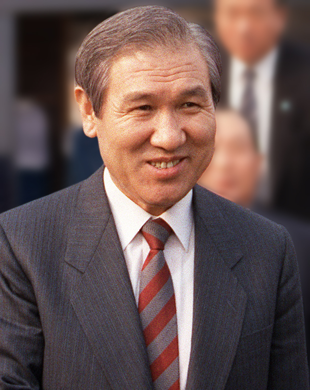
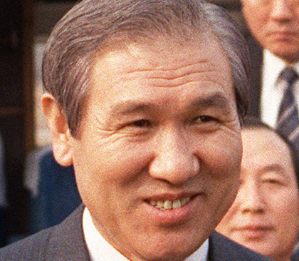
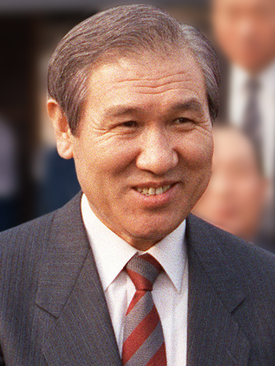

36년 전 오늘, 1990년 10월 30일. 정부가 단단히 묶여 있던 개발제한구역, 이른바 그린벨트의 건축 및 토지 이용 규제를 대폭 완화한다고 발표했습니다. 집 한 칸 수리하기조차 버거웠던 구역 내 주민들에게는 오랜 갈증을 달래는 소식이었지만, 동시에 공공 개발로 인한 자연 훼손 우려도 함께 불거졌습니다.

## 묶여 있던 개발제한구역, 숨통 트인 주민 주거 규제

그린벨트가 지정된 이래 해당 구역에 거주하던 주민들은 주택 개보수나 증축에서 극심한 제약을 받아왔습니다. 지하실이 없는 일반 단층 주택이라 해도 연면적 30평을 초과할 수 없어 자녀가 자라거나 식구가 늘어도 방을 더 마련하기 어려웠습니다. 이에 따라 주민들의 생활 불편과 재산권 침해에 대한 불만이 꾸준히 누적되었습니다.

건설부는 이러한 민원을 반영해 도시계획법 시행규칙과 개발제한구역 관리규정을 개정했습니다. 그린벨트 지정 전부터 터를 잡고 살아온 원주민에 한해 지하층이 없는 주택의 지상층 면적을 기존 30평에서 5평 늘어난 최대 35평까지 증개축할 수 있도록 허용했습니다. 다만 지정 이후 집을 사서 들어온 주민은 종전처럼 30평 제한을 그대로 유지하도록 차등을 두었습니다.

## 15평 미만 신고제 전환과 영농시설 대폭 확대

주거 편의와 더불어 절차상의 문턱도 낮아졌습니다. 기존에는 작은 규모의 증축이라도 일일이 행정 관청의 사전 허가를 받아야 했으나, 15평 미만의 증축은 단순 신고만으로 가능하도록 절차를 간소화했습니다. 이에 따라 복잡한 인허가 서류를 준비하던 농가들의 행정적 부담이 크게 줄어들었습니다.

농업 관련 시설 규제도 손질됐습니다. 종전에는 30평까지만 지을 수 있었던 버섯재배사 규모를 표준 영농 규모에 맞춰 90평까지 세 배로 확대 신축할 수 있게 했습니다. 또한 마을 부락 공동 명의로만 허용되었던 양식장 설치 자격을 개인 농가에게도 개방하여 생계 활동의 폭을 넓혔습니다.

*사건 당시 사진 아님 · 1989년 — 사진: CHERIE A. THURLBY / Public domain*

## 시청사와 구치소까지, 공공기관 신축의 빗장을 열다

이번 조치의 이면에는 공공기관의 부지 부족 문제를 해결하려는 목적이 크게 자리 잡고 있었습니다. 당초 300평 이상의 대규모 공공건물을 지으려면 국무회의 심의를 거쳐야 했으나, 이번 개정으로 건설부장관의 승인만 받으면 지을 수 있도록 절차가 대폭 간소화되었습니다.

특히 관할구역의 3분의 2 이상이 개발제한구역으로 묶여 청사를 마련하지 못하던 지자체들의 숨통이 트였습니다. 경기도 미금시, 구리시, 의왕시, 시흥시, 하남시와 부산 강서구 등 신설 또는 승격된 시·구 지역의 청사와 경찰서 신축이 공식 허용되었습니다. 여기에 대구와 대전의 보훈병원 신축, 대구와 울산의 미결수 구치소 신축도 그린벨트 내에 들어설 수 있는 길이 열렸습니다.

*사건 당시 사진 아님 · 1989년 — 사진: CHERIE A. THURLBY / Public domain*

## 휴식 시설 확충과 행정 권한 하부 위임

그린벨트 공간을 여가 휴식 공간으로 활용하려는 시도도 포함되었습니다. 국가와 지방자치단체는 계곡, 호수, 강변, 사적지 등에 잔디광장, 피크닉장, 체력단련시설, 야외수영장 등을 설치해 시민들에게 개방할 수 있게 되었습니다. 또한 지정 전부터 대지였던 나대지에는 국민체육진흥관리공단이 테니스장, 배구장, 배드민턴장 등 간이 체육시설을 관리할 수 있도록 했습니다.

교통과 물류 시설을 위한 조항도 마련되었습니다. 버스 노선의 시점과 종점이 그린벨트에 위치할 경우, 시가 부지를 사들여 시내버스 공동차고지를 조성한 뒤 버스회사에 임대할 수 있게 했으며 송유관 매설도 허용했습니다. 이와 함께 건설부장관 권한 20건 중 10건은 도지사에게, 6건은 시장·군수에게 넘기고, 도지사 권한 26건 중 15건을 시장·군수에게 위임해 인허가 처리 속도를 높였습니다.

*사건 당시 사진 아님 · 1989년 — 사진: CHERIE A. THURLBY / Public domain*

## 환경 훼손 논란과 오늘날 남아 있는 숙제

정부는 주민 생활 편의를 명분으로 내세웠으나 발표 직후 거센 비판에 부딪혔습니다. 완화된 총 16개 항목 가운데 주민을 위한 것은 5개에 불과했고, 나머지 11개 조항은 정부와 공공기관의 필요에 따른 시설 신축 허용이었기 때문입니다. 환경보호론자들과 시민사회는 정부가 땅값 상승과 도심 팽창을 막기 위해 지정한 보존 공간을 스스로 훼손하고 있다고 강하게 반발했습니다.

자연환경 보전이라는 공익과 거주민의 기본권, 도시의 효율적인 확장이라는 세 가지 가치는 1990년 가을에도 팽팽히 맞섰습니다. 36년이 흐른 지금도 개발제한구역을 둘러싼 논쟁은 토지 정책과 환경 보전의 가장 첨예한 화두로 이어지고 있습니다.

### 참고 자료

- <https://newslibrary.naver.com/viewer/index.naver?articleId=1990103000209201003&editNo=2&printCount=1&publishDate=1990-10-30&officeId=00020&pageNo=1&printNo=21284&publishType=00020>
- <https://commons.wikimedia.org/wiki/File:South_Korean_counter-tunnel_(1990).JPEG>
- <https://commons.wikimedia.org/wiki/File:Roh_Tae-woo_-_cropped,_1989-Mar-13.jpg>
- <https://commons.wikimedia.org/wiki/File:Roh_Tae-woo_1989-03-13_(headshot).jpg>
- <https://commons.wikimedia.org/wiki/File:Roh_Tae-woo_March_1989_(3x4).jpg>
