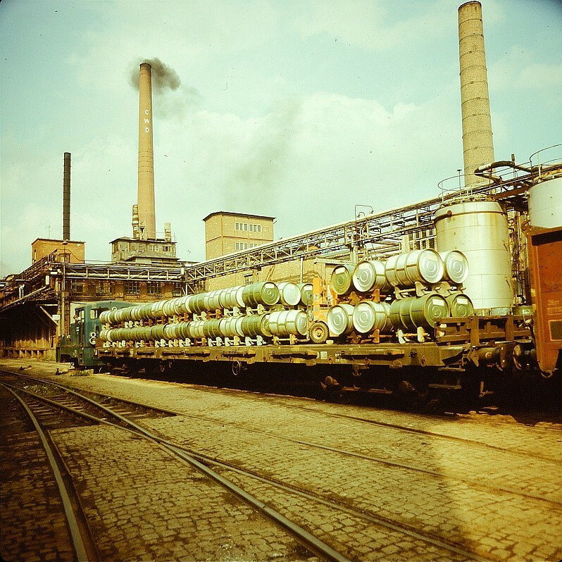
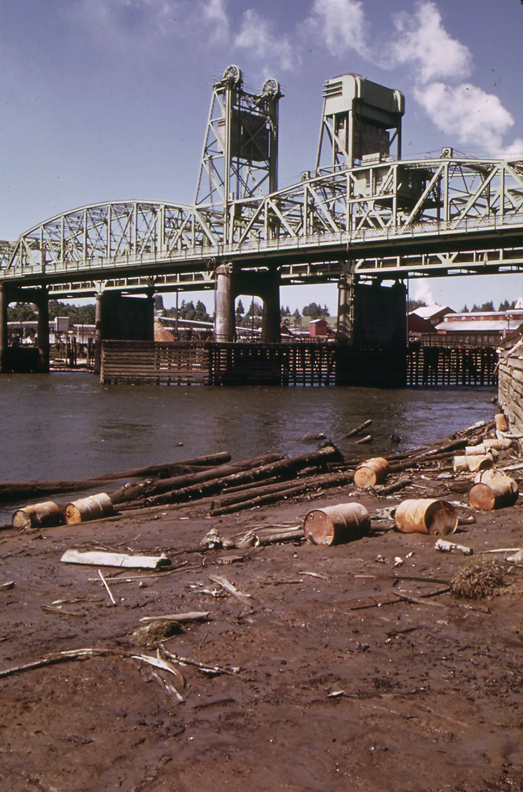
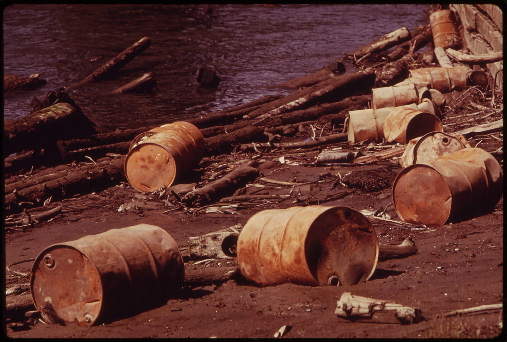

45년 전 오늘, 1981년 10월 30일. 석유수출국기구(OPEC)가 배럴당 34달러로 기준 유가를 단일화했다고 발표했습니다. 세계 석유 시장의 가격 혼란을 잡기 위한 조치였지만, 한국 경제에는 곧바로 기름값 인상이라는 거센 불똥이 튀었습니다.

## 30개월의 가격 혼란, 제네바에서 마침표를 찍다

1970년대 두 차례의 오일쇼크를 거치며 세계 경제는 원유 가격 변동에 극도로 민감해져 있었습니다. 산유국 간의 입장 차이로 인해 국제 유가는 극심한 난맥상을 겪고 있었습니다. 기준 유가는 배럴당 32달러와 36달러로 쪼개져 있었고, 일부 고유가 국가들은 프리미엄을 붙여 최고 41달러까지 원유를 팔았습니다.

세계 석유 공급의 약 80퍼센트를 차지하던 오펙 13개국은 시장의 혼란을 수습하기 위해 스위스 제네바에서 제61차 특별회의를 열었습니다. 이례적으로 단 하루 동안 진행된 이 회의에서 산유국들은 마침내 단일 가격 합의안을 도출해 냈습니다.

## 배럴당 34달러 단일화와 1982년 말까지 동결

회의 직후 발표된 성명에 따르면, 오펙은 기존의 이중 기준 유가 체제를 폐지하고 '아라비안 라이트' 원유를 기준으로 삼은 단일 유가를 배럴당 34달러로 확정했습니다. 이 가격은 1981년 11월 11일부터 적용되며, 1982년 말까지 동결하기로 약속했습니다.

또한 최고 41달러에 달하던 가격 상한선도 38달러로 낮추기로 합의했습니다. 이에 따라 리비아와 알제리 같은 고유가 수출국들은 공식 가격을 40달러대에서 38달러로 인하했습니다. 오펙 21년 역사상 처음으로 공식 가격 인하를 단행한 회의였습니다. 오펙 의장이었던 인도네시아의 수브로토 석유상은 전체 평균 인상 폭이 1~2퍼센트인 35센트에서 70센트 수준에 그칠 것이라고 밝혔습니다.

*Fotothek df n-23 0000089 Werkansicht — 사진: Eugen Nosko / CC BY-SA 3.0 de*

## 세계는 안도했지만 한국은 오히려 가격 인상 압박

세계 석유 시장은 이번 합의로 가격 안정의 전기를 맞이했다고 평가했습니다. 그러나 우리나라 동력자원부와 산업계의 표정은 어두웠습니다. 오펙 전체의 평균 유가는 내렸지만, 정작 한국의 평균 도입 단가는 오르는 역설적인 상황이 벌어졌기 때문입니다.

당시 최대 석유 수출국인 사우디아라비아는 기존 32달러에서 34달러로 원유가를 2달러(6.25%) 올렸습니다. 문제는 한국이 들여오는 원유 전체 물량 중 사우디산이 무려 60퍼센트를 차지하고 있었다는 점입니다. 다른 나라 기름값이 내려도 주 수입원인 사우디산이 오르면서 한국의 평균 도입 단가는 배럴당 33.45달러에서 34.65달러로 상승하게 되었습니다.

*Pollution of the Snohomish river, Everett, Washington State. - NARA - 552247 — 사진: Doug Wilson / Public domain*

## 국내 기름값 10% 인상 압박, 앞당겨진 인상 계획

당시 정부는 원래 겨울철 서민 물가 안정을 위해 한겨울이 지난 1982년 2월에 기름값을 조정할 방침이었습니다. 이미 정유업계는 국제 고금리에 따른 유전소 이자 부담과 환율 상승으로 상반기에만 1천억 원의 적자를 내며 8.8퍼센트의 인상 요인을 안고 있었습니다.

여기에 오펙의 유가 단일화로 인한 1.3퍼센트의 추가 인상 요인이 더해졌습니다. 총 10.1퍼센트에 달하는 기름값 인상 압력이 누적되자 정부는 당초 계획을 앞당겨 연내 기름값 인상을 단행할 수밖에 없는 처지에 놓였습니다. 기름값 상승은 공장 가동 비용과 물류비, 대중교통 요금으로 직결되기에 국민 생활 전체에 비상이 걸렸습니다.

*Pollution of the Snohomish river, Everett, Washington State. - NARA - 552248 — 사진: Doug Wilson / Public domain*

## 기름 한 방울의 무게와 에너지 자립의 교훈

1981년 가을 오펙의 유가 단일화 소식은 에너지 자원이 부족한 나라의 서글픈 현실을 다시금 일깨워준 사건이었습니다. 머나먼 제네바 회의장에서 산유국 석유상들이 나눈 숫자 하나에 서울의 주유소 가격표와 서민 가계부가 요동쳤습니다.

이러한 혹독한 시련을 거치며 한국은 중동 일변도의 원유 도입선을 다변화하고 비축유 기지를 넓히는 등 에너지 위기 대응력을 키워왔습니다. 세계 경제의 거센 파고 속에서 기름값 한 푼을 아끼며 겨울을 준비해야 했던 그 시절의 긴장감은 오늘날에도 깊은 울림을 줍니다.

### 참고 자료

- <https://newslibrary.naver.com/viewer/index.naver?articleId=1981103000209201006&editNo=2&printCount=1&publishDate=1981-10-30&officeId=00020&pageNo=1&printNo=18484&publishType=00020>
- <https://www.kogl.or.kr/recommend/recommendDivView.do?division=img&recommendIdx=76729>
- <https://commons.wikimedia.org/wiki/File:Fotothek_df_n-23_0000089_Werkansicht.jpg>
- <https://commons.wikimedia.org/wiki/File:Pollution_of_the_Snohomish_river,_Everett,_Washington_State._-_NARA_-_552247.jpg>
- <https://commons.wikimedia.org/wiki/File:Pollution_of_the_Snohomish_river,_Everett,_Washington_State._-_NARA_-_552248.jpg>
