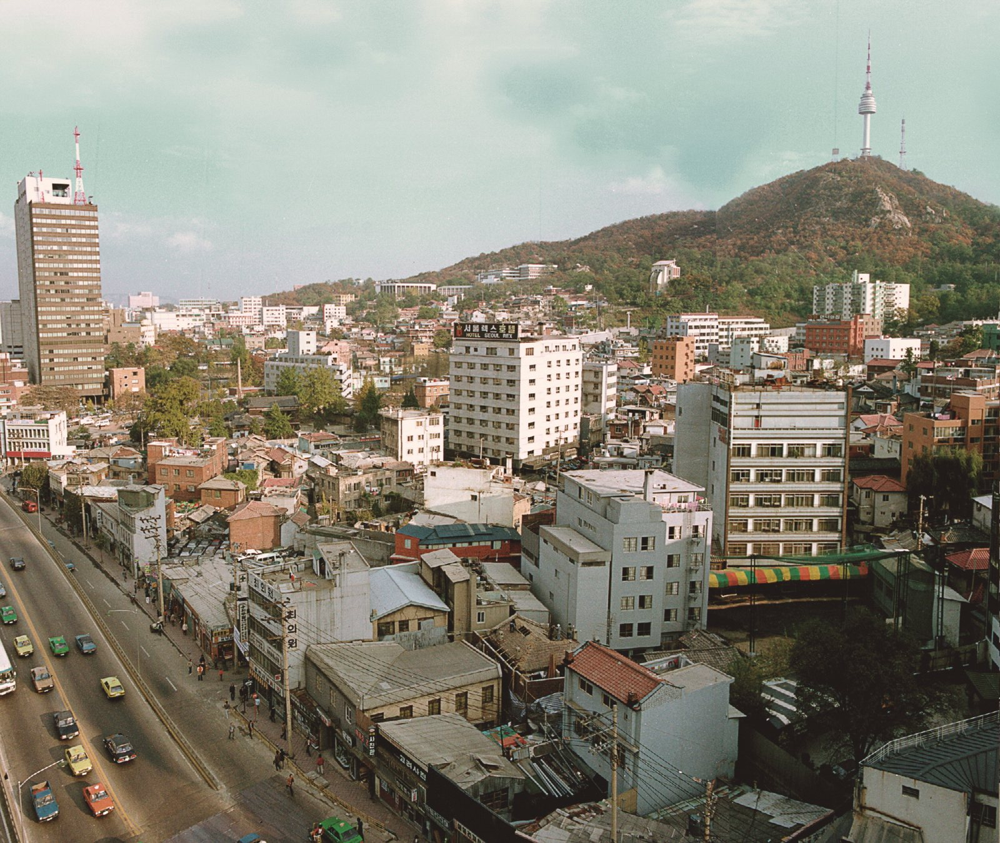

29년 전 오늘, 1997년 10월 31일. 정부가 실수요 목적을 제외한 모든 외화 매입을 전면 금지하는 초유의 환율방어대책을 시행했습니다. 개장 직후 거래가 중단되는 외환시장 마비 사태 속에서 한국 경제는 외환위기라는 거대한 소용돌이의 입구로 들어서고 있었습니다.

## 개장 8분 만의 거래 중단, 마비된 서울 외환시장

1997년 10월 30일 아침, 서울 외환시장은 문을 열자마자 극심한 패닉에 빠졌습니다. 오전 9시 30분 개장 후 불과 8분 만에 원·달러 환율이 하루 상승제한폭인 984원 70전까지 수직 상승했습니다. 당시 기준환율인 963원 10전보다 21원 60전이 치솟으면서 시장 규정에 따라 거래가 완전히 중단됐습니다.

외환시장에서 달러 거래가 멈춰 선 것은 사흘 연속 일어난 일이었습니다. 외환 딜러들은 요동치는 환율 속에서 빗발치는 주문 전화를 붙잡고 진땀을 흘렸고, 수입 대금을 결제해야 하는 기업들은 달러를 확보하지 못해 발을 굴렀습니다.

## 정부의 긴급 개입과 5억 달러 방출 작전

시장 마비 사태가 벌어지자 재정경제원과 외환당국은 비상체제에 돌입했습니다. 강경식 경제부총리 명의로 시중은행을 비롯한 금융기관은 물론 30대 대기업 그룹에까지 공문을 보내 달러 매입 자제와 보유 달러 매각을 강력히 촉구했습니다. 당국자들은 은행과 대기업에 일일이 전화를 걸어 여유 달러를 시장에 내놓으라고 독려했습니다.

동시에 한국은행은 과거 대규모 시장 개입 수준의 두 배에 달하는 5억 달러 이상의 보유 달러를 긴급히 외환시장에 쏟아부었습니다. 대기업들이 정부의 종용에 따라 보유 외환을 내놓으면서, 중단됐던 외환 거래는 오전 11시경 약 1시간 20분 만에 가까스로 재개됐습니다.

![[2003호] 대통령 중, 일 순방 일본 방문 (1994.03.31) 장면 1](../images/2026-10-31-01-2.jpg)
*[2003호] 대통령 중, 일 순방 일본 방문 (1994.03.31) 장면 1 — 사진: KTV 국민방송 e영상역사관 (대한뉴스) / KTV 공공저작물 — 영상 저작물 전면 개방(대통령실 2025-07-09), 출처 표시*

## 사상 최대 변동폭과 주가 500선 붕괴

당국의 전방위 개입으로 984원 70전이던 환율은 오전 한때 950원까지 급락했습니다. 그러나 시장의 달러 수요는 쉽게 가라앉지 않았고, 오후 들어 다시 매수세가 유입되면서 결국 964원 80전으로 장을 마쳤습니다. 이날 하루 환율 진폭은 34원 70전에 달해 종전 기록(1997년 2월 17원 80전)을 두 배 가까이 갈아치운 사상 최대치를 기록했습니다.

증권시장 역시 참담한 폭락을 겪었습니다. 전날 발표된 금융시장 대책을 외면한 외국인 투자자들이 하루 기준 사상 최대인 1349억 원어치를 순매도하면서 종합주가지수는 전날보다 21.56포인트 하락한 485.08로 주저앉았습니다. 심리적 지지선이던 500선이 완전히 무너지며 1992년 8월 이후 5년 2개월 만에 가장 낮은 수준을 기록했습니다.

![[1965호] 신경제 계획 구성 신경제 계획 구성 (1993.07.07) 장면 1](../images/2026-10-31-01-3.jpg)
*[1965호] 신경제 계획 구성 신경제 계획 구성 (1993.07.07) 장면 1 — 사진: KTV 국민방송 e영상역사관 (미공개 대한뉴스) / KTV 공공저작물 — 영상 저작물 전면 개방(대통령실 2025-07-09), 출처 표시*

## 실수요 외 외화 매입 전면 금지… 깐깐해진 환전

재정경제원은 30일 오전 거래 중단 직후 긴급 환율방어대책을 발표하고, 10월 31일부터 시장이 안정될 때까지 실수요 거래를 제외한 모든 외화 매입을 전면 금지하기로 했습니다. 개인 1인당 연간 2만 달러 이내의 소지 목적 외화 매입, 한도가 없던 거주자 예금용 외화 매입, 그리고 해외 예금용 외화 매입이 일제히 금지됐습니다.

실제로 외환이 필요한 경우에도 엄격한 증빙을 요구했습니다. 해외여행을 가려면 여권에 은행의 환전 증명 도장을 찍어야 했고, 유학생은 학교 재학증명서를, 어학연수생은 연수기관 증명서를 내야 했습니다. 수출입 기업 역시 정식 서류를 제출해 실수요를 입증해야만 결제일 5일 이내에 한해 외화를 살 수 있었습니다.

*도심재개발 회현구역 제1지구 — 사진: 서울역사박물관 / KOGL Type 1 (공공누리 제1유형, 출처표시)*

## 은행 창구의 혼란과 남대문 암달러상

이 같은 강력한 규제로 인해 일반 국민들의 일상도 직격탄을 맞았습니다. 유학 중인 자녀에게 학비를 송금하려던 학부모나 해외 출장을 앞둔 직장인들이 은행 창구에서 환전을 거부당하거나 대기표를 쥐고 발을 굴렀습니다.

은행 문턱이 높아지자 서울 남대문 시장 등 암달러 골목으로 사람들이 몰려들었습니다. 그러나 달러 가격이 연일 치솟자 일선 암달러상들조차 큰손들의 사재기로 인해 시중에 유통되는 달러가 없어 거래를 활발히 하지 못하는 기현상이 벌어졌습니다.

## 외환위기 전야의 경고음

1997년 10월 31일 고시된 시장 기준환율은 965원 10전이었습니다. 정부와 중앙은행의 막대한 외환 쏟아붓기와 강력한 통제 조치로 환율 폭등세는 잠시 숨을 죽였지만, 이는 미봉책에 불과했습니다. 시장 밑바닥에서는 이미 한국 경제의 외환보유액이 바닥을 향해 치닫고 있었습니다.

개장 8분 만의 외환시장 마비와 달러 매입 전면 규제는 불과 한 달 뒤 대한민국 전역을 뒤흔든 국제통화기금(IMF) 구제금융 사태의 시작을 알리는 뚜렷한 경고 신호였습니다.

### 참고 자료

- <https://newslibrary.naver.com/viewer/index.naver?articleId=1997103100209101001&editNo=45&printCount=1&publishDate=1997-10-31&officeId=00020&pageNo=1&printNo=23695&publishType=00010>
- <https://www.ehistory.go.kr/view/movie?mediasrcgbn=KV&mediaid=12207&mediadtl=28496&mediagbn=DH#t=0.7>
- <https://www.ehistory.go.kr/view/movie?mediasrcgbn=KV&mediaid=12007&mediadtl=27483&mediagbn=DH#t=0.3>
- <https://www.ehistory.go.kr/view/movie?mediasrcgbn=KV&mediaid=30000492&mediadtl=43816&mediagbn=DK#t=0.3>
- <https://museum.seoul.go.kr/archive/archiveNew/NR_archiveView.do?ctgryId=CTGRY766&type=B&upperNodeId=CTGRY767&fileSn=300&fileId=H-TRNS-96015-767>
