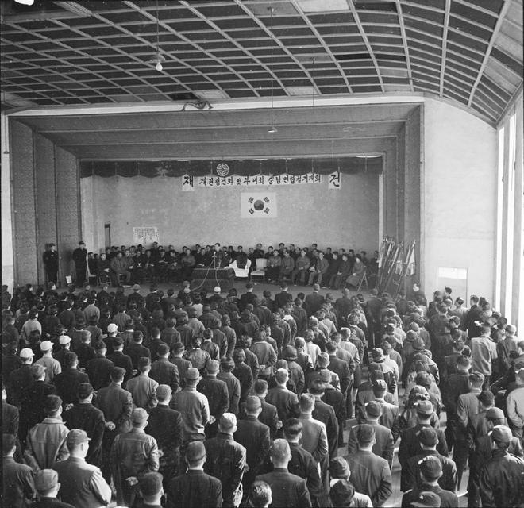
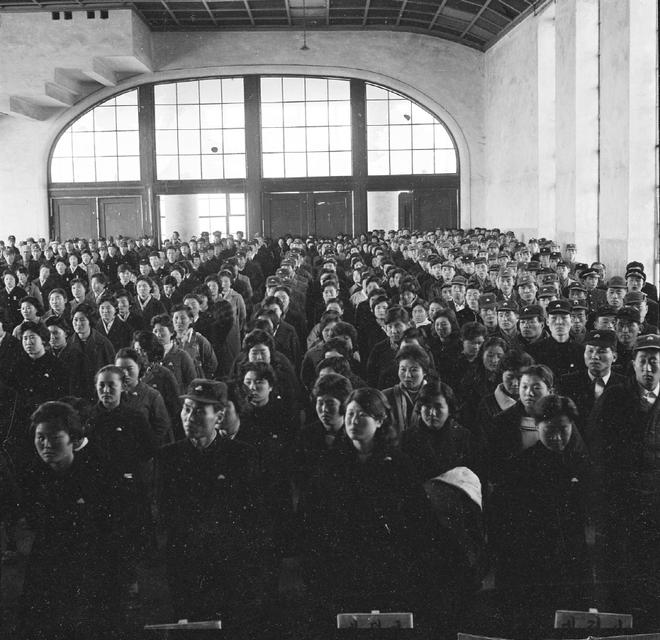
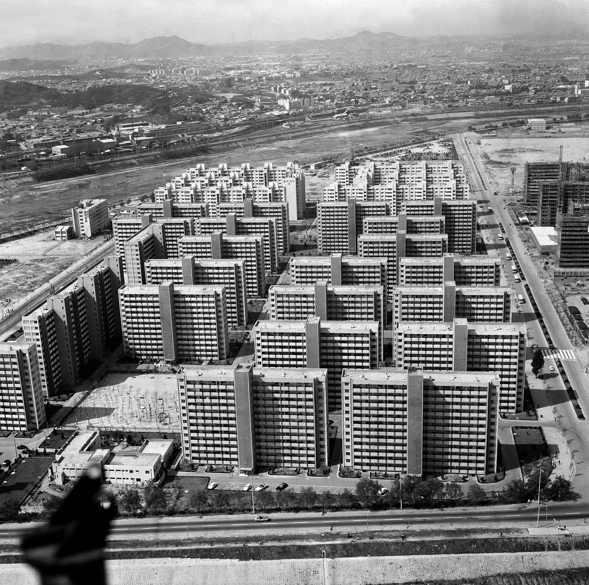

48년 전 오늘, 1978년 10월 31일. 판문점 인근 비무장지대 남쪽에서 북한의 제3남침땅굴이 발견된 사실이 알려지자, 서울 여의도 5.16광장에 무려 2백만 명에 달하는 인파가 모여들었습니다. 수도 서울의 턱밑을 겨눈 기습 침략용 지하 통로의 존재는 온 국민을 경악과 분노로 몰아넣었습니다.

## 수도권을 겨눈 판문점 제3땅굴의 충격

1974년 제1땅굴, 1975년 제2땅굴에 이어 1978년 판문점 남쪽 비무장지대에서 또다시 발견된 제3땅굴은 충격의 무게가 남달랐습니다. 휴전선에서 서울로 이어지는 최단거리 침략 축선에 위치해 있었기 때문입니다. 겉으로는 평화 통일과 남북적십자회담 등 대화를 표방하면서 지하에서는 대규모 병력 이동이 가능한 침략 통로를 뚫고 있었다는 이중성이 만천하에 드러났습니다. 이에 국민적 위기감이 고조되며 대규모 규탄 집회가 추진되었습니다.

## 오전 7시부터 여의도 5.16광장을 메운 200만 군중

1978년 10월 31일 아침 7시, 쌀쌀한 가을 날씨에도 불구하고 서울 여의도 5.16광장 일대는 시민들의 발걸음으로 가득 찼습니다. 일반 시민과 학생, 종교계, 여성단체, 상이군경회 등 사회 각계각층이 한자리에 모였습니다. 참가자들은 '땅굴 파는 두더지, 때려잡자 김일성' 같은 문구가 적힌 플래카드와 피켓을 손에 쥐고 광장을 메웠으며, 공식 집회가 시작된 오전 11시경에는 운집한 인원이 약 2백만 명에 달했습니다.

*사건 당시 사진 아님 · 1961년 — 사진: 충청남도 / KOGL Type 0 Public Domain*

## 총력안보중앙협의회와 각계 대표의 규탄 연설

총력안보중앙협의회 김용우 의장은 대회사에서 평화적 대화의 이면에서 무력 침략을 준비한 행태를 강력히 규탄했습니다. 이어 대한상이군경회 최태호 회장, 김윤덕 국회의원, 종교계를 대표한 김창인 목사, 학생 대표로 나선 서울대 경영대 박준성 군 등이 차례로 단상에 올라 자주국방과 총화단결을 호소했습니다. 광장을 메운 시민들은 연설이 이어질 때마다 뜨거운 함성으로 호응하며 안보 태세를 다졌습니다.

*사건 당시 사진 아님 · 1961년 — 사진: 충청남도 / KOGL Type 0 Public Domain*

## 귀순자 김부성 씨가 폭로한 지하 공사장의 참상

이날 집회의 가장 극적인 순간은 과거 북한의 지하 땅굴 굴착 작업에 직접 참여했다가 1974년 9월 5일 귀순했던 김부성 씨의 증언이었습니다. 단상에 선 김 씨는 자신이 확인한 땅굴만 개성, 고랑포, 평강, 철원 등지에 걸쳐 10여 개에 이른다고 폭로했습니다. 또한 제3땅굴 현장은 낙반과 침수, 폭발 사고가 끊이지 않아 숱한 사상자가 실려 나오는 생지옥이었으며, 공사 보안을 위해 참여 요원들의 외출과 휴가는 물론 군 제대마저 중단됐었다고 증언해 군중의 분노를 자아냈습니다. 정부는 이날 김 씨에게 보조금 1천만 원을 전달했습니다.

*1975년 자료 — 사진: 한국정책방송원 (KTV) / KOGL Type 1*

## 결의문 채택과 허수아비 화형식으로 이어진 분노

집회는 시인 모윤숙 씨의 발의로 박정희 대통령에게 보내는 메시지를, 이맹기 재향군인회장의 발의로 쿠르트 발트하임 유엔 사무총장에게 보내는 메시지를 각각 채택했습니다. 이어 제3땅굴 규탄과 평화통일 대화 호응을 촉구하는 4개항의 결의문이 낭독되었습니다. 김홍일 장군의 주창으로 만세삼창을 외친 시민들은 광장에 마련된 김일성 허수아비 화형식을 진행하며 2시간여에 걸친 대회를 마무리했습니다.

## 안보의 상징이 된 제3땅굴과 그날의 기억

당시 발견된 제3땅굴은 이후 안보 교육과 현장 견학의 대표적 장소로 보존되어 오늘날까지 국내외 수많은 방문객이 찾는 역사의 현장이 되었습니다. 여의도 5.16광장을 가득 채웠던 200만 시민의 함성과 팽팽했던 냉전 시대의 긴장감은, 격변의 현대사를 지나온 많은 국민들의 기억 속에 잊히지 않는 장면으로 선명히 남아 있습니다.

### 참고 자료

- <https://newslibrary.naver.com/viewer/index.naver?articleId=1978103100329201004&editNo=2&printCount=1&publishDate=1978-10-31&officeId=00032&pageNo=1&printNo=10180&publishType=00020>
- <https://www.kogl.or.kr/recommend/recommendDivView.do?division=img&recommendIdx=75035>
- <https://www.kogl.or.kr/recommend/recommendDivView.do?division=img&recommendIdx=37459>
- <https://commons.wikimedia.org/wiki/File:%EC%97%AC%EC%9D%98%EB%8F%84_%EC%95%84%ED%8C%8C%ED%8A%B8_%EB%8B%A8%EC%A7%80_%EC%A0%84%EA%B2%BD_(1975).jpg>
