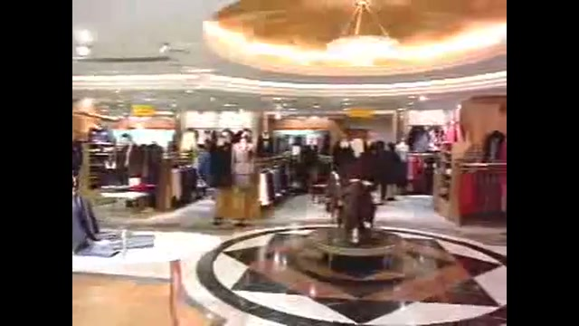
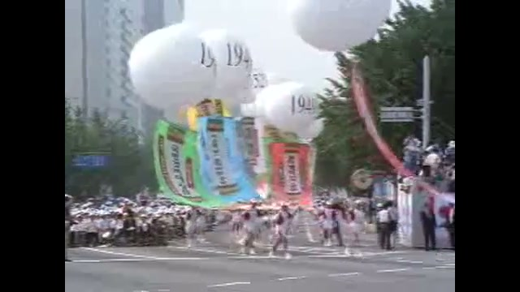

28년 전 오늘, 1998년 10월 31일 신문들은 일제히 현대 유니콘스의 한국시리즈 제패 소식을 전했습니다. 10월 30일 인천 숭의야구장에서 열린 6차전에서 현대는 LG를 5-2로 물리치며 시리즈 전적 4승 2패로 첫 우승 트로피를 품에 안았습니다.

## 삼미에서 청보, 태평양까지 이어진 눈물의 세월

인천 연고 프로야구팀의 역사는 영광보다는 깊은 상처로 시작되었습니다. 1982년 프로야구 원년 삼미 슈퍼스타즈는 15승 65패, 승률 1할 8푼 8리라는 최악의 성적을 기록했습니다. 1983년 장명부 투수가 홀로 30승을 거두는 괴력을 발휘하며 잠시 반등했으나 우승 문턱에는 닿지 못했습니다. 1985년에는 개막전 승리 이후 무려 18연패라는 깊은 수렁에 빠졌고, 결국 구단은 70억 원에 청보 핀토스로 매각되었습니다.

하지만 청보 역시 3년을 넘기지 못하고 1987년 태평양화학에 50억 원에 매각되며 태평양 돌핀스로 재출범했습니다. 태평양은 뛰어난 투수진을 육성하며 ‘투수 왕국’이라는 별명을 얻었고, 1994년에는 정규시즌 2위로 창단 첫 한국시리즈에 진출했습니다. 그러나 한국시리즈에서 LG 트윈스에 4전 전패를 당하며 눈물을 삼켜야 했습니다.

## 현대그룹의 과감한 인수와 유니콘스의 탄생

1995년 9월 21일, 현대그룹은 재정난을 겪던 태평양 돌핀스를 당시 프로야구 사상 최고액인 470억 원에 인수했습니다. 이듬해인 1996년 3월 11일 현대 유니콘스라는 팀명으로 새롭게 출발했습니다. 초대 사령탑으로는 태평양 시절 수석코치였던 김재박 감독이 지휘봉을 잡았습니다.

현대는 창단 첫해였던 1996년 탄탄한 투수력을 앞세워 정규시즌을 치렀고, 곧바로 한국시리즈에 진출하여 준우승을 차지했습니다. 막강한 투자와 체계적인 전력 보강이 더해지면서 현대는 리그의 새로운 강자로 급부상했습니다.

*날로 도약하는 한국 날로 도약하는 한국의 모습 (1998.00.00) 장면 1 — 사진: KTV 국민방송 e영상역사관 (문화영화) / KTV 공공저작물 — 영상 저작물 전면 개방(대통령실 2025-07-09), 출처 표시*

## 1998년 10월 30일, 숭의구장에 울려 퍼진 우승 환호

1998년 정규시즌 1위를 기록하며 한국시리즈에 직행한 현대의 결승 상대는 전통의 강호 LG 트윈스였습니다. 1994년 태평양 시절 4전 전패의 수모를 안겼던 상대와의 숙명적인 맞대결이었습니다. 시리즈는 치열하게 전개되었고, 10월 30일 인천 숭의야구장에서 운명의 6차전이 펼쳐졌습니다.

정민태를 비롯한 탄탄한 마운드 운영과 타선의 집중력을 앞세운 현대는 LG를 상대로 5-2 승리를 거두었습니다. 이로써 시리즈 전적 4승 2패를 완성하며 창단 3년 만에 대망의 한국시리즈 첫 우승을 확정 지었습니다. 인천 홈구장을 가득 메운 관중들은 연고지 팀의 사상 첫 제패에 감격의 눈물을 쏟아냈습니다.

*날로 도약하는 한국 날로 도약하는 한국의 모습 (1998.00.00) 장면 2 — 사진: KTV 국민방송 e영상역사관 (문화영화) / KTV 공공저작물 — 영상 저작물 전면 개방(대통령실 2025-07-09), 출처 표시*

## 현대 왕조의 구축과 네 번의 챔피언 등극

1998년의 첫 우승은 거대한 현대 왕조의 시작이었습니다. 현대는 2000년 수원으로 연고지를 옮긴 뒤 두산 베어스를 꺾고 두 번째 한국시리즈 정상에 올랐습니다. 당시 포수 박경완은 40홈런을 기록하며 정규시즌 최우수선수(MVP)에 선정되기도 했습니다.

이어 2003년에는 SK 와이번스를 제치고 우승을 차지했고, 2004년에는 삼성 라이온즈를 상대로 9차전까지 가는 혈투 끝에 통산 네 번째 한국시리즈 우승을 달성했습니다. 심정수, 브룸바, 정민태 등 공수를 아우르는 최정상급 스타들이 팀의 전성기를 이끌었습니다.

*90년대 ... 0년대 (1995.00.00) 장면 2 — 사진: KTV 국민방송 e영상역사관 (문화영화) / KTV 공공저작물 — 영상 저작물 전면 개방(대통령실 2025-07-09), 출처 표시*

## 역사 속으로 사라진 구단, 팬들의 기억 속에 남은 환희

화려했던 전성기도 모기업의 재정난 앞에서는 영원하지 못했습니다. 대주주였던 현대전자의 부도와 계열 분리, 구단 지원 중단 등으로 극심한 운영난에 시달렸습니다. 결국 현대 유니콘스는 2007년 시즌을 끝으로 해체되었고, 선수단은 센테니얼 인베스트먼트에 인수되어 우리 히어로즈로 재창단되었습니다.

비록 현대 유니콘스라는 이름은 역사의 뒤안길로 사라졌지만, 최하위와 연패의 아픔을 딛고 1998년 10월 인천 숭의야구장에서 터져 나왔던 첫 우승의 함성은 한국 프로야구 역사와 팬들의 가슴속에 지워지지 않는 추억으로 남아 있습니다.

### 참고 자료

- <https://newslibrary.naver.com/viewer/index.naver?articleId=1998103100289101003&editNo=6&printCount=1&publishDate=1998-10-31&officeId=00028&pageNo=1&printNo=3336&publishType=00010>
- <https://commons.wikimedia.org/wiki/File:Members_of_the_local_and_military_press_document_the_caravan_of_501_cattle_and_50_vehicles_as_they_enter_Communist_North_Korea_from_Panmunjom,_Republic_of_Korea,_Oct._27,_1998._Sout_-_DPLA_-_4020a0f49ea814b987fa41435f0fe3d4.jpeg>
- <https://www.ehistory.go.kr/view/movie?mediasrcgbn=KV&mediaid=1215&mediadtl=7109&mediagbn=MH#t=0.3>
- <https://www.ehistory.go.kr/view/movie?mediasrcgbn=KV&mediaid=1215&mediadtl=7109&mediagbn=MH#t=0.7>
- <https://www.ehistory.go.kr/view/movie?mediasrcgbn=KV&mediaid=1159&mediadtl=7309&mediagbn=MH#t=0.7>
