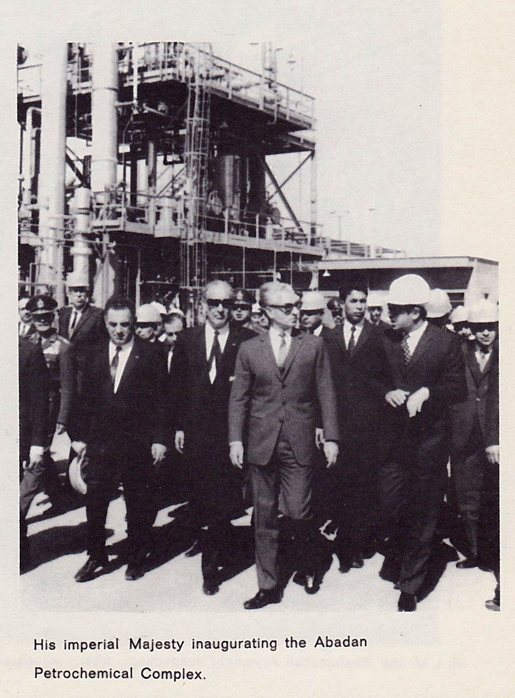
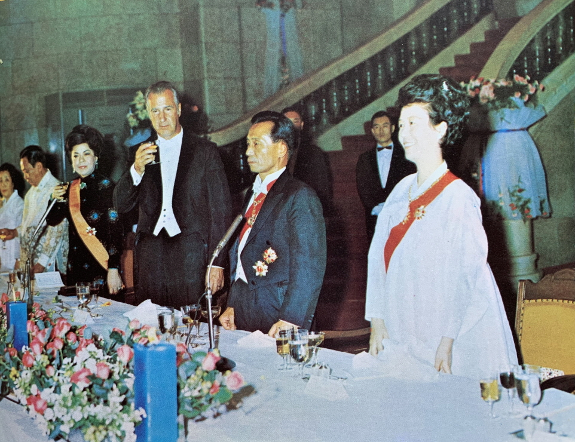
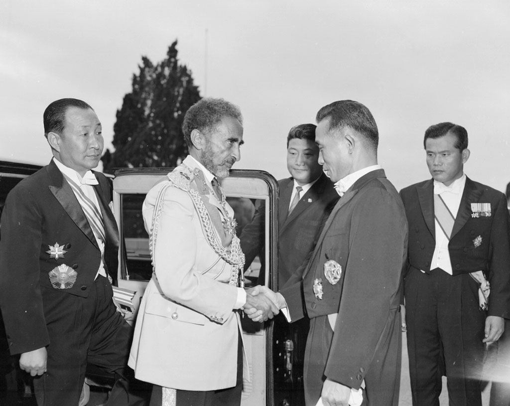

54년 전 오늘인 1972년 10월 31일, 울산석유화학공업단지에서 나프타분해공장을 비롯한 9개 석유화학공장의 합동 준공식이 거행되었습니다. 검은 원유에서 산업의 핵심 소재를 뽑아내는 대규모 설비들이 일제히 가동에 들어간 역사적인 날이었습니다. 전량 수입에 의존하던 석유화학 기초 원료를 국산화하면서 대한민국 제조업은 자립 경제를 향한 결정적인 전환점을 맞이했습니다.

## 원료 수입국에서 자립국으로 가는 길

1970년대 초 대한민국은 산업화를 힘차게 추진하고 있었지만, 플라스틱과 합성섬유, 합성고무를 만드는 기초 원료는 거의 전량을 외국에서 들여와야 했습니다. 제조업 규모가 커질수록 해외에서 사 오는 석유화학 제품도 늘어났습니다. 원료를 스스로 만들지 못하면 완제품을 수출해도 많은 외화가 빠져나가는 한계에 부딪힐 수밖에 없었습니다.

이 문제를 해결하기 위해 정부는 석유를 분해해 다양한 산업 원료를 공급하는 대단위 석유화학 콤비나트 조성을 추진했습니다. 지난 1969년부터 시작된 제1단계 석유화학공업 건설사업에는 외자 1억 9천 1백만 달러와 내자 5천 8백 40만 달러 등 모두 2억 4천 9백 40만 달러라는 막대한 자금이 투입되었습니다.

## 1972년 10월 31일 오후 2시, 울산의 준공식

1972년 10월 31일 오후 2시, 울산석유화학공업단지에서 9개 공장의 합동 준공식이 열렸습니다. 이날 완공된 핵심 시설은 석유화학의 심장부로 불리는 나프타분해공장이었습니다. 석유의 나프타 유분을 800도 안팎의 고온에서 열분해하여 에틸렌과 프로필렌 등 기초 유분을 뽑아내는 핵심 설비가 완성된 것입니다.

나프타분해공장과 함께 이를 원료로 사용하는 계열 공장들도 일제히 가동을 시작했습니다. 폴리에틸렌공장, 합성고무를 만드는 에스비알(SBR)공장, 브이시엠(VCM)공장, 합성섬유 원료를 생산하는 아크릴로니트릴공장, 무수프탈산공장, 알킬벤젠공장, 폴리프로필렌공장 등 8개 공장이 함께 준공 테이프를 끊었습니다.

*1967년 자료 — 사진: National Iranian Oil Company / Public domain*

## 연간 1억 달러 외화 절약과 경제적 효과

울산 제1단계 석유화학공장 건설사업은 지난해 이미 가동에 들어간 석유화학지원공단과 메타놀공장에 이어 이날 9개 공장이 준공되면서 모두 10개 공장이 기틀을 다졌습니다. 여기에 에틸렌공장과 아세트알데히드공장, 카프로락탐공장도 내년 4월 완공을 목표로 순조롭게 공사가 이어졌습니다.

정부는 이번 1단계 완공으로 연간 1억 2천만 달러에 이르는 수입 대체 효과와 함께 1억 달러의 외화를 절약할 수 있을 것으로 내다보았습니다. 또한 거대한 석유화학단지가 가동되면서 약 3천 명의 새로운 일자리가 창출되어 고용 증대에도 크게 기여했습니다.

*사건 당시 사진 아님 · 1971년 — 사진: 셀수스협동조합 / KOGL Type 1*

## 현장의 주역들과 1976년을 향한 청사진

이날 준공식에서는 공장 건설을 성공으로 이끈 유공자들에 대한 훈장과 포창장 수여식이 열렸습니다. 대한유화 강수철 전무가 동탑산업훈장을, 석유화학심의회 함병소 위원과 김광모 위원이 석탑산업훈장을 받았습니다. 청와대 제2수석비서관 오원철에게 황조근정훈장이, 상공부 석유화학과 김희술에게 녹조근정훈장이 수여되었으며, 외국 협력사 대표들에게도 산업포장이 돌아갔습니다.

박정희 대통령은 치사를 통해 평화통일을 이루기 위해서는 온 국민이 단결해 경제력을 키워야 한다고 역설했습니다. 아울러 제3차 5개년 계획이 끝나는 1976년까지 울산 외에 제2의 석유화학공업단지를 추진하고 종합제철 등 중화학공업을 완성해 자립경제 체제를 확립하겠다는 비전을 제시했습니다.

*사건 당시 사진 아님 · 1968년 — 사진: 대한민국 국가기록원 / KOGL Type 1*

## 생활용품 원료의 국산화와 국민의 삶

울산 석유화학단지의 준공은 국민들의 일상생활에도 큰 변화를 가져왔습니다. 농사용 비닐과 플라스틱 바가지, 고무신과 합성섬유 옷감에 이르기까지 생활필수품을 만드는 원료가 우리 공장에서 직접 생산되기 시작했습니다.

1970년대 초반 당시 짜장면 한 그릇이나 시내버스 요금, 라면 한 봉지가 수십 원 하던 시절이었습니다. 2억 달러가 넘는 거액을 들여 세운 석유화학 공장들은 일상에 쓰이는 각종 공산품의 가격을 안정시키고 물자를 풍족하게 만드는 든든한 밑천이 되었습니다.

## 오늘날 화학 강국을 일군 든든한 주춧돌

1972년 10월 31일 울산에 세워진 거대한 콤비나트는 대한민국이 중화학공업 국가로 체질을 개선하는 결정적인 분수령이었습니다. 원유가 나지 않는 나라에서 원유를 가공해 최고 수준의 원료와 화학 제품을 수출하는 산업 기적이 울산 앞바다에서 시작되었습니다.

반세기가 지난 오늘날에도 울산석유화학공업단지는 한국 경제를 지탱하는 핵심 산업 기지로 당당히 자리하고 있습니다. 허허벌판에 거대한 파이프와 공장을 올리며 경제 자립을 꿈꾸었던 그날의 열정은 우리 산업사에 지워지지 않을 커다란 이정표로 남아 있습니다.

### 참고 자료

- <https://newslibrary.naver.com/viewer/index.naver?articleId=1972103100209201010&editNo=2&printCount=1&publishDate=1972-10-31&officeId=00020&pageNo=1&printNo=15717&publishType=00020>
- <https://commons.wikimedia.org/wiki/File:Bundesarchiv_Bild_183-F1228-0013-001,_Kombinat_B%C3%B6hlen_nimmt_Erd%C3%B6lverarbeitung_auf.jpg>
- <https://commons.wikimedia.org/wiki/File:HIM_Shah_of_Iran_Opens_Petrochemical_Industry_Abadan.jpg>
- <https://commons.wikimedia.org/wiki/File:1971%EB%85%84_%ED%95%9C%EA%B5%AD_7%EB%8C%80_%EB%8C%80%ED%86%B5%EB%A0%B9_%EC%B7%A8%EC%9E%84%EC%8B%9D.jpg>
- <https://commons.wikimedia.org/wiki/File:Haile_Selassie_meeting_Park_Chung_Hee.jpg>
