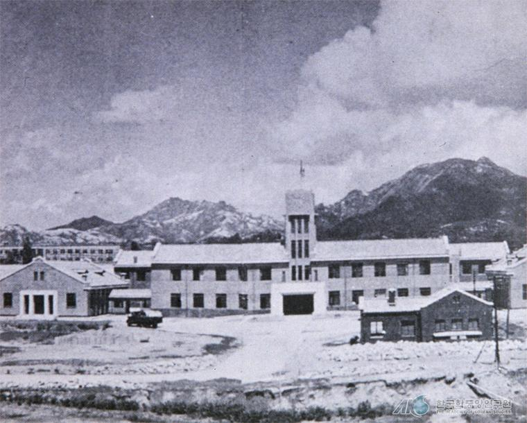
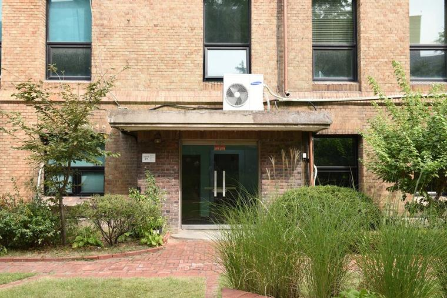

45년 전 오늘, 1981년 10월 31일. 국내 과학계에서 처음으로 곰팡이 유전자를 세균에 옮겨 심는 유전자 조작 실험에 성공했다는 소식이 전해졌습니다. 외국의 첨단 기술에만 기대던 유전공학 불모지에서, 온전히 우리 연구진의 손으로 생명공학의 기초를 확립한 역사적인 전환점이었습니다.

## 세계적인 유전공학 열풍과 척박했던 국내 현실

1970년대 후반부터 1980년대 초반, 세계 과학계는 유전공학의 눈부신 발전에 주목하고 있었습니다. 디엔에이(DNA)를 인위적으로 재조합해 인슐린 등 의약품을 만들거나 새로운 생물 자원을 개발하는 기술은 인류의 미래 산업으로 떠올랐습니다. 하지만 당시 한국의 생명공학 연구 기반은 매우 열악했습니다. 첨단 연구 장비는 턱없이 부족했고, 유전자를 자르고 잇는 기본 시약조차 구하기 어려웠습니다.

## 춘천 강원대학교에서 날아든 낭보

1981년 10월 30일, 춘천 강원대학교에서 열린 대한미생물학회 학술대회에서 깜짝 발표가 나왔습니다. 서울대학교 자연과학대학 미생물학과의 강현삼 교수와 이병재 연구팀이 곰팡이의 유전자를 대장균에 삽입해 형질을 변경하는 데 성공했다고 보고한 것입니다. 2년 동안 끈질기게 매달린 기초 연구 끝에 얻어낸 값진 결실이었습니다. 이 소식은 이튿날 주요 일간지 1면을 장식하며 과학계뿐만 아니라 온 국민의 큰 관심을 모았습니다.

*사건 당시 사진 아님 — 사진: 한국학중앙연구원 / KOGL Type 1 attribution*

## 곰팡이 유전자를 세균에 심는 정밀한 실험 과정

연구팀이 실험에 사용한 것은 국내 항생물질 생산에 널리 쓰이던 아스페르질러스 곰팡이(Aspergillus nidulans)였습니다. 연구팀은 고속원심분리기를 이용해 곰팡이 세포에서 물질 합성 원료를 운반하는 역할을 하는 티알엔에이(tRNA)를 분리했습니다. 이어 대장균에서 일종의 화학공장 역할을 하는 플라스미드를 추출했습니다. 시험관 안에서 제한효소와 합성효소를 사용해 곰팡이 유전자를 플라스미드에 끼워 넣은 뒤, 이를 다시 대장균에 주입해 완전히 새로운 형질을 지닌 세균을 만들어냈습니다.

*사건 당시 사진 아님 — 사진: 국가유산청 / KOGL Type 1 attribution*

## 국내 기술로 만든 효소로 일궈낸 자급자족의 쾌거

이 연구가 특히 높은 평가를 받은 이유는 유전자 조작의 핵심 열쇠인 효소를 자급자족했다는 점이었습니다. 강현삼 교수는 학회 보고에서 "이번 실험은 완전히 국내에서 생산된 효소로 이루어졌다"고 강조했습니다. 비싼 외산 효소를 들여오지 않고도 국내 기술로 유전자 분리와 결합을 성공시킴으로써, 향후 독자적인 생명공학 연구를 이어갈 수 있는 확고한 토대를 마련했습니다. 배양된 새로운 대장균 1,400개는 본래 갖고 있던 항생제 저항성을 잃고 방사성동위원소 실험에서도 독특한 구조를 나타내며 실험의 성공을 명확히 증명했습니다.

*사건 당시 사진 아님 — 사진: 국가유산청 / KOGL Type 1 attribution*

## 페니실린 합성 연구로 이어진 한국 바이오의 첫걸음

강현삼 교수 연구팀은 이 성과에 안주하지 않고 곧바로 다음 단계 연구에 착수했습니다. 연구팀은 확립된 유전자 조작 기술을 바탕으로 항생물질인 니신과 페니실린(6APA) 합성 유전자를 대장균 세포에 심는 응용 연구를 시작한다고 밝혔습니다. 불과 수년 안에 국내에서도 의약품과 화학 원료 생산에 유전공학을 본격 활용할 수 있을 것이라는 기대가 한껏 부풀어 올랐습니다. 1981년 가을, 실험실 시험관 안에서 이뤄진 이 작은 재조합은 오늘날 세계적인 경쟁력을 갖춘 한국 바이오·제약 산업의 든든한 출발점이 되었습니다.

### 참고 자료

- <https://newslibrary.naver.com/viewer/index.naver?articleId=1981103100329201004&editNo=2&printCount=1&publishDate=1981-10-31&officeId=00032&pageNo=1&printNo=11105&publishType=00020>
- <https://commons.wikimedia.org/wiki/File:Wait_and_see_strategy.png>
- <https://www.kogl.or.kr/recommend/recommendDivView.do?division=img&recommendIdx=72963>
- <https://www.kogl.or.kr/recommend/recommendDivView.do?division=img&recommendIdx=1552>
