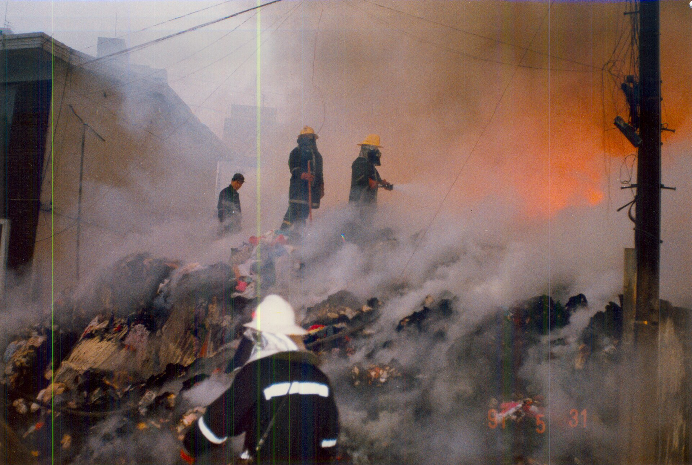
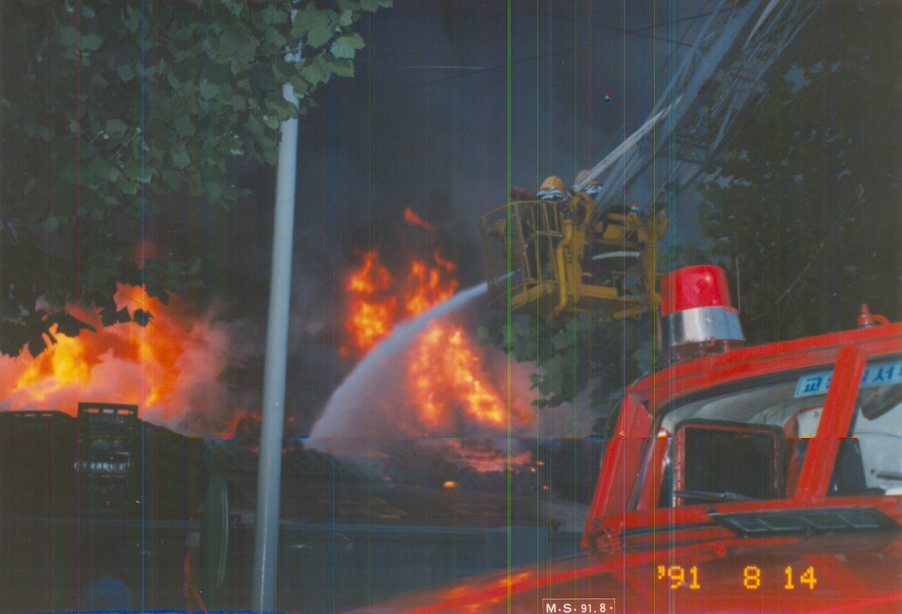
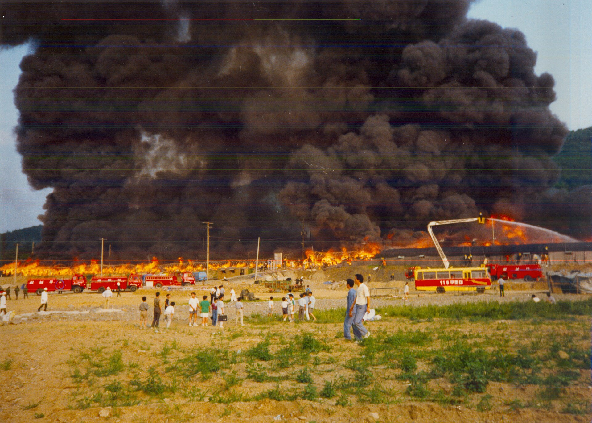

27년 전 오늘, 1999년 11월 1일. 인천 인현동 상가 건물에서 일어난 화재로 55명이 숨지고 78명이 중경상을 입었다는 참혹한 소식이 조간신문 1면을 가득 채웠습니다. 가을 축제를 마치고 모여든 청소년들이 어른들의 탐욕과 무책임 속에 갇혀 희생된 비극이었습니다.

## 축제 날 저녁, 상가 건물 지하에서 치솟은 불길

참사는 1999년 10월 30일 토요일 저녁 6시 55분경, 인천 중구 인현동 119번지에 위치한 4층짜리 상가 건물에서 시작되었습니다. 지하 1층 '히트 노래방' 내부 인테리어 조명 공사 현장에서 전등 불꽃이 바닥의 인화성 물질로 튀면서 폭발음과 함께 불길이 일어났습니다. 당시 지하 공사 현장에는 안전관리 수칙이 전혀 지켜지지 않았고, 천장에 달려 있던 분말확산소화기마저 공사에 방해된다는 이유로 떼어낸 상태였습니다. 인화성 물질과 우레탄폼 실내 장식을 타고 번진 맹렬한 유독가스는 건물 계단을 굴뚝 삼아 순식간에 위층으로 뿜어져 올라갔습니다.

## 폐쇄 명령 무시한 불법영업, 갇혀버린 120여 명

피해가 가장 집중된 곳은 건물 2층의 '라이브Ⅱ 호프집'이었습니다. 이날 인천 시내 10여 개 고등학교에서 가을 축제가 열렸고, 축제를 마친 학생들이 삼삼오오 뒤풀이를 위해 이곳으로 모여들었습니다. 50여 평 남짓한 공간에 탁자와 의자가 빽빽하게 들어찼고, 120명이 넘는 손님들로 발 디딜 틈이 없었습니다. 이 호프집은 화재 발생 열흘 전인 10월 19일 무허가 영업으로 적발되어 22일 관청으로부터 영업장 폐쇄 명령을 받은 상태였습니다. 그러나 업주는 행정 처분을 비웃기라도 하듯 미성년자들의 신분증 검사도 하지 않은 채 불법 영업을 강행하고 있었습니다.

*1990년대 초기 서울소방 활동 사진스캔0045 — 사진: 서울특별시 소방재난본부 / CC BY-SA 4.0*

## 비상구는 없었고 출입문은 가로막혔다

지하에서 치솟은 검은 연기가 2층을 덮치자 호프집 안은 순식간에 아수라장이 되었습니다. 건물 밖으로 나갈 수 있는 탈출로는 폭 1.2미터 남짓한 비좁은 계단 단 하나뿐이었습니다. 별도의 비상계단이나 비상구는 설치되어 있지 않았고, 외부로 통하던 창문마저 통유리로 바꾼 뒤 베니어판을 덧대어 완전히 막아놓은 밀폐 구조였습니다. 더욱 기막힌 사실은 불길이 번지는 위급한 상황에서 종업원들이 손님들의 탈출을 막아섰다는 점이었습니다. 술값을 내지 않고 도망가려 한다거나 경찰 단속이 들통날 것을 우려해 문을 막아서면서, 탈출의 골든타임은 허망하게 흘러가고 말았습니다.

*1990년대 초기 서울소방 활동 사진스캔0055 — 사진: 서울특별시 소방재난본부 / CC BY-SA 4.0*

## 35분 만에 꺼진 불, 그러나 남겨진 133명의 사상자

신고를 받고 출동한 소방차와 소방관들이 진화 작업을 벌여 불은 약 35분 만에 잡혔습니다. 1층 식당과 3층 당구장에 있던 사람들은 창문을 깨고 뛰어내리거나 빠르게 거리로 빠져나와 화를 면했습니다. 그러나 2층 호프집에 갇혀 있던 학생들은 비좁은 출구 앞에서 엉킨 채 매캐한 유독가스에 질식해 쓰러졌습니다. 이 사고로 인천여상 학생 8명을 비롯해 중고등학생 등 무려 55명이 목숨을 잃었고, 78명이 중경상을 입어 인근 병원으로 분산 후송되었습니다. 1971년 서울 대연각호텔 화재와 1974년 대왕코너 화재에 이어 국내 화재 사고 사상 세 번째로 많은 인명 피해였습니다.

*1990년대 초기 서울소방 활동 사진스캔0006 — 사진: 서울특별시 소방재난본부 / CC BY-SA 4.0*

## 공권력의 유착과 어른들의 안전 불감증이 부른 인재

경찰 수사 결과 화재 현장의 추악한 민낯이 드러났습니다. 문제의 호프집은 평소에도 청소년을 상대로 불법 영업을 일삼아 인근 주민들의 신고가 잦았으나, 업주와 관할 경찰관들 사이의 유착으로 단속을 피해왔던 정황이 확인되었습니다. 안전 설비조차 갖추지 않은 채 이익만을 좇던 업주와 이를 묵인한 공권력의 무사안일이 참사를 키웠습니다. 같은 해 6월 30일 씨랜드 청소년수련원 화재의 상처가 채 아물기도 전에 터진 대참사 앞에 온 국민은 비통함과 분노를 감추지 못했습니다.

## 지금도 남은 위령비, 잊지 말아야 할 교훈

참사 이후 2004년, 화재 현장 인근에 들어선 인천광역시학생교육문화회관 앞마당에 희생된 넋을 기리는 추모석과 위령비가 건립되었습니다. 피어나지도 못한 채 스러져간 청소년들의 넋을 달래고, 다시는 어른들의 무책임으로 어린 생명들이 희생되지 않도록 경종을 울리기 위한 공간입니다. 1999년 그 차가웠던 늦가을, 수많은 이들의 가슴에 씻을 수 없는 상처를 남긴 그날의 비극은 오늘날에도 안전의 가치를 엄중하게 되묻고 있습니다.

### 참고 자료

- <https://newslibrary.naver.com/viewer/index.naver?articleId=1999110100209101003&editNo=45&printCount=1&publishDate=1999-11-01&officeId=00020&pageNo=1&printNo=24341&publishType=00010>
- <https://museum.seoul.go.kr/archive/archiveNew/NR_archiveView.do?ctgryId=CTGRY333&type=A&upperNodeId=CTGRY336&fileSn=300&fileId=H-TRNS-71230-336>
- <https://commons.wikimedia.org/wiki/File:1990%EB%85%84%EB%8C%80_%EC%B4%88%EA%B8%B0_%EC%84%9C%EC%9A%B8%EC%86%8C%EB%B0%A9_%ED%99%9C%EB%8F%99_%EC%82%AC%EC%A7%84%EC%8A%A4%EC%BA%940045.jpg>
- <https://commons.wikimedia.org/wiki/File:1990%EB%85%84%EB%8C%80_%EC%B4%88%EA%B8%B0_%EC%84%9C%EC%9A%B8%EC%86%8C%EB%B0%A9_%ED%99%9C%EB%8F%99_%EC%82%AC%EC%A7%84%EC%8A%A4%EC%BA%940055.jpg>
- <https://commons.wikimedia.org/wiki/File:1990%EB%85%84%EB%8C%80_%EC%B4%88%EA%B8%B0_%EC%84%9C%EC%9A%B8%EC%86%8C%EB%B0%A9_%ED%99%9C%EB%8F%99_%EC%82%AC%EC%A7%84%EC%8A%A4%EC%BA%940006.jpg>
