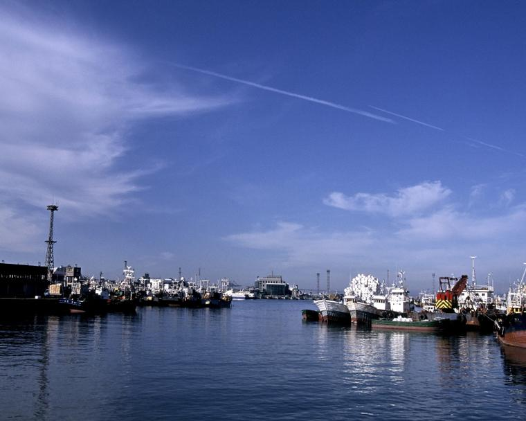
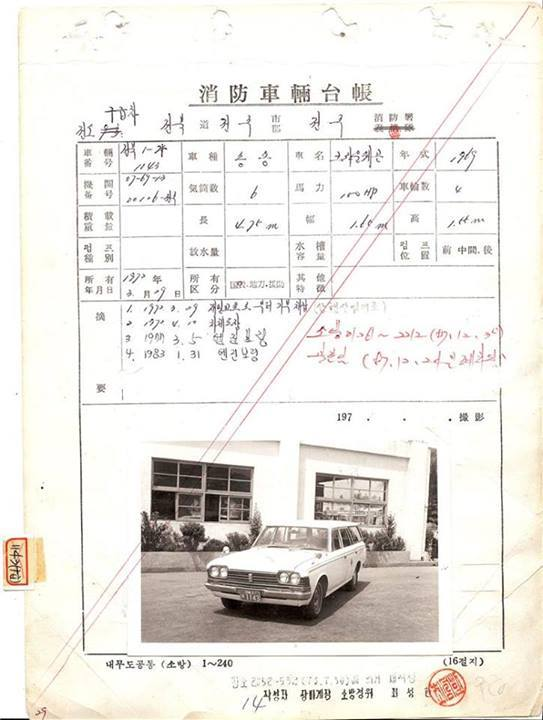

52년 전 오늘, 1974년 11월 1일 저녁. 김포공항 국제선 입국장에 수염도 깎지 못한 채 허름한 작업복을 입은 사내들이 모습을 드러냈습니다. 인도양으로 참치잡이를 떠났다가 태풍을 만나 미수교 적성국이던 중국 땅에 표류했던 고려원양 소속 제77광명호 선원 24명이었습니다.

## 인도양으로 떠난 305톤 참치잡이 어선

1974년 10월 9일, 305톤급 원양어선 제77광명호는 선장 김태준 씨를 비롯한 26명의 선원을 태우고 전남 여수항을 힘차게 출발했습니다. 목적지는 먼 인도양의 참치 어장이었습니다. 당시 원양어업은 국가적으로 귀중한 외화를 벌어들이고 가난한 선원 가족의 생계를 책임지던 고된 삶의 터전이었습니다.

## 태풍 엘렌호의 습격과 남오도 좌초

출항 나흘 만인 10월 13일 새벽 1시 무렵, 광명호는 대만 남쪽 해상에서 거대한 태풍 엘렌호를 맞닥뜨렸습니다. 집채만 한 파도와 거센 폭풍우 속에서 사투를 벌이던 배는 새벽 4시 25분경 중국 광둥성 영토인 남오도 앞 50미터 지점에서 암초에 걸려 반파되고 말았습니다. 파도가 덮치며 배가 부서지는 와중에 냉동실에서 암모니아 가스까지 유출되어 선원들은 큰 부상과 시력 장애를 입었습니다. 이 과정에서 기관원 김만호 씨와 전건국 씨 두 명이 거센 파도에 휩쓸려 끝내 바다에서 목숨을 잃었습니다.

*사건 당시 사진 아님 — 사진: 인천광역시 / KOGL Type 1 attribution*

## 적성국 영토에서의 18일과 뜻밖의 보호

13일 오후 1시 30분, 생사의 기로에 놓였던 선원 24명은 현지를 지나던 중국 어선들에 의해 극적으로 구조되었습니다. 당시 한국과 중국은 공식 수교를 맺지 않았고 이른바 '중공'이라 부르며 엄격히 대치하던 적성국 관계였습니다. 냉전의 한가운데서 적성국 영토에 갇혔다는 소식은 한국 사회를 긴장으로 몰아넣었습니다. 선원들은 남오에서 3일간 조사를 받은 뒤 광둥성 징해현으로 이송되어 15일간 머물렀습니다. 다행히 중국 측은 조난 선원들에게 비교적 따뜻한 대우를 제공했고, 숨진 기관원 김만호 씨의 시신도 현지에서 장례를 치러 가매장해 주었습니다.

*사건 당시 사진 아님 · 1972년 — 사진: 최광모 / CC BY-SA 4.0*

## 홍콩 로우역을 거쳐 김포공항으로

체류 18일째이던 10월 31일 오후 2시 30분, 중국 당국은 홍콩과의 경계선인 로우역에서 홍콩 정청을 거쳐 한국 총영사관 측에 24명의 선원을 무사히 인계했습니다. 이는 1967년 제5천강호, 1973년 대창호, 1974년 9월 제67금성호에 이어 중국이 한국 조난 어부를 송환한 네 번째 사례였으며, 억류 기간도 18일로 가장 짧았습니다. 홍콩 삼록호텔에서 하룻밤을 보낸 선원들은 11월 1일 오후 7시 20분 대한항공 여객기를 타고 김포공항에 도착했습니다.

![[1002호] 이런일 저런일 ... (1974.09.28) 장면 1](../images/2026-11-01-04-4.jpg)
*[1002호] 이런일 저런일 ... (1974.09.28) 장면 1 — 사진: KTV 국민방송 e영상역사관 (대한뉴스) / KTV 공공저작물 — 영상 저작물 전면 개방(대통령실 2025-07-09), 출처 표시*

## 동료를 잃은 슬픔과 다시 찾은 고국의 품

김포공항에 내린 선원들은 출항할 때 입었던 작업복 차림 그대로였고, 일부는 중국 측에서 내준 슬리퍼를 신고 있었습니다. 김태준 선장은 살아서 돌아온 기쁨보다 거친 바다에서 두 동료를 끝내 지켜내지 못했다는 자책감에 유가족을 대할 면목이 없다며 눈시울을 붉혔습니다. 목숨을 걸고 먼바다로 나가 거센 파도와 싸워야 했던 1970년대 대한민국 원양 어부들의 고단한 땀방울과 냉전의 파고를 넘어 이뤄진 기적 같은 생환은 당시 국민들에게 잊지 못할 뭉클함을 안겨주었습니다.

### 참고 자료

- <https://newslibrary.naver.com/viewer/index.naver?articleId=1974110100329201009&editNo=2&printCount=1&publishDate=1974-11-01&officeId=00032&pageNo=1&printNo=8955&publishType=00020>
- <https://commons.wikimedia.org/wiki/File:Seoul_Metro_1974-001.JPG>
- <https://www.kogl.or.kr/recommend/recommendDivView.do?division=img&recommendIdx=32806>
- <https://commons.wikimedia.org/wiki/File:%EC%B5%9C%EC%B4%88%EC%9D%98_%EA%B5%AC%EA%B8%89%EC%B0%A8_%EC%B0%A8%EB%9F%89%EB%8C%80%EC%9E%A5.jpg>
- <https://www.ehistory.go.kr/view/movie?mediasrcgbn=KV&mediaid=910&mediadtl=6775&mediagbn=DH#t=0.3>
