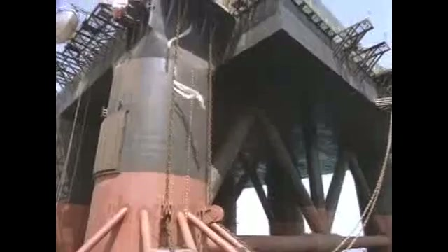
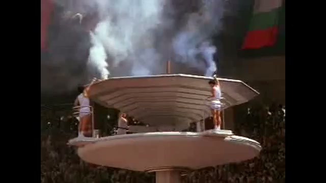

38년 전 오늘인 1988년 11월 1일, 미화 1달러의 가치가 마침내 6백 원대로 내려앉았습니다. 한국은행이 이날 고시한 원화에 대한 미 달러화 집중기준율은 전날보다 1원 50전 떨어진 699원 90전이었습니다. 1달러 가격이 6백 원대로 내려선 것은 당시 외환 시장과 산업계 전반에 커다란 충격을 던졌습니다.

## 경상수지 흑자와 미국의 거센 절상 압력

1988년 한국 경제는 올림픽 개최와 맞물려 유례없는 호황을 누리고 있었습니다. 한 해 경상수지 흑자 규모가 120억 달러 이상에 달할 것으로 전망되면서 무역 흑자가 빠르게 쌓여 갔습니다.

하지만 눈부신 수출 성장은 곧바로 대외적인 통상 마찰을 불러왔습니다. 미국은 무역 적자를 줄이기 위해 한국 정부를 향해 원화 가치를 대폭 올리라는 절상 압력을 가중했습니다. 서울 올림픽이 끝난 10월 초부터 환율 하락 속도는 눈에 띄게 빨라지기 시작했습니다.

## 약 1년 만의 6백 원대 진입과 가파른 하락세

1988년 11월 1일 고시된 환율은 달러당 699원 90전으로, 약 1년 만에 다시 6백 원대에 진입한 수치였습니다. 1988년 초부터 이날까지 원화에 대한 미 달러화 가치는 달러당 92원 40전이나 떨어졌습니다.

이로써 연초 이후 원화 절상 폭은 13.2%에 이르렀습니다. 시장에서는 연말 환율이 670원에서 680원 선까지 더 떨어져 연간 절상 폭이 16.5%에서 18.2%에 달할 것이라는 관측이 쏟아져 나왔습니다.

![[1102호] 수출 진흥 확대 회의 제 8회 수출 진흥 확대 회의 (1976.10.02) 장면 2](../images/2026-11-01-07-2.jpg)
*[1102호] 수출 진흥 확대 회의 제 8회 수출 진흥 확대 회의 (1976.10.02) 장면 2 — 사진: KTV 국민방송 e영상역사관 (대한뉴스) / KTV 공공저작물 — 영상 저작물 전면 개방(대통령실 2025-07-09), 출처 표시*

## 수출 전선에 드리운 위기감과 5백 원대 우려

원화 가치의 급격한 상승은 해외 시장에 의존하던 한국 기업들에게 날벼락과 같았습니다. 당시 한국은 전체 수출의 40%를 미국 시장에 기대고 있는 구조였습니다.

원화 가치가 오르면 미국 시장에서 한국 상품의 가격이 비싸져 가격 경쟁력이 약화될 수밖에 없었습니다. 만약 연말 환율이 670원까지 떨어지고 이듬해 원화가 11.6% 이상 추가로 절상된다면 환율이 다시 5백 원대로 곤두박질칠 수 있다는 어두운 전망마저 제기되었습니다.

*발전하는 우리 산업 ... 철강공업, 용광로의 모습 (1979.00.00) 장면 1 — 사진: KTV 국민방송 e영상역사관 (문화영화) / KTV 공공저작물 — 영상 저작물 전면 개방(대통령실 2025-07-09), 출처 표시*

## 주요 통화 동반 절상으로 깊어진 기업들의 시련

환율 문제는 미 달러화 하나에 그치지 않았습니다. 한국 원화는 전 세계 주요국 통화에 대해서도 가파르게 동반 절상되는 현상을 겪었습니다.

1988년 11월 1일 기준으로 원화 가치는 일본 엔화에 대해 15.5% 절상되었습니다. 유럽 통화에 대해서는 더욱 가팔라 영국 파운드화에 19.13%, 서독 마르크화에 26.87%, 프랑스 프랑화에는 27.89%나 절상되며 수출 업체들은 채산성 악화라는 이중고를 겪어야 했습니다.

*올림픽대회 안전 올림픽대회 안전을 위한 준비 (1988.00.00) 장면 1 — 사진: KTV 국민방송 e영상역사관 (문화영화) / KTV 공공저작물 — 영상 저작물 전면 개방(대통령실 2025-07-09), 출처 표시*

## 거센 파고를 넘었던 환율 전쟁의 기억

환율 하락은 수입 물가를 안정시키는 긍정적 측면도 있었지만, 제조업과 수출을 기반으로 성장하던 한국 경제에는 생존이 걸린 무거운 시험대였습니다. 환율이 6백 원대로 떨어지며 기업마다 원가 절감과 생산성 향상을 위해 허리띠를 졸라매던 긴박한 날들이 이어졌습니다.

오늘날 환율 변동은 일상적인 경제 지표가 되었지만, 호황의 절정에서 1달러 6백 원대 진입이 가져왔던 충격과 긴장감은 한국 경제사의 중요한 한 페이지로 남아 있습니다. 1달러가 6백 원대로 내려앉았던 1988년 가을, 그때 그 기억이 나시나요?

### 참고 자료

- <https://newslibrary.naver.com/viewer/index.naver?articleId=1988110100209201003&editNo=2&printCount=1&publishDate=1988-11-01&officeId=00020&pageNo=1&printNo=20643&publishType=00020>
- <https://www.ehistory.go.kr/view/movie?mediasrcgbn=KV&mediaid=10078&mediadtl=20305&mediagbn=DH#t=0.3>
- <https://www.ehistory.go.kr/view/movie?mediasrcgbn=KV&mediaid=10078&mediadtl=20305&mediagbn=DH#t=0.7>
- <https://www.ehistory.go.kr/view/movie?mediasrcgbn=KV&mediaid=2051&mediadtl=8947&mediagbn=MH#t=0.3>
- <https://www.ehistory.go.kr/view/movie?mediasrcgbn=KV&mediaid=2392&mediadtl=9242&mediagbn=MH#t=0.3>
