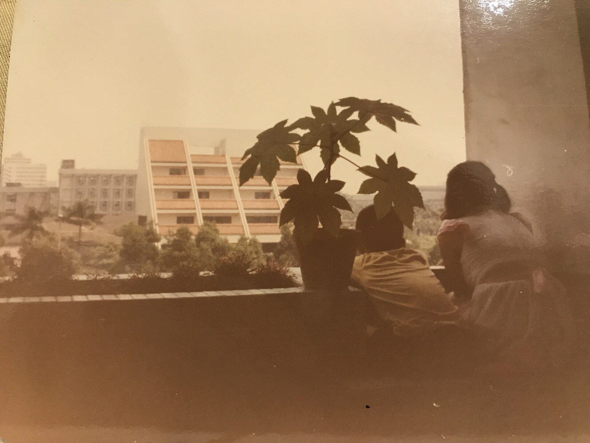

43년 전 오늘인 1983년 11월 1일, 문교부가 전국 중학교와 고등학교의 남녀공학을 적극 권장하겠다는 방침을 공식 발표했습니다. 기존의 분리 교육 중심에서 벗어나 남녀 학생이 한 울타리, 나아가 같은 학급에서 생활하도록 유도하겠다는 전환점이었습니다.

## 왜 남녀공학을 적극 권장했나

문교부는 그동안 신설 중학교 등을 중심으로 제한적으로 권장해온 남녀공학제를 살펴본 결과, 학업 성적이 오르고 생활지도 면에서도 긍정적인 성과가 뚜렷하게 나타났다고 설명했습니다. 남녀 학생이 함께 생활하면서 남녀평등의 가치관을 자연스럽게 배울 수 있다는 점도 주요 장점으로 꼽혔습니다. 아울러 해마다 취학 학생 수가 줄어드는 농어촌 지역의 경우 학교 시설을 효율적으로 이용하기 위해서도 남자중학교나 여자중학교를 따로 두는 것보다 남녀공학이 훨씬 바람직하다는 판단이 내려졌습니다.

## 같은 학교에서 같은 반으로, 혼성 학급 추진

당시 남녀공학 학교라 하더라도 실제로는 같은 구내에 남학생과 여학생을 따로 수용하고 반을 분리해 운영하는 경우가 많았습니다. 문교부는 이러한 방식을 넘어 남녀 학생을 같은 학급으로 편성하는 혼성 학급 방식으로 점차 전환해 나가도록 유도하기로 했습니다. 혼성 학급을 운영해 본 결과 학습 분위기가 한층 진지해지고 특별활동이 활발해지는 효과가 확인되었기 때문입니다.

*사건 당시 사진 아님 · 1982년 — 사진: 文及真 / CC BY-SA 4.0*

## 학생 생활지도와 통학 환경의 개선

문교부 조사에 따르면 남녀공학, 특히 혼성 학급에서는 학생들의 언어가 순화되고 정서가 안정되어 난폭한 행동이 줄어드는 성과가 나타났습니다. 건전하고 자연스러운 이성 교제의 계기가 마련되면서 사회성 발달에도 긍정적인 도움을 주는 것으로 파악되었습니다. 또한 통학 거리가 줄어들어 도심지 교통난 해소에 기여하고 학군 조정도 한결 수월해진다는 실질적인 장점도 강조되었습니다.

![[1366호] 중.고등학생 교복 머리형 자율화 중.고등학생 교복 머리형 자율화 (1982.01.09) 장면 1](../images/2026-11-01-08-3.jpg)
*[1366호] 중.고등학생 교복 머리형 자율화 중.고등학생 교복 머리형 자율화 (1982.01.09) 장면 1 — 사진: KTV 국민방송 e영상역사관 (대한뉴스) / KTV 공공저작물 — 영상 저작물 전면 개방(대통령실 2025-07-09), 출처 표시*

## 신설 학교 53곳부터 단계적 확대

문교부는 내년에 설립되는 전국 53개 중학교를 비롯해 앞으로 새로 문을 여는 중·고등학교가 남녀공학을 채택하도록 적극 권장하기로 했습니다. 의무교육 연한 연장 계획에 따라 군 이하 지역의 중학교는 단계적으로 모두 남녀공학제로 전환할 방침을 세웠습니다. 반면 단설 학교가 대다수를 차지하던 서울, 부산, 대구, 인천 등 대도시 지역의 기존 중·고등학교에 대해서도 공학제로 전환하는 방안을 점진적으로 강구해 나가기로 했습니다.

![[1366호] 중.고등학생 교복 머리형 자율화 중.고등학생 교복 머리형 자율화 (1982.01.09) 장면 2](../images/2026-11-01-08-4.jpg)
*[1366호] 중.고등학생 교복 머리형 자율화 중.고등학생 교복 머리형 자율화 (1982.01.09) 장면 2 — 사진: KTV 국민방송 e영상역사관 (대한뉴스) / KTV 공공저작물 — 영상 저작물 전면 개방(대통령실 2025-07-09), 출처 표시*

## 1982년 말 당시 지역별 공학 비율의 큰 격차

1982년 말 당시 남녀공학을 실시하고 있던 비율은 전국 중학교가 51.56퍼센트, 고등학교가 29.25퍼센트에 머물렀습니다. 지역에 따른 편차도 매우 컸습니다. 중학교의 경우 전남 지역은 공학 비율이 67.79퍼센트에 달했으나 부산은 2.91퍼센트에 불과했습니다. 고등학교 역시 경기도가 52.42퍼센트였던 반면 부산은 4.09퍼센트에 그쳐 대도시 지역의 남녀 분리 교육 경향이 두드러졌습니다.

## 교복자유화와 함께 시작된 학창 시절의 변화

1948년 7월 17일 정부 수립과 함께 발족했던 문교부는 1990년 12월 26일 교육부로 개편되기 전까지 수많은 교육 정책의 틀을 놓았습니다. 특히 1980년대 초반 교복자유화에 이어 추진된 남녀공학 확대와 혼성 학급 도입은 규율 중심의 학교 문화를 바꾸는 계기가 되었습니다. 남학생과 여학생이 한 교실에서 나란히 짝꿍이 되어 수업을 듣던 그 시절의 교실 풍경은 지금도 많은 이들의 기억 속에 생생하게 남아 있습니다.

### 참고 자료

- <https://newslibrary.naver.com/viewer/index.naver?articleId=1983110100209201011&editNo=2&printCount=1&publishDate=1983-11-01&officeId=00020&pageNo=1&printNo=19101&publishType=00020>
- <https://commons.wikimedia.org/wiki/File:Koreans_in_the_open-air_market_during_the_joint_U.S._Marine_Corps_and_Republic_of_Korea_marine_training_Exercise_Team_Spirit_%2783_-_DPLA_-_9709018acc3f0f2a7130720b4131f978.jpeg>
- <https://commons.wikimedia.org/wiki/File:Memorybank2019-%E6%B6%88%E5%A4%B1%E7%9A%84%E4%B8%89%E6%98%8E%E6%B2%BB%E5%BB%BA%E7%AF%89.jpg>
- <https://www.ehistory.go.kr/view/movie?mediasrcgbn=KV&mediaid=10323&mediadtl=21916&mediagbn=DH#t=0.3>
- <https://www.ehistory.go.kr/view/movie?mediasrcgbn=KV&mediaid=10323&mediadtl=21916&mediagbn=DH#t=0.7>
