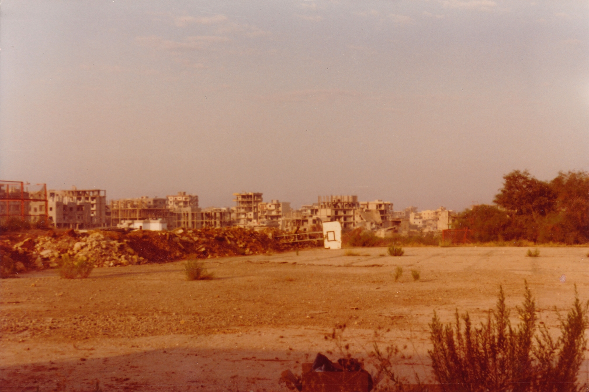
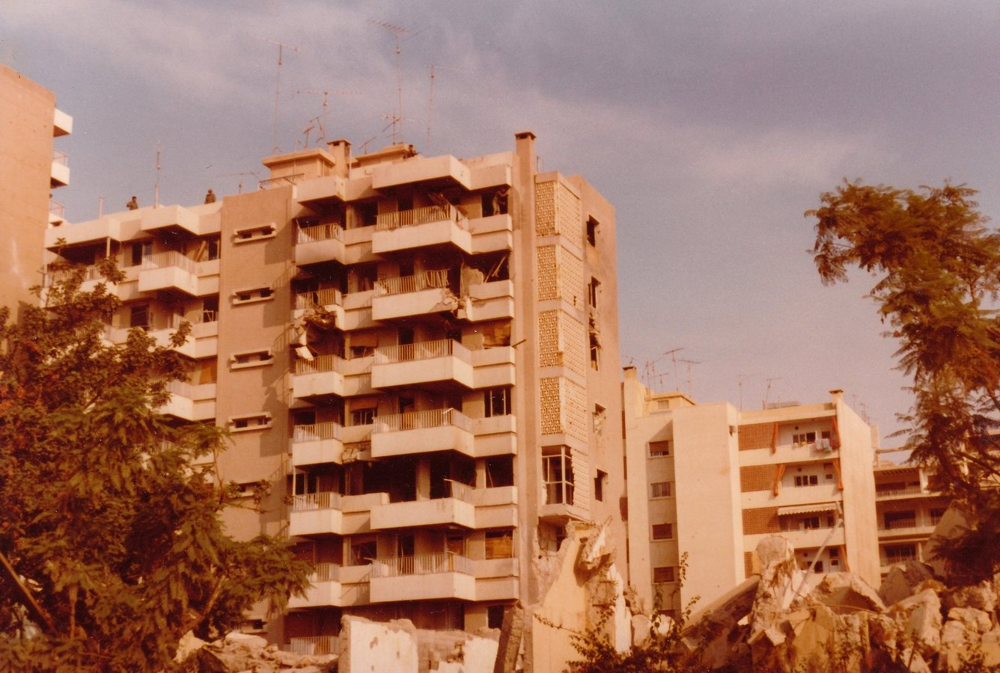
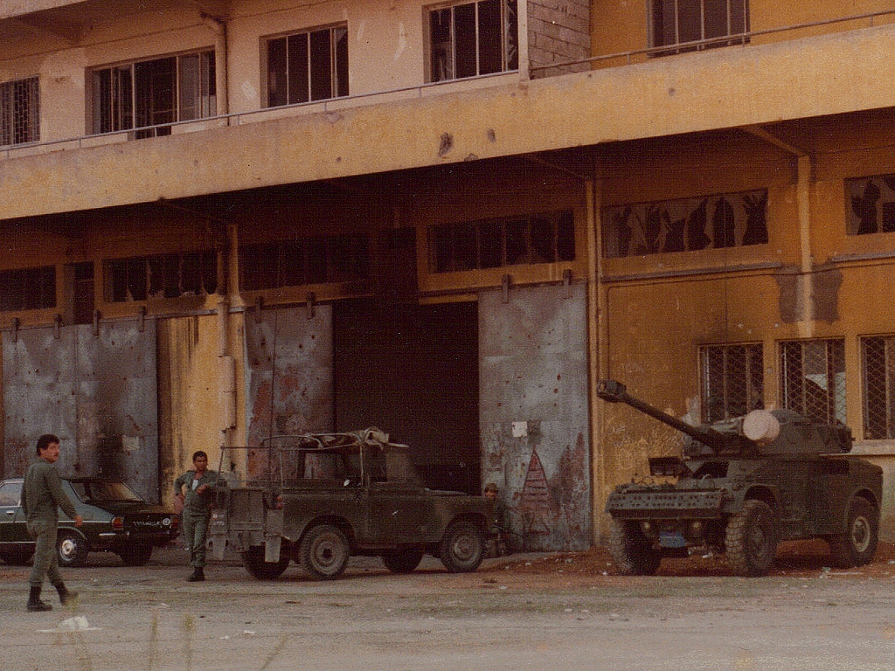

39년 전 오늘, 1987년 11월 2일. 레바논 베이루트에서 피랍됐던 도재승 서기관이 21개월 만에 풀려나 서울로 돌아온다는 소식이 전해졌습니다. 생사조차 불투명했던 외교관의 무사 귀환 소식에 온 나라가 안도의 한숨을 내쉬었습니다.

## 베이루트 시내에서 벌어진 21개월의 악몽

도재승 서기관은 작년 1월 31일 오전 레바논 베이루트 시내에서 정체불명의 괴한들에게 납치되었습니다. 현지 치안이 극도로 불안했던 상황에서 대한민국 외교관이 피랍되자 국내외는 큰 충격에 휩싸였습니다. 이후 21개월이라는 기나긴 시간 동안 도 서기관의 생사와 행방은 쉽게 확인되지 않았고, 가족과 국민들은 애타는 마음으로 소식을 기다려야 했습니다.

## 스위스 제네바 도착과 자유의 첫날밤

만 21개월 만인 지난달 31일 마침내 풀려난 도 서기관은 레바논 국영 미들이스트 항공 MEA 213편을 타고 스위스 제네바 쿠앵트랭 공항에 도착했습니다. 혼자 여객기 트랩을 내려온 그는 주제네바 대표부 정경일 공사의 마중을 받으며 안전한 숙소로 이동했습니다.

공항에 도착했을 당시 그는 크림색 양복과 줄무늬 넥타이를 맨 창백한 모습이었습니다. 제네바 주정부가 제공한 흰색 세단과 우리 대표부 차량을 이용해 숙소에 도착한 도 서기관은 21개월 만에 처음으로 잣죽과 구절판 등 한식으로 식사를 마친 뒤 깊은 잠에 빠졌습니다.

*사건 당시 사진 아님 · 1982년 — 사진: CapCase / CC BY 2.0*

## "마치 동물이 된 것 같았다", 18분간의 회견

11월 1일 오후 제네바 주재 한국대표부 공관에서 파리 주재 한국 특파원들과의 기자회견이 열렸습니다. 서울에서 가져온 짙은 감색 정장을 차려입고 짧게 머리를 깎은 도 서기관은 다소 수척했지만 간혹 엷은 미소를 띠며 18분간 회견에 임했습니다.

그는 억류 생활 동안 가장 큰 고통이 무엇이었느냐는 질문에 밤낮의 구별이 없이 아무것도 하지 못한 채 갇혀 지낸 세월을 꼽았습니다. 쓰던 안경마저 빼앗긴 채 지냈으며, 24시간마다 한 끼씩 넣어주는 식사로 간신히 날짜를 짐작했다고 털어놓았습니다. "동물이 되었다고 생각하면서 살았다", "한국말을 연습할 기회가 없어 말조차 잊어버린 것 같다"는 그의 고백은 지켜보던 이들의 가슴을 먹먹하게 만들었습니다.

*사건 당시 사진 아님 · 1982년 — 사진: CapCase / CC BY 2.0*

## 선후배 동료들과의 재회, 그리고 전해진 소식들

도 서기관은 숙소에서 과거 직속상관이었던 이상옥 주스위스대사를 만나 큰절을 하려다 만류를 받기도 했습니다. 이 대사는 전두환 대통령이 보낸 위로전문을 전했고, 도 서기관은 전문을 소리 내어 읽으며 감격해했습니다.

그는 동료들에게 자신이 아직도 외무부 직원인지를 조심스럽게 물었습니다. 이에 이상옥 대사는 피랍 당시 사무관이었던 그가 1등서기관으로 승진했으며 매달 월급도 가족에게 차질 없이 전달되었다는 사실을 알려주었습니다. 지난 1주일 치 동아일보를 읽으며 국내에서 대통령선거가 치러진다는 소식을 접한 그는 "이제 나도 투표할 수 있게 되었군요"라며 미소를 짓기도 했습니다.

*사건 당시 사진 아님 · 1982년 — 사진: CapCase / CC BY 2.0*

## 꿈에 그리던 고국과 가족의 품으로

제네바에서 이틀 동안 휴식을 취한 도 서기관은 11월 2일 프랑크푸르트를 경유하는 대한항공 편을 이용해 3일 오후 서울에 도착할 예정이라는 보도가 이어졌습니다. 정부는 안전한 귀국을 위해 대표부 직원을 항공편에 동승시켰습니다.

암흑 같은 억류의 시간을 견뎌내고 마침내 고국과 가족의 품으로 돌아오게 된 도재승 서기관. 온 국민이 함께 마음을 졸이고 기뻐했던 그날의 소식은 한국 외교사의 잊을 수 없는 한 페이지로 남아 있습니다.

### 참고 자료

- <https://newslibrary.naver.com/viewer/index.naver?articleId=1987110200329201003&editNo=3&printCount=1&publishDate=1987-11-02&officeId=00032&pageNo=1&printNo=12953&publishType=00020>
- <https://commons.wikimedia.org/wiki/File:Lebanese_Army,_Beirut,_Lebanon_1982.jpg>
- <https://commons.wikimedia.org/wiki/File:Basketball_Courts,_Beirut,_Lebanon,_1982_-_11036339813.jpg>
- <https://commons.wikimedia.org/wiki/File:Apartment_Buildings,_Beirut,_Lebanon,_1982_-_11036158625.jpg>
- <https://commons.wikimedia.org/wiki/File:Lebanese_Army,_Beirut,_Lebanon_1982_-_2190140529.jpg>
