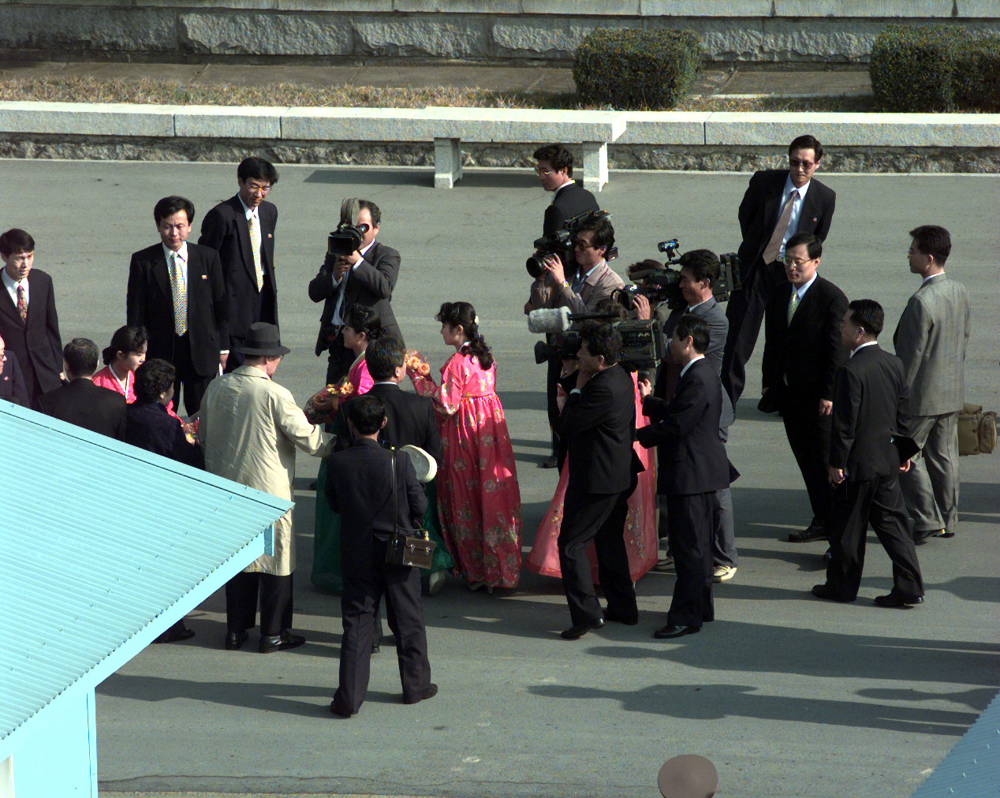
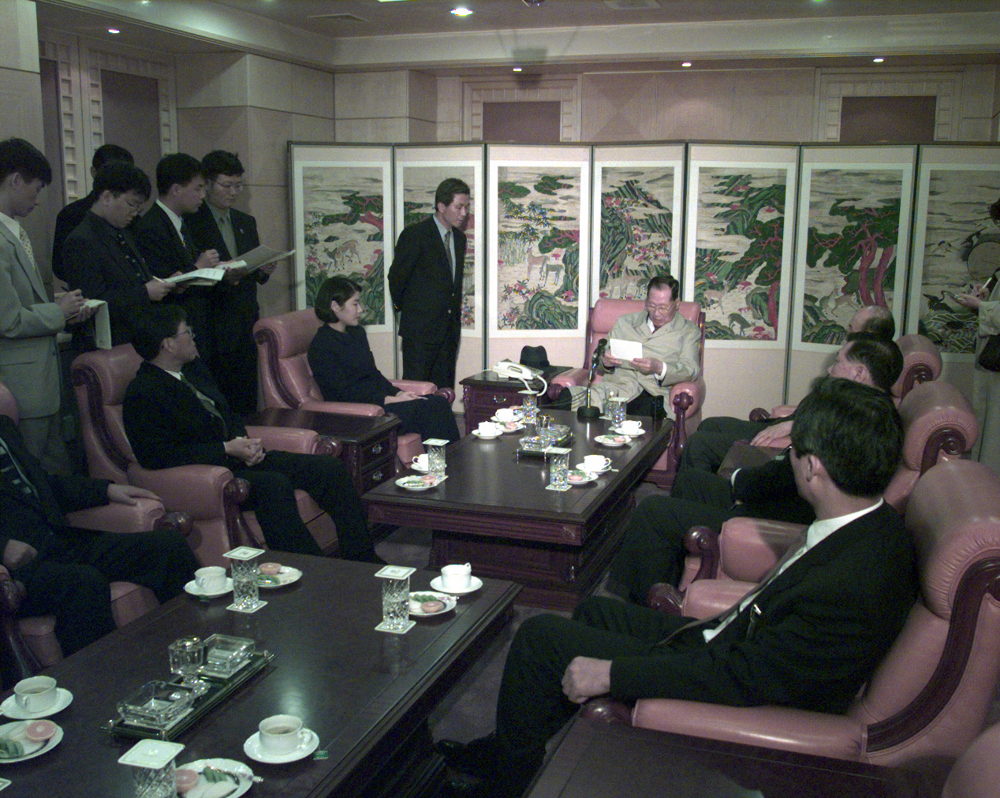
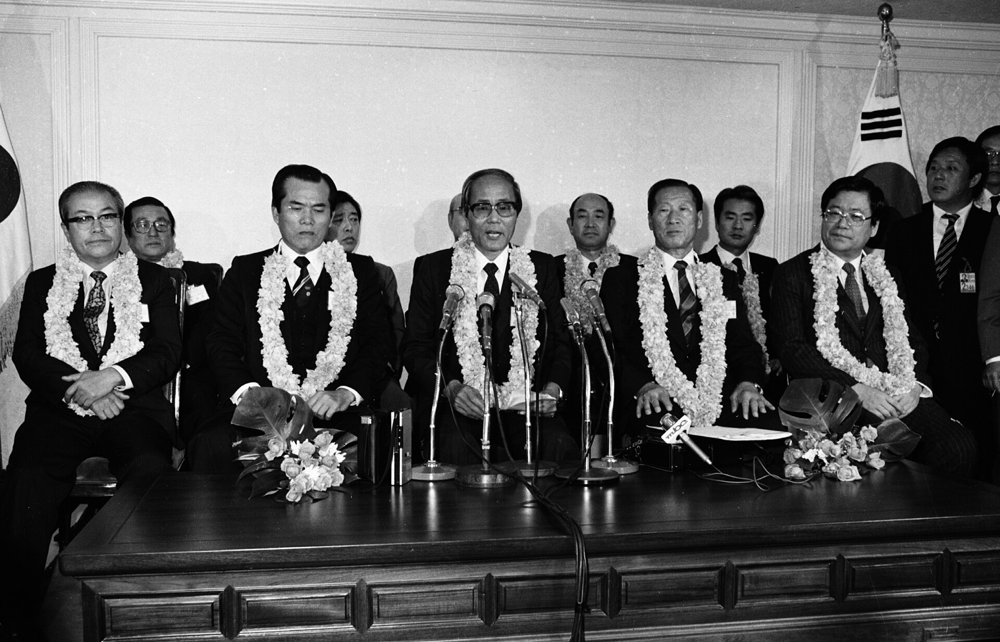

28년 전 오늘, 1998년 11월 2일. 분단 반세기 동안 가로막혀 있던 금강산의 뱃길이 마침내 열린다는 소식이 아침 신문 1면을 가득 메웠습니다. 정주영 현대그룹 명예회장이 북한 김정일 국방위원장을 만나 금강산 독점 개발을 비롯한 대규모 경제협력에 합의하고 돌아왔다는 소식이었습니다.

## 소 501마리와 함께 넘은 판문점

정주영 명예회장은 1998년 6월 16일 소 500마리를 몰고 판문점을 넘은 데 이어, 같은 해 10월 27일 소 501마리를 이끌고 다시 북한 땅을 밟았습니다. 자신의 고향인 강원도 통천을 기억하며 시작된 소몰이 방북은 전 세계의 이목을 집중시켰습니다. 4박 5일간의 두 번째 방북 일정은 단순한 고향 방문을 넘어 남북 경제 협력의 새로운 물꼬를 트는 여정이었습니다.

## 백화원초대소에서 성사된 45분간의 담판

10월 30일 밤 10시 25분, 평양 백화원초대소에서 역사적인 만남이 성사되었습니다. 북한의 최고권력자인 김정일 국방위원장이 숙소로 직접 찾아와 정주영 명예회장과 45분 동안 면담을 가졌습니다. 북한 최고지도자가 남한의 기업 총수를 직접 만난 것은 분단 이후 최초의 일이었습니다. 이 자리에서 김정일 위원장은 금강산 개발과 경협 사업 추진을 전폭적으로 지원하겠다고 약속했습니다.

*1998년 자료 — 사진: TSGT Renee' Sitler / Public domain*

## 금강산 독점 개발과 9대 경협 합의

10월 31일 판문점을 통해 귀환한 현대그룹은 서울 계동 사옥에서 구체적인 합의 내용을 공개했습니다. 현대는 금강산 일대 8개 지구에 대한 사업권을 확보하고 2004년까지 6년 동안 9억 600만 달러를 지급하는 조건으로 금강산종합개발 계약을 체결했습니다. 이와 함께 북한 매장 석유 공동 탐사 및 파이프라인 남측 공급, 800만 평 규모의 서해안 공단 조성, 평양 실내종합체육관 건설 등 9개 분야의 경제협력 사업에 합의했습니다.

*1998년 자료 — 사진: TSGT Renee' Sitler / Public domain*

## 11월 18일 첫 출항, 눈앞으로 다가온 금강산

합의의 핵심 중 하나는 금강산 관광선의 출항 일정이었습니다. 현대는 11월 18일 관광선 첫 출항을 확정 짓고, 11월 2일 오늘부터 일반인을 대상으로 본격적인 관광객 모집에 들어갔습니다. 또한 11월 14일부터 사흘 동안 시험 운항선 봉래호를 띄워 동해에서 장전항으로 이어지는 뱃길을 사전 점검하기로 했습니다.

*1988년 서울올림픽 유치 대표단의 유치 성공 기자회견 (1981.10.04) — 사진: 서울역사박물관 / KOGL Type 1*

## 분단 반세기 만에 북녘 명산을 마주한 국민들

꿈으로만 여기던 금강산 관광이 눈앞의 현실로 다가오자 대한민국 전역이 들썩였습니다. 접수 창구에는 이산가족과 실향민을 비롯해 민족의 명산을 두 눈으로 확인하려는 국민들의 발길이 끝없이 이어졌습니다. 교과서와 노래 속에서만 부르던 '일만이천봉'을 직접 보러 떠날 수 있다는 사실은 수많은 이들의 가슴을 울렸습니다.

## 동해를 가르던 힘찬 뱃고동 소리를 기억하며

1998년 11월 2일 발표된 대북 경협 합의는 냉전의 벽을 넘어 평화와 교류의 가능성을 열어젖힌 상징적인 사건이었습니다. 비록 오랜 시간이 흐르며 금강산으로 향하던 뱃길은 멈춰 섰지만, 동해항을 출발해 장전항으로 향하던 그날의 벅찬 감동은 지금도 많은 이들의 기억 속에 생생하게 남아 있습니다.

### 참고 자료

- <https://newslibrary.naver.com/viewer/index.naver?articleId=1998110200329101001&editNo=45&printCount=1&publishDate=1998-11-02&officeId=00032&pageNo=1&printNo=16580&publishType=00010>
- <https://commons.wikimedia.org/wiki/File:Chung_Ju-yung.jpg>
- <https://commons.wikimedia.org/wiki/File:Ladies_from_North_Korea_wearing_traditional_hanbok_leave_Panmungak_to_present_gifts_to_South_Korean_business_tycoon_Chung_Ju-yung_981027-F-XT789-528.jpg>
- <https://commons.wikimedia.org/wiki/File:South_Korean_business_tycoon_Chung_Ju-yung,_founder_and_honorary_chairman_of_Hyundai_Group,_speaks_to_the_press_at_Panmunjom_Freedom_House,_Republic_of_Korea_981027-F-XT789-543.jpg>
- <https://commons.wikimedia.org/wiki/File:1988%EB%85%84_%EC%84%9C%EC%9A%B8%EC%98%AC%EB%A6%BC%ED%94%BD_%EC%9C%A0%EC%B9%98_%EB%8C%80%ED%91%9C%EB%8B%A8%EC%9D%98_%EC%9C%A0%EC%B9%98_%EC%84%B1%EA%B3%B5_%EA%B8%B0%EC%9E%90%ED%9A%8C%EA%B2%AC_(1981.10.04).jpg>
